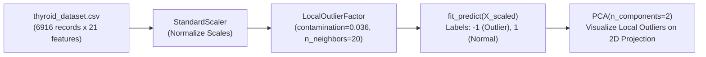

# Module 32.11: Local Outlier Factor (LOF) Implementation (Code Walkthrough)

## 1. Overview & Practical Objectives

In this hands-on module, we implement **Local Outlier Factor (LOF)** on the clinical Thyroid Disease dataset (`thyroid_dataset.csv`) using Scikit-Learn.

### Why Apply LOF to Thyroid Diagnostics?
While Isolation Forest partitions global feature space efficiently via random tree cuts, patient health profiles frequently present subtle cluster variations—for example, older patients vs younger patients naturally form subgroups with differing baseline hormone concentrations. LOF benchmarks each patient against their $k$-nearest physiological neighbors, isolating localized abnormalities that do not conform to their immediate cohort.



---

## 2. Step-by-Step Code Walkthrough

### Step 1: Imports & Dataset Preparation
```python
import pandas as pd
import numpy as np
import matplotlib.pyplot as plt
from sklearn.preprocessing import StandardScaler
from sklearn.decomposition import PCA
from sklearn.neighbors import LocalOutlierFactor

# Load clinical dataset
df = pd.read_csv("thyroid_dataset.csv")

# Extract feature matrix and separate evaluation target
X = df.drop("Outlier_label", axis=1)
y = df["Outlier_label"]

# Scale all 21 continuous attributes
scaler = StandardScaler()
X_scaled = scaler.fit_transform(X)

print(f"Prepared Feature Matrix: {X_scaled.shape}") # (6916, 21)
```

### Step 2: Fitting Local Outlier Factor
We configure `LocalOutlierFactor` with `contamination=0.036` (matching the clinical benchmark rate of $3.61\%$):
```python
# Instantiate LOF with contamination parameter
neighbs = LocalOutlierFactor(
    n_neighbors=20,       # Default k=20 nearest neighbors
    contamination=0.036
)

# fit_predict directly returns cluster and anomaly labels
labels = neighbs.fit_predict(X_scaled)
```

### Step 3: Quantifying Detected Local Outliers
```python
# Compute counts of predicted outliers (-1) and normal instances (1)
n_outliers = np.sum(labels == -1)
n_normal = np.sum(labels == 1)

print("Detected Local Outliers:", n_outliers)
print("Normal Inliers         :", n_normal)
```
**Execution Output**:
- `Detected Local Outliers: 249`
- `Normal Inliers         : 6667`
- **Result**: LOF detected exactly **249 localized clinical anomalies**, perfectly matching the domain contamination threshold!

### Step 4: Visualizing Anomalies via PCA 2D Projection
```python
# Fit PCA to compress 21 features into 2 Principal Components for plotting
pca = PCA(n_components=2)
X_pca = pca.fit_transform(X_scaled)

plt.figure(figsize=(8, 6))
plt.scatter(X_pca[:, 0], X_pca[:, 1], c=labels, cmap="coolwarm", s=25, alpha=0.7)

plt.xlabel("PC1")
plt.ylabel("PC2")
plt.title("Local Outlier Factor (LOF) on Thyroid Dataset (2D PCA Projection)")
plt.colorbar(label="Anomaly Status (-1: Outlier, 1: Normal)")
plt.grid(True, linestyle="--", alpha=0.5)
plt.show()
```

---

## 3. Comparative Analysis: LOF vs. Isolation Forest on Thyroid Data

| Dimension | Isolation Forest (`Notes_32.09`) | Local Outlier Factor (`Notes_32.11`) |
| :--- | :--- | :--- |
| **Detection Principle** | Global random isolation tree depth | Local $k$-nearest neighbor density ratios |
| **Detected Count** | $249$ outliers | $249$ outliers |
| **Spatial Distribution** | Tends to isolate points situated on the far outer periphery of the global projection | Detects both peripheral points and subtle outliers nestled between adjacent sub-clusters |
| **Runtime Performance** | Faster ($O(N \log N)$), tree-based | Slower ($O(N^2)$), requires $k$-NN search over 6,916 records |

### Module Files:
- Dedicated Notebook: [`local_outlier_factor.ipynb`](file:///c:/Users/Shivam%20Keshari/OneDrive/Desktop/AI-ML/lecture_32/Notes_32.11/local_outlier_factor.ipynb)
- Dataset: [`thyroid_dataset.csv`](file:///c:/Users/Shivam%20Keshari/OneDrive/Desktop/AI-ML/lecture_32/Notes_32.11/thyroid_dataset.csv)
