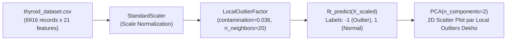

# Module 32.11: Local Outlier Factor (LOF) Implementation (Code Walkthrough - Hinglish)

## 1. Overview & Practical Objectives

Is hands-on module mein hum clinical Thyroid Disease dataset (`thyroid_dataset.csv`) par Scikit-Learn ke zariye **Local Outlier Factor (LOF)** implement karenge.

### Thyroid Data Par LOF Kyun?
Isolation Forest ne global feature space ke cuts laga kar anomalies dhoondhi thi. Lekin medical data mein kai subgroups hote hain—jaise bujurg mareezon aur young mareezon ka baseline hormone level naturally alag hota hai. LOF har patient ko uske sabse paas wale $k$ neighbors ke sath compare karta hai, jisse woh aise subtle "local" anomalies ko pakad leta hai jo global methods se chhoot sakti hain.



---

## 2. Step-by-Step Code Walkthrough

### Step 1: Libraries Import & Data Preparation
```python
import pandas as pd
import numpy as np
import matplotlib.pyplot as plt
from sklearn.preprocessing import StandardScaler
from sklearn.decomposition import PCA
from sklearn.neighbors import LocalOutlierFactor

# Clinical data load karo
df = pd.read_csv("thyroid_dataset.csv")

# Evaluation column drop karke features alag karo
X = df.drop("Outlier_label", axis=1)
y = df["Outlier_label"]

# 21 features ko standard scale karo
scaler = StandardScaler()
X_scaled = scaler.fit_transform(X)

print(f"Feature Space: {X_scaled.shape}") # (6916 rows, 21 columns)
```

### Step 2: Local Outlier Factor Model Fit Karna
Hum `contamination=0.036` set karte hain (jo medical ground truth $3.61\%$ ke barabar hai):
```python
# LOF initialize karo
neighbs = LocalOutlierFactor(
    n_neighbors=20,       # Default k=20 nearest neighbors
    contamination=0.036
)

# fit_predict seedhe labels return karta hai (-1 = outlier, 1 = normal)
labels = neighbs.fit_predict(X_scaled)
```

### Step 3: Detected Local Outliers Ka Count Nikalna
```python
# Predicted labels count karo
n_outliers = np.sum(labels == -1)
n_normal = np.sum(labels == 1)

print("Detected Local Outliers:", n_outliers)
print("Normal Inliers         :", n_normal)
```
**Output**:
- `Detected Local Outliers: 249`
- `Normal Inliers         : 6667`
- **Result**: LOF ne exactly **249 local anomalies** detect kiye!

### Step 4: PCA Ke Zariye 2D Plot Par Outliers Dekhna
21 features ko human screen par visual inspect karne ke liye 2 Principal Components par project karte hain:
```python
# 21D se 2D PCA projection
pca = PCA(n_components=2)
X_pca = pca.fit_transform(X_scaled)

plt.figure(figsize=(8, 6))
plt.scatter(X_pca[:, 0], X_pca[:, 1], c=labels, cmap="coolwarm", s=25, alpha=0.7)

plt.xlabel("PC1")
plt.ylabel("PC2")
plt.title("Local Outlier Factor (LOF) on Thyroid Dataset (2D PCA Projection)")
plt.colorbar(label="Anomaly Status (-1: Outlier, 1: Normal)")
plt.grid(True, linestyle="--", alpha=0.5)
plt.show()
```

---

## 3. LOF vs Isolation Forest Ka Comparison (Thyroid Data Par)

| Feature | Isolation Forest (`Notes_32.09`) | Local Outlier Factor (`Notes_32.11`) |
| :--- | :--- | :--- |
| **Logic** | Global random isolation tree depth | Local $k$-nearest neighbors ki density ratio |
| **Detected Outliers** | $249$ | $249$ |
| **Outlier Type** | Zyadatar poore data ke outer edge (periphery) par baithe points ko pakadta hai | Periphery ke sath-sath do clusters ke beech mein chhipe hue local outliers ko bhi dhoondh leta hai |
| **Speed** | Super fast tree execution ($O(N \log N)$) | Thoda slow ($O(N^2)$), kyunki 6,916 points ke neighbors dhoondhne padte hain |

### Module Files:
- Dedicated Notebook: [`local_outlier_factor.ipynb`](file:///c:/Users/Shivam%20Keshari/OneDrive/Desktop/AI-ML/lecture_32/Notes_32.11/local_outlier_factor.ipynb)
- Dataset: [`thyroid_dataset.csv`](file:///c:/Users/Shivam%20Keshari/OneDrive/Desktop/AI-ML/lecture_32/Notes_32.11/thyroid_dataset.csv)
