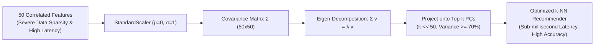
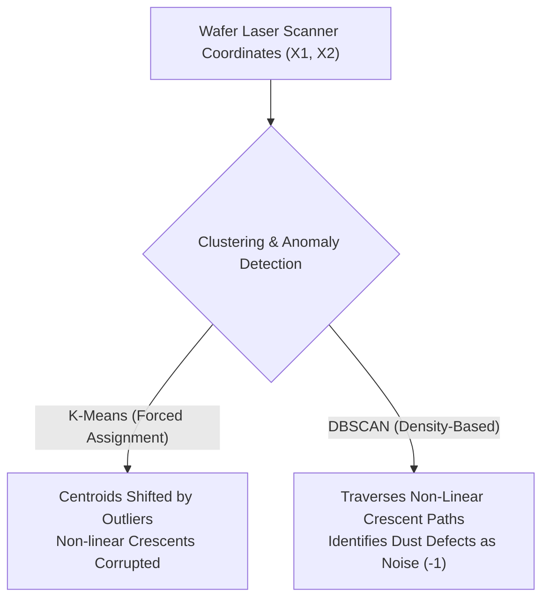
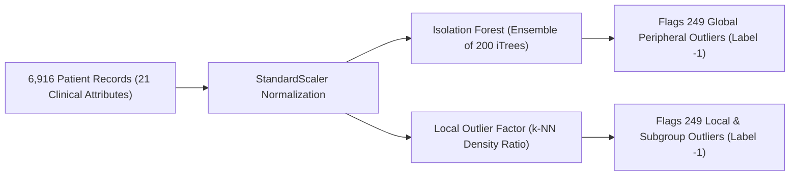

# Practice Problems: Day 32 - Unsupervised Machine Learning (Part-2)

This practice suite contains **3 comprehensive, real-world case studies** strictly aligned with the topics, mathematical derivations, algorithms, and code taught in Day 32:
1. **Case Study 1**: High-Dimensional E-Commerce Analytics & PCA Dimensionality Reduction
2. **Case Study 2**: Semiconductor Wafer Defect Detection with Non-Linear DBSCAN
3. **Case Study 3**: Clinical Endocrinology Anomaly Detection: Isolation Forest vs. Local Outlier Factor (LOF)

---

## Case Study 1: High-Dimensional E-Commerce Analytics & PCA Compression

### Context & Scenario
A global e-commerce platform tracks customer interaction events on their mobile app across **$50$ distinct behavioral metrics** ($f_1, f_2, \dots, f_{50}$), including weekly sessions, product page view duration, cart additions, review interactions, and checkout abandonment rates. The analytics engineering team feeds these $50$ features into a $k$-Nearest Neighbors ($k$-NN) collaborative filtering recommender. 

However, the team observes severe operational degradation:
- Recommender query latency has escalated to unacceptable levels.
- Recommender accuracy has plummeted—customer recommendation lists appear random and unpersonalized.
- Feature correlation analysis reveals that metrics like weekly session count, daily watch time, and item completion rate are heavily collinear.

The Chief Data Scientist instructs you to resolve this by deploying **Principal Component Analysis (PCA)**.

### Questions to Solve:
1. **The Curse of Dimensionality & Hughes Phenomenon**:
   - Explain why high dimensionality causes Euclidean distance to become non-discriminative in the $k$-NN recommender:
$$\lim_{d \to \infty} \frac{\text{dist}_{\max} - \text{dist}_{\min}}{\text{dist}_{\min}} = 0$$
   - How does the Hughes Phenomenon (Peaking Effect) explain why increasing features from $10 \to 20$ improved performance, but expanding from $20 \to 50$ degraded recommendation quality?
2. **Mathematical Variance Retention Calculation**:
   - The team computes the eigenvalues of the standardized $50 \times 50$ covariance matrix $\Sigma$. The total sum of all 50 eigenvalues is $\sum_{j=1}^{50} \lambda_j = 40.0$.
   - The top 3 eigenvalues are:
     - $\lambda_1 = 15.2$
     - $\lambda_2 = 8.8$
     - $\lambda_3 = 5.2$
   - Calculate the **individual explained variance ratio** for $PC1$, $PC2$, and $PC3$.
   - Calculate the **cumulative explained variance ratio** if the team reduces the dataset from $50$ dimensions to $3$ dimensions. Does this 3D projection satisfy an operational threshold of retaining at least $70\%$ of the platform's behavioral signal?
3. **The Geometric Equivalence Proof (Ma'am's Blackboard Derivation)**:
   - For an arbitrary centered customer profile $P(x_i, y_i)$ and candidate line $PC1$, let $d_1$ be the perpendicular reconstruction error from $P$ to the line, $d_2$ be the projected distance from the origin $(0, 0)$ to the projection point $P'$, and $d_{\text{hyp}}$ be the Euclidean distance from origin to $P$.
   - Using the Pythagorean theorem on $\triangle OP'P$, formally prove why **minimizing the sum of squared perpendicular errors $\sum d_1^2$ is mathematically identical to maximizing the projected variance $\sum d_2^2$**.

---

## Case Study 2: Semiconductor Wafer Defect Detection with Non-Linear DBSCAN

### Context & Scenario
A semiconductor manufacturing foundry produces microprocessors on silicon wafers. High-precision laser scanners measure the physical coordinates $(X_1, X_2)$ of chemical vapor depositions. Valid micro-circuit pathways naturally deposit along **two interlocking crescent-shaped curvilinear bands** (analogous to `make_moons`). 

During fabrication, thermal fluctuations and microscopic dust contaminants introduce anomalous defects across the wafer substrate.

### Questions to Solve:
1. **Failure Modes of Centroid Clustering**:
   - Contrast K-Means against DBSCAN for this defect screening pipeline. Specifically, explain what happens to cluster centroids when extreme dust anomalies are present, and why K-Means cannot follow curved crescent trajectories.
2. **Hyperparameter Selection via Rule of Thumb**:
   - According to Ma'am's practical heuristic, how should the initial `min_samples` parameter be estimated for this 2D coordinate space ($d = 2$)?
   - If an engineer arbitrarily configures $\text{min\_samples} = 100$ on a wafer sample containing $500$ deposition points, what catastrophic misclassification occurs? Conversely, what failure mode occurs if $\text{min\_samples} = 1$?
3. **Epsilon ($\epsilon$) Tuning Progression**:
   - Describe the clustering outcome when $\epsilon$ is set too large ($\epsilon = 0.50$ on scaled data) versus when $\epsilon$ is fine-tuned to $\epsilon = 0.18$.
   - Suppose two microscopic dust particles land adjacent to each other in a remote corner of the wafer ($d(\text{dust}_1, \text{dust}_2) < \epsilon$). Under what exact conditions will DBSCAN still correctly classify both particles as **Noise (`label = -1`)** rather than forming an illegitimate third circuit cluster?

---

## Case Study 3: Clinical Endocrinology: Isolation Forest vs. Local Outlier Factor (LOF)

### Context & Scenario
A university medical center screens **$6,916$ patient records** across **$21$ continuous and categorical clinical attributes** (`thyroid_dataset.csv`), including thyroxine levels (T4), thyroid-stimulating hormone (TSH), patient age, and diagnostic markers. 

Medical ground-truth records indicate that approximately **$3.61\%$ of patients ($\approx 250$ individuals)** suffer from rare pathological hypothyroid abnormalities requiring urgent endocrinological intervention, while the remaining $>96\%$ of patients are healthy.

### Questions to Solve:
1. **Isolation Forest Mathematical Anomaly Scoring**:
   - State the official Anomaly Score equation $s(x, n)$ used by Isolation Forest, defining each variable ($h(x)$, $E(h(x))$, $c(n)$, and Euler's constant $\gamma$).
   - For a patient record $P_{\text{pathological}}$, the average path length across an ensemble of 200 isolation trees is $E(h(x)) = 2.10$. For a dataset size $n = 6,916$, the expected BST search path is $c(6,916) \approx 16.52$.
     - Calculate the exact Anomaly Score $s(P_{\text{pathological}}, 6916)$.
     - Based on decision thresholds ($s \to 1$ vs $s < 0.5$), classify this patient profile and state the Scikit-Learn prediction label.
2. **Computational Superiority in 21 Dimensions**:
   - Why does Isolation Forest scale linearly in $O(t \cdot \psi \log \psi)$ time while remaining immune to the distance metric degradation that hampers Euclidean nearest-neighbor models across 21 dimensions?
3. **The Multi-Density Subgroup Problem & LOF Resolution**:
   - The patient population contains distinct demographic sub-cohorts: elderly patients naturally possess lower baseline metabolic hormone concentrations than young athletes.
   - Explain why a global method (like DBSCAN or fixed-threshold filtering) can fail to identify a young patient who has an abnormally low hormone level relative to their youth cohort but whose absolute values overlap with normal elderly patients.
   - For a suspected local anomaly $q$, suppose its local reachability density is $\text{lrd}_{20}(q) = 0.05$, while the average local reachability density of its 20 nearest neighbors is $\frac{1}{20}\sum \text{lrd}_{20}(\text{neighbors}) = 0.20$.
     - Compute the LOF score: $\text{LOF}_{20}(q)$.
     - Provide the clinical and geometric interpretation of this score. Does Scikit-Learn tag patient $q$ as an outlier (`-1`) or normal (`1`)?