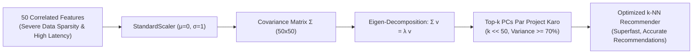
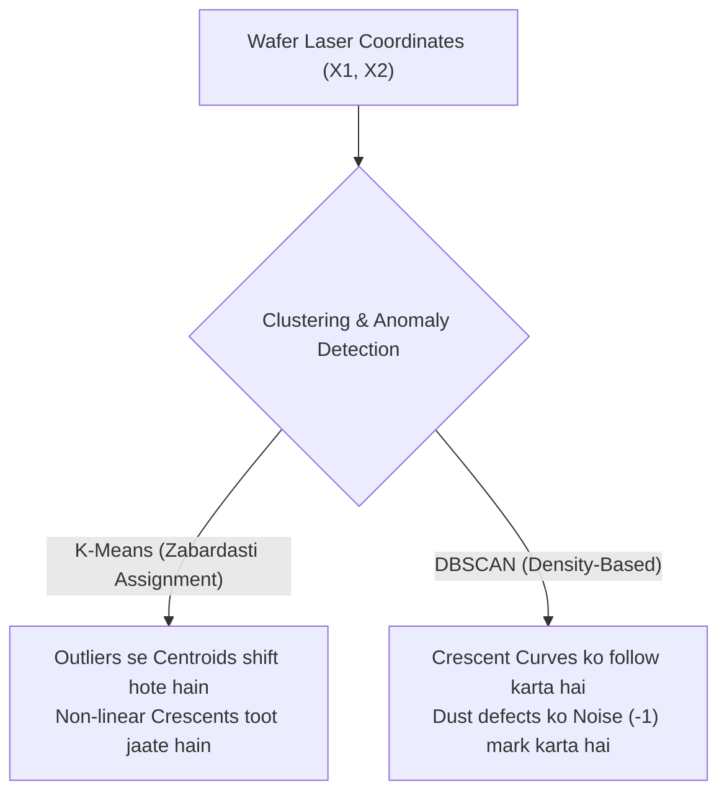
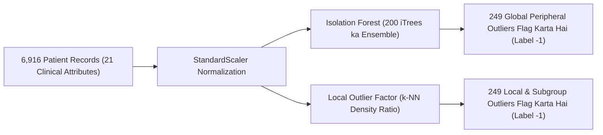

# Practice Problems: Day 32 - Unsupervised Machine Learning (Part-2) (Hinglish)

Yeh practice suite **3 comprehensive real-world case studies** provide karta hai jo Day 32 ke syllabus, mathematical derivations, algorithms aur Ma'am ke blackboard notes ke sath 100% aligned hain:
1. **Case Study 1**: High-Dimensional E-Commerce Analytics & PCA Dimensionality Reduction
2. **Case Study 2**: Semiconductor Wafer Defect Detection with Non-Linear DBSCAN
3. **Case Study 3**: Clinical Endocrinology Anomaly Detection: Isolation Forest vs. Local Outlier Factor (LOF)

---

## Case Study 1: E-Commerce User Analytics & PCA Compression

### Scenario & Problem Context
Ek global e-commerce application apne users ke app usage se **$50$ alag-alag behavioral features** ($f_1, f_2, \dots, f_{50}$) collect karti hai (jaise weekly sessions, product watch time, cart additions, review clicks, scroll velocity). Data science team in 50 features ko ek $k$-Nearest Neighbors ($k$-NN) recommendation engine mein feed karti hai.

Lekin production mein team ko badi problems face karni padti hain:
- Recommendation generate hone ka time (latency) bohot badh gaya hai.
- User recommendations irrelevant aur bekar aane lagi hain.
- Feature analysis se pata chalta hai ki session count, watch time aur completion rate ek dusre se bohot zyada **correlated** hain.

Chief Data Scientist aapko **PCA (Principal Component Analysis)** implement karke is problem ko solve karne ko kehte hain.

### Solve Karne Wale Questions:
1. **Curse of Dimensionality & Hughes Phenomenon**:
   - Explain karein ki high-dimensional space mein Euclidean distance meaningless kyun ho jaata hai:
$$\lim_{d \to \infty} \frac{\text{dist}_{\max} - \text{dist}_{\min}}{\text{dist}_{\min}} = 0$$
   - Hughes Phenomenon (Peaking Effect) ke mutabiq, shuruat mein $10 \to 20$ features karne par accuracy badhi, par $20 \to 50$ features karne par model ki performance achanak kyun gir gayi?
2. **Variance Retention Calculation**:
   - Standardized $50 \times 50$ covariance matrix ke saare 50 eigenvalues ka total sum $\sum_{j=1}^{50} \lambda_j = 40.0$ hai.
   - Top 3 eigenvalues hain:
     - $\lambda_1 = 15.2$
     - $\lambda_2 = 8.8$
     - $\lambda_3 = 5.2$
   - $PC1$, $PC2$, aur $PC3$ ka **individual explained variance ratio** calculate karein.
   - Agar hum 50 features ko compress karke sirf 3 components ($PC1, PC2, PC3$) rakhein, toh **cumulative variance** kitni hogi? Kya yeh platform ke 70% information threshold ko meet karti hai?
3. **Pythagoras Theorem Proof (Ma'am Ka Blackboard Derivation)**:
   - Origin $(0, 0)$ par centered point $P(x_i, y_i)$ aur candidate line $PC1$ ke liye: $d_1$ perpendicular error hai, $d_2$ origin se projection tak ka distance hai, aur $d_{\text{hyp}}$ origin se point ka original distance hai.
   - Right triangle $\triangle OP'P$ par Pythagoras theorem use karke prove karein ki **perpendicular error $d_1$ ko minimize karna origin se projected distance $d_2$ ko maximize karne ke barabar kyun hai**.

---

## Case Study 2: Silicon Wafer Defect Detection with Non-Linear DBSCAN

### Scenario & Problem Context
Ek microprocessor factory mein laser scanners silicon wafers par chemical circuits ke 2D physical coordinates $(X_1, X_2)$ record karte hain. Normal circuit paths **do aapas mein mudi hui crescent (moon-shaped) bands** banati hain (jaise `make_moons` dataset). 

Fabrication ke dauran thermal bubbles aur dhool ke kan (dust particles) substrate par sparse defects create kar dete hain.

### Solve Karne Wale Questions:
1. **Centroid-Based Clustering Ka Failure**:
   - Wafer inspection ke liye K-Means vs DBSCAN ka comparison karein. Agar dust particles maujood hon, toh K-Means ke centroids par kya asar padega aur woh curved crescents ko pehchanne mein kyun fail ho jaata hai?
2. **Rule-of-Thumb Se Hyperparameter Selection**:
   - Ma'am ke practical rule of thumb ke mutabiq, 2D coordinates ($d = 2$) ke liye initial `min_samples` kitna set karna chahiye ($2 \times d$)?
   - Agar koi engineer 500 points wale wafer par $\text{min\_samples} = 100$ set kar de, toh kya nuksan hoga? Aur agar $\text{min\_samples} = 1$ set kar de, toh kya dikkat aayegi?
3. **Epsilon ($\epsilon$) Tuning Progression**:
   - Agar scaled data par $\epsilon = 0.50$ rakhein versus jab hum ise fine-tune karke $\epsilon = 0.18$ karte hain, toh clustering output mein kya fark aata hai?
   - Agar do dhool ke kan wafer ke ek kone mein paas-paas gire hon ($d(\text{dust}_1, \text{dust}_2) < \epsilon$), toh DBSCAN unhe alag cluster banayega ya **Noise (`label = -1`)** mark karega? Core point condition ke sath explain karein.

---

## Case Study 3: Clinical Thyroid Pathology: Isolation Forest vs. Local Outlier Factor (LOF)

### Scenario & Problem Context
Ek medical testing laboratory **$6,916$ patients ke records** ko **$21$ clinical attributes** (`thyroid_dataset.csv`, TSH, T4, Age, etc.) par screen karti hai. Data mein lagbhag **$3.61\%$ patients ($\approx 250$ log)** severe hypothyroid disease se grast hain jinhe immediate medical treatment chahiye, jabki baaki $>96\%$ normal healthy log hain.

### Solve Karne Wale Questions:
1. **Isolation Forest Anomaly Score Formula**:
   - Isolation Forest ka official Anomaly Score formula $s(x, n)$ likhein aur uske har variable ($h(x)$, $E(h(x))$, $c(n)$, $\gamma$) ka meaning explain karein.
   - Ek patient profile $P_{\text{pathological}}$ ka 200 trees mein average path length $E(h(x)) = 2.10$ hai. $n = 6,916$ ke liye expected BST path $c(6,916) \approx 16.52$ hai.
     - Patient ka exact Anomaly Score $s(P_{\text{pathological}}, 6916)$ calculate karein.
     - Decision threshold ($s \to 1$ vs $s < 0.5$) ke hisab se bataiye ki is patient ka classification kya hoga aur Scikit-Learn kaun sa label dega?
2. **21 Dimensions Mein Linear Speed Ka Fayda**:
   - Isolation Forest bina Euclidean distance matrix calculate kiye linear time $O(t \cdot \psi \log \psi)$ mein 21 features ke data par kaise accurate kaam karta hai?
3. **Multi-Density Demographic Subgroups Aur LOF Ka Solution**:
   - Hospital data mein alag-alag age groups hain: bujurg mareezon ka normal baseline hormone level young athletic mareezon se naturally alag hota hai.
   - Global distance method ek young patient ko kyun miss kar sakti hai jiska hormone level uske age-group ke mutabiq dangerously low hai par elderly normal range mein match ho raha hai?
   - Ek local suspect point $q$ ke liye, agar local density $\text{lrd}_{20}(q) = 0.05$ hai aur uske 20 neighbors ki average density $0.20$ hai:
     - $\text{LOF}_{20}(q)$ calculate karein.
     - Is score ka clinical interpretation dein. Scikit-Learn is patient ko kya label dega (`-1` ya `1`)?