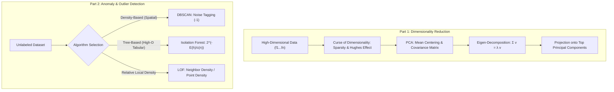

# Lecture 32: Unsupervised Machine Learning (Part-2) — Dimensionality Reduction & Anomaly Detection

Welcome to **Lecture 32: Unsupervised Machine Learning (Part-2)**. This lecture comprehensively covers two foundational pillars of modern unsupervised learning:
1. **Dimensionality Reduction**: Principal Component Analysis (PCA), Curse of Dimensionality, Hughes Phenomenon, and geometric eigen-decomposition.
2. **Anomaly & Outlier Detection**: Density-based, tree-based, and neighborhood-relative algorithms: DBSCAN, Isolation Forest, and Local Outlier Factor (LOF).

---

## Complete Curriculum & Submodule Navigation

| Submodule | Topic & Title | Type | Code Artifacts | Description |
| :--- | :--- | :--- | :--- | :--- |
| [`Notes_32.01`](file:///c:/Users/Shivam%20Keshari/OneDrive/Desktop/AI-ML/lecture_32/Notes_32.01/README.md) | **Dimensionality Reduction & Curse of Dimensionality** | Theory | — | Data sparsity ($O(k^d)$), Euclidean distance failure, computational bottlenecks, Hughes phenomenon, and feature selection vs extraction. |
| [`Notes_32.02`](file:///c:/Users/Shivam%20Keshari/OneDrive/Desktop/AI-ML/lecture_32/Notes_32.02/README.md) | **What is PCA - Intuition & Principles** | Theory | — | Netflix user engagement intuition, correlation requirement, data spread $\equiv$ variance, mean centering, PC1 & orthogonal PC2. |
| [`Notes_32.03`](file:///c:/Users/Shivam%20Keshari/OneDrive/Desktop/AI-ML/lecture_32/Notes_32.03/README.md) | **PCA Step-by-Step Mathematical Algorithm** | Theory | — | Z-score standardization, covariance matrix $\Sigma$, Pythagorean equivalence ($\min d_1 \iff \max d_2$), $\Sigma \mathbf{v} = \lambda \mathbf{v}$, and projection matrix $W$. |
| [`Notes_32.04`](file:///c:/Users/Shivam%20Keshari/OneDrive/Desktop/AI-ML/lecture_32/Notes_32.04/README.md) | **PCA Implementation on Iris Dataset** | Practical | [`pca.ipynb`](file:///c:/Users/Shivam%20Keshari/OneDrive/Desktop/AI-ML/lecture_32/Notes_32.04/pca.ipynb) | Scikit-Learn `PCA(n_components=2)`, explained variance ratio (72.96% & 22.85%), eigenvector loadings, and 2D scatter visualization. |
| [`Notes_32.05`](file:///c:/Users/Shivam%20Keshari/OneDrive/Desktop/AI-ML/lecture_32/Notes_32.05/README.md) | **What is Anomaly Detection - Outlier vs Anomaly** | Theory | — | Fundamental distinction: Outliers (extreme but valid) vs Anomalies (suspicious violations); real-world domains: finance, QC, healthcare, cyber, bots. |
| [`Notes_32.06`](file:///c:/Users/Shivam%20Keshari/OneDrive/Desktop/AI-ML/lecture_32/Notes_32.06/README.md) | **DBSCAN for Anomaly Detection** | Theory | — | Density-based noise isolation, core vs border vs noise (`label = -1`), comparison against K-Means forced assignment. |
| [`Notes_32.07`](file:///c:/Users/Shivam%20Keshari/OneDrive/Desktop/AI-ML/lecture_32/Notes_32.07/README.md) | **DBSCAN Implementation for Anomaly Detection** | Practical | [`clustering_DBSCAN.ipynb`](file:///c:/Users/Shivam%20Keshari/OneDrive/Desktop/AI-ML/lecture_32/Notes_32.07/clustering_DBSCAN.ipynb) | Non-linear `make_moons` clustering, hyperparameter heuristics ($\text{min\_samples} \approx 2d = 5$, $\epsilon = 0.18$), and scatter plot with detected noise. |
| [`Notes_32.08`](file:///c:/Users/Shivam%20Keshari/OneDrive/Desktop/AI-ML/lecture_32/Notes_32.08/README.md) | **Isolation Forest for Anomaly Detection** | Theory | — | Isolation trees (iTrees), random orthogonal partitioning, path length $h(x)$, anomaly scoring formula $s(x, n) = 2^{-E(h(x))/c(n)}$, and BST normalization. |
| [`Notes_32.09`](file:///c:/Users/Shivam%20Keshari/OneDrive/Desktop/AI-ML/lecture_32/Notes_32.09/README.md) | **Isolation Forest on Clinical Thyroid Dataset** | Practical | [`isolation_forest.ipynb`](file:///c:/Users/Shivam%20Keshari/OneDrive/Desktop/AI-ML/lecture_32/Notes_32.09/isolation_forest.ipynb) [`thyroid_dataset.csv`](file:///c:/Users/Shivam%20Keshari/OneDrive/Desktop/AI-ML/lecture_32/Notes_32.09/thyroid_dataset.csv) | Clinical screening of 6,916 patient records across 21 features with `contamination=0.036`, detecting 249 hypothyroid pathology outliers. |
| [`Notes_32.10`](file:///c:/Users/Shivam%20Keshari/OneDrive/Desktop/AI-ML/lecture_32/Notes_32.10/README.md) | **Local Outlier Factor (LOF) for Anomaly Detection** | Theory | — | Multi-density cluster breakdown, local vs global outliers, $k$-distance, reachability distance, local reachability density (LRD), and LOF ratio scoring. |
| [`Notes_32.11`](file:///c:/Users/Shivam%20Keshari/OneDrive/Desktop/AI-ML/lecture_32/Notes_32.11/README.md) | **Local Outlier Factor Implementation** | Practical | [`local_outlier_factor.ipynb`](file:///c:/Users/Shivam%20Keshari/OneDrive/Desktop/AI-ML/lecture_32/Notes_32.11/local_outlier_factor.ipynb) [`thyroid_dataset.csv`](file:///c:/Users/Shivam%20Keshari/OneDrive/Desktop/AI-ML/lecture_32/Notes_32.11/thyroid_dataset.csv) | End-to-end LOF implementation on 21-feature clinical data detecting 249 local outliers with 2D PCA visual projections. |
| [`Practice_Problems`](file:///c:/Users/Shivam%20Keshari/OneDrive/Desktop/AI-ML/lecture_32/Practice_Problems/README.md) | **Practice Case Studies & Solutions** | Problems & Solutions | [`Solutions.md`](file:///c:/Users/Shivam%20Keshari/OneDrive/Desktop/AI-ML/lecture_32/Practice_Problems/Solutions.md) | 3 rigorous real-world case studies: E-Commerce PCA analytics, semiconductor wafer defect detection, and clinical endocrinology diagnostics. |
| [`Lecture_Code`](file:///c:/Users/Shivam%20Keshari/OneDrive/Desktop/AI-ML/lecture_32/Lecture_Code/README.md) | **Master Official Code Directory** | Code Directory | All Notebooks & CSV | Master archive containing official unmodified instructor notebooks and datasets. |

---

## Core Algorithmic Architecture

---

## Architectural Rules Followed
- **No Synthetic Code in Theory Submodules**: Pure theory modules (`32.01`, `32.02`, `32.03`, `32.05`, `32.06`, `32.08`, `32.10`) contain exclusively rich mathematical expositions, blackboard mappings, and diagrams with zero artificial notebooks.
- **Official Code Fidelity**: Code submodules (`32.04`, `32.07`, `32.09`, `32.11`) contain clean, tested Jupyter notebooks matching the exact code taught in lecture.
- **MathJax Column 0 Alignment**: All display math expressions are unindented at column 0 for universal rendering across GitHub markdown, Pandoc, and PDF converters.
- **Bilingual Dual Deliverables**: Every module provides both an English (`README.md`) and Hinglish (`README_HINGLISH.md`) guide, accompanied by compiled vector-grade PDFs.
