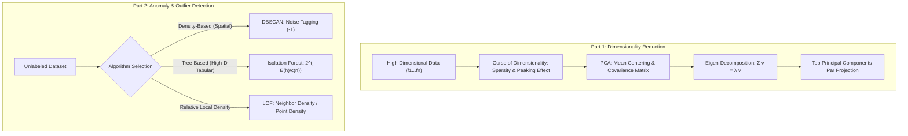

# Lecture 32: Unsupervised Machine Learning (Part-2) — Dimensionality Reduction & Anomaly Detection (Hinglish)

Swagat hai **Lecture 32: Unsupervised Machine Learning (Part-2)** mein. Yeh lecture modern unsupervised machine learning ke do bohot zaroori topics ko cover karta hai:
1. **Dimensionality Reduction**: Principal Component Analysis (PCA), Curse of Dimensionality, Hughes Phenomenon aur mathematical eigen-decomposition.
2. **Anomaly & Outlier Detection**: Density-based, tree-based aur local density algorithms: DBSCAN, Isolation Forest aur Local Outlier Factor (LOF).

---

## Complete Curriculum & Submodule Navigation

| Submodule | Topic & Title | Type | Code Files | Description |
| :--- | :--- | :--- | :--- | :--- |
| [`Notes_32.01`](file:///c:/Users/Shivam%20Keshari/OneDrive/Desktop/AI-ML/lecture_32/Notes_32.01/README_HINGLISH.md) | **Dimensionality Reduction & Curse of Dimensionality** | Theory | — | Data sparsity ($O(k^d)$), Euclidean distance ka be-asar hona, computation cost, Hughes effect aur feature selection vs extraction. |
| [`Notes_32.02`](file:///c:/Users/Shivam%20Keshari/OneDrive/Desktop/AI-ML/lecture_32/Notes_32.02/README_HINGLISH.md) | **What is PCA - Intuition & Principles** | Theory | — | Netflix user engagement example, correlation ki zaroorat, spread $\equiv$ variance, mean centering, PC1 aur perpendicular PC2. |
| [`Notes_32.03`](file:///c:/Users/Shivam%20Keshari/OneDrive/Desktop/AI-ML/lecture_32/Notes_32.03/README_HINGLISH.md) | **PCA Step-by-Step Mathematical Algorithm** | Theory | — | Z-score scaling, covariance matrix $\Sigma$, Pythagoras theorem derivation ($\min d_1 \iff \max d_2$), $\Sigma \mathbf{v} = \lambda \mathbf{v}$ aur projection matrix $W$. |
| [`Notes_32.04`](file:///c:/Users/Shivam%20Keshari/OneDrive/Desktop/AI-ML/lecture_32/Notes_32.04/README_HINGLISH.md) | **PCA Implementation on Iris Dataset** | Practical | [`pca.ipynb`](file:///c:/Users/Shivam%20Keshari/OneDrive/Desktop/AI-ML/lecture_32/Notes_32.04/pca.ipynb) | Scikit-Learn `PCA(n_components=2)`, explained variance ratio (72.96% & 22.85%), eigenvector weights aur 2D scatter plot visualization. |
| [`Notes_32.05`](file:///c:/Users/Shivam%20Keshari/OneDrive/Desktop/AI-ML/lecture_32/Notes_32.05/README_HINGLISH.md) | **What is Anomaly Detection - Outlier vs Anomaly** | Theory | — | Asli antar: Outliers (extreme par valid) vs Anomalies (suspicious violations); real-world domains: banking fraud, factory QC, medical tests, botnet. |
| [`Notes_32.06`](file:///c:/Users/Shivam%20Keshari/OneDrive/Desktop/AI-ML/lecture_32/Notes_32.06/README_HINGLISH.md) | **DBSCAN for Anomaly Detection** | Theory | — | Density-based noise separation, core vs border vs noise (`label = -1`), aur K-Means ki forced assignment se comparison. |
| [`Notes_32.07`](file:///c:/Users/Shivam%20Keshari/OneDrive/Desktop/AI-ML/lecture_32/Notes_32.07/README_HINGLISH.md) | **DBSCAN Implementation for Anomaly Detection** | Practical | [`clustering_DBSCAN.ipynb`](file:///c:/Users/Shivam%20Keshari/OneDrive/Desktop/AI-ML/lecture_32/Notes_32.07/clustering_DBSCAN.ipynb) | Non-linear `make_moons` data par DBSCAN, hyperparameter tuning rules ($\text{min\_samples} \approx 2d = 5$, $\epsilon = 0.18$) aur noise visualization. |
| [`Notes_32.08`](file:///c:/Users/Shivam%20Keshari/OneDrive/Desktop/AI-ML/lecture_32/Notes_32.08/README_HINGLISH.md) | **Isolation Forest for Anomaly Detection** | Theory | — | Isolation trees (iTrees), random cuts, path length $h(x)$, anomaly scoring formula $s(x, n) = 2^{-E(h(x))/c(n)}$ aur BST average depth. |
| [`Notes_32.09`](file:///c:/Users/Shivam%20Keshari/OneDrive/Desktop/AI-ML/lecture_32/Notes_32.09/README_HINGLISH.md) | **Isolation Forest on Clinical Thyroid Dataset** | Practical | [`isolation_forest.ipynb`](file:///c:/Users/Shivam%20Keshari/OneDrive/Desktop/AI-ML/lecture_32/Notes_32.09/isolation_forest.ipynb) [`thyroid_dataset.csv`](file:///c:/Users/Shivam%20Keshari/OneDrive/Desktop/AI-ML/lecture_32/Notes_32.09/thyroid_dataset.csv) | 6,916 patients ke 21 attributes par clinical anomaly detection, `contamination=0.036` ke sath 249 hypothyroid pathology outliers detect karna. |
| [`Notes_32.10`](file:///c:/Users/Shivam%20Keshari/OneDrive/Desktop/AI-ML/lecture_32/Notes_32.10/README_HINGLISH.md) | **Local Outlier Factor (LOF) for Anomaly Detection** | Theory | — | Multi-density clusters, local vs global outliers ka antar, $k$-distance, reachability distance, local reachability density (LRD) aur LOF ratio. |
| [`Notes_32.11`](file:///c:/Users/Shivam%20Keshari/OneDrive/Desktop/AI-ML/lecture_32/Notes_32.11/README_HINGLISH.md) | **Local Outlier Factor Implementation** | Practical | [`local_outlier_factor.ipynb`](file:///c:/Users/Shivam%20Keshari/OneDrive/Desktop/AI-ML/lecture_32/Notes_32.11/local_outlier_factor.ipynb) [`thyroid_dataset.csv`](file:///c:/Users/Shivam%20Keshari/OneDrive/Desktop/AI-ML/lecture_32/Notes_32.11/thyroid_dataset.csv) | 21-feature clinical data par LOF implementation, demographic local anomalies aur 2D PCA visual scatter plot. |
| [`Practice_Problems`](file:///c:/Users/Shivam%20Keshari/OneDrive/Desktop/AI-ML/lecture_32/Practice_Problems/README_HINGLISH.md) | **Practice Case Studies & Solutions** | Problems & Solutions | [`Solutions_HINGLISH.md`](file:///c:/Users/Shivam%20Keshari/OneDrive/Desktop/AI-ML/lecture_32/Practice_Problems/Solutions_HINGLISH.md) | 3 syllabus-aligned real-world case studies: E-Commerce PCA analytics, semiconductor wafer defect screening aur clinical thyroid diagnostics. |
| [`Lecture_Code`](file:///c:/Users/Shivam%20Keshari/OneDrive/Desktop/AI-ML/lecture_32/Lecture_Code/README_HINGLISH.md) | **Master Official Code Directory** | Code Directory | Saare Notebooks & CSV | Ma'am ke dwara diye gaye official original notebooks aur datasets ka master index. |

---

## Overall Architecture Flow

---

## Important Rules Followed
- **Pure Theory Modules Mein Koi Faltu Code Notebook Nahi**: Modules `32.01`, `32.02`, `32.03`, `32.05`, `32.06`, `32.08`, `32.10` mein sirf concepts, mathematical formulas aur diagrams hain.
- **Official Code Fidelity**: Code modules (`32.04`, `32.07`, `32.09`, `32.11`) mein tested clean Jupyter notebooks hain jo Ma'am ke padhaye code ke 100% anuroop hain.
- **MathJax Column 0 Alignment**: Saare display math formulas `$$` column 0 par unindented hain taaki Markdown aur PDF dono mein bina error render hon.
- **Bilingual Notes & Vector PDFs**: Har sub-module mein English aur Hinglish dono versions hain aur sabhi ke vector-quality PDFs generate kiye ja rahe hain.
