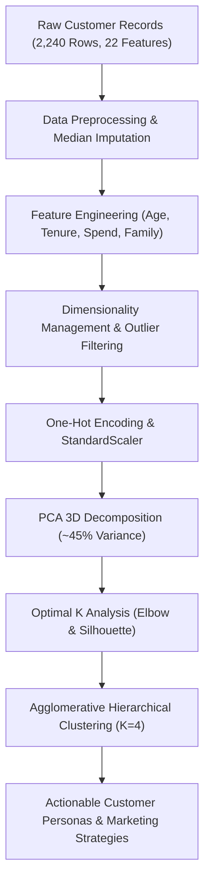

# Submodule 33.01: Project Introduction & Business Objectives

## Topic Overview & Business Context
In modern retail and e-commerce platforms, customer segmentation is one of the most commercially critical applications of **Unsupervised Machine Learning**. Rather than treating all customers uniformly with generic, mass marketing campaigns ("spray-and-pray"), businesses must group customers into cohesive behavioral clusters. This enables personalized product recommendations, optimized marketing budget allocation, and elevated customer retention rates.

In this project, we engineer the **SmartCart Clustering System** for an international e-commerce company serving customers across multiple regions. The dataset comprises 2,240 customer transaction records across 22 multi-faceted attributes.



---

## 1. The Business Problem & Objectives
- **Current Operational Bottleneck**: SmartCart currently executes generic marketing and promotional strategies.
- **Core Deficiencies**:
  - Inability to distinguish high-value loyal spenders from discount-seeking casual visitors.
  - Suboptimal return on marketing investment (marketing spend wasted on unengaged leads).
  - High customer churn due to irrelevant promotional bombardment.
- **Project Goal**: Build an intelligent customer segmentation pipeline using unsupervised clustering algorithms to discover hidden behavioral archetypes and empower data-driven marketing decisions.
- **Target Output**: Segments mapped to distinct customer personas with customized business recommendations.

---

## 2. Dataset Architecture & Attribute Categorization
The dataset (`smartcart_customers.csv`) contains 2,240 customer records across 22 attributes:

| Category | Attributes | Business Significance |
| :--- | :--- | :--- |
| **Demographics** | `ID`, `Year_Birth`, `Education`, `Marital_Status`, `Income`, `Kidhome`, `Teenhome` | Personal profile, earning capacity, and household dependency structure. |
| **Product Expenditures** | `MntWines`, `MntFruits`, `MntMeatProducts`, `MntFishProducts`, `MntSweetProducts`, `MntGoldProds` | Basket composition and category preferences over the last 2 years. |
| **Purchasing Channels** | `NumDealsPurchases`, `NumWebPurchases`, `NumCatalogPurchases`, `NumStorePurchases` | Channel preferences (e-commerce web vs brick-and-mortar store vs mail catalog). |
| **Engagement & Recency** | `Dt_Customer`, `Recency`, `NumWebVisitsMonth`, `Complain`, `Response` | Customer loyalty, days since last purchase, website activity, friction, and campaign response. |

---

## 3. Data Ingestion & Initial Exploratory Audit
The official project code is located at:
- [smartcart.ipynb](file:///c:/Users/Shivam%20Keshari/OneDrive/Desktop/AI-ML/lecture_33/SmartCart_Project/smartcart.ipynb)
- [smartcart_customers.csv](file:///c:/Users/Shivam%20Keshari/OneDrive/Desktop/AI-ML/lecture_33/SmartCart_Project/smartcart_customers.csv)

### Python Implementation (Notebook Cells 00 - 04)
```python
import pandas as pd
import matplotlib.pyplot as plt
import seaborn as sns

# Load dataset
df = pd.read_csv("smartcart_customers.csv")

# Display initial rows
print(df.head())

# Check dataset dimensions
print("Dataset Shape:", df.shape) # Output: (2240, 22)

# Audit missing values across columns
print(df.isnull().sum())
```

### Initial Health Check Findings:
1. **Dimensions**: 2,240 rows and 22 feature columns.
2. **Missing Values**:
   - `Income`: Exactly 24 null values present.
   - All other 21 columns have 0 missing values.
3. **No Target Label**: There is no ground-truth target vector $y$. All features represent input attributes $X$ for exploratory unsupervised manifold learning.
