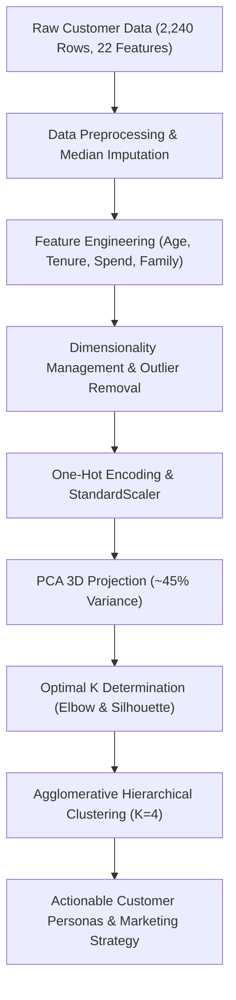

# Submodule 33.01: Project Introduction & Business Objectives (Hinglish)

## Topic Overview & Business Context
E-commerce aur modern retail platforms ke andar customer segmentation **Unsupervised Machine Learning** ka sabse popular aur commercially impactful use case hai. Agar ek company apne sabhi customers ko ek jaisa treat karegi aur generic marketing strategies ("spray-and-pray") chalayegi, toh marketing budget waste hota hai aur high-value customers retain nahi ho pate.

Is minor project mein hum **SmartCart Clustering System** build kar rahe hain jo ek international e-commerce company ke 2,240 customers ke transaction records (22 attributes) par based hai.



---

## 1. Business Problem aur Objectives
- **Current Problem**: SmartCart generic marketing aur mass engagement strategies use kar raha hai.
- **Nuksan**:
  - Company high-value loyal customers ko identify nahi kar pa rahi hai.
  - Inefficient marketing spend: Low-budget shoppers aur premium spenders ko same campaigns bheje ja rahe hain.
- **Machine Learning Solution**: Unsupervised clustering algorithms use karke historical transaction data se hidden patterns discover karna aur customers ko meaningful segments mein group karna.
- **Goal**: Har segment ke liye personalized marketing, discount targeting aur retention strategies design karna.

---

## 2. Dataset Architecture aur Attributes
Dataset (`smartcart_customers.csv`) ke 22 attributes ko 4 broad categories mein classify kiya gaya hai:

| Category | Attributes | Significance |
| :--- | :--- | :--- |
| **Demographics** | `ID`, `Year_Birth`, `Education`, `Marital_Status`, `Income`, `Kidhome`, `Teenhome` | Customer ki age, education, household income aur ghar mein bacchon ki sankhya. |
| **Product Expenditures** | `MntWines`, `MntFruits`, `MntMeatProducts`, `MntFishProducts`, `MntSweetProducts`, `MntGoldProds` | Wine, fruit, meat, fish, sweets aur gold par pichle 2 saal mein kitna spend kiya. |
| **Purchasing Channels** | `NumDealsPurchases`, `NumWebPurchases`, `NumCatalogPurchases`, `NumStorePurchases` | Discounts, website, catalog aur physical stores se purchases ka count. |
| **Engagement & Recency** | `Dt_Customer`, `Recency`, `NumWebVisitsMonth`, `Complain`, `Response` | Joining date, last purchase ke days, monthly web visits, complaints aur campaign response. |

---

## 3. Data Ingestion aur Initial Inspection
Official project assets yahan available hain:
- [smartcart.ipynb](file:///c:/Users/Shivam%20Keshari/OneDrive/Desktop/AI-ML/lecture_33/SmartCart_Project/smartcart.ipynb)
- [smartcart_customers.csv](file:///c:/Users/Shivam%20Keshari/OneDrive/Desktop/AI-ML/lecture_33/SmartCart_Project/smartcart_customers.csv)

### Python Implementation (Notebook Cells 00 - 04)
```python
import pandas as pd
import matplotlib.pyplot as plt
import seaborn as sns

# Dataset load karna
df = pd.read_csv("smartcart_customers.csv")

# Pehle 5 rows inspect karna
print(df.head())

# Dimensions check karna
print("Shape:", df.shape) # Output: (2240, 22)

# Null values check karna
print(df.isnull().sum())
```

### Initial Observations:
1. Dataset mein **2,240 rows** aur **22 columns** hain.
2. Sirf `Income` column mein **24 missing values** hain, baki sabhi 21 columns completely clean hain.
3. Koi target label ($y$) nahi hai, yeh pure unsupervised learning problem hai.
