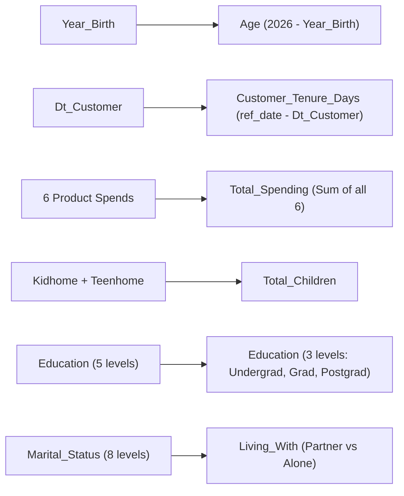

# Submodule 33.03: Feature Engineering (Domain-Specific Transformations)

## Topic Overview & Theoretical Motivation
Feature engineering is the single most decisive step in unsupervised machine learning. Clustering algorithms cannot autonomously synthesize higher-order commercial concepts; they merely calculate distances between raw vector coordinates. 

In this module, raw attributes are converted into high-signal behavioral and demographic variables.



---

## 1. Feature Synthesis Derivations

### A. Age Synthesis
Raw birth years (e.g., 1957, 1984) distort clustering geometry. Age provides direct commercial interpretability:
$$
\text{Age}_i = 2026 - \text{Year\_Birth}_i
$$

### B. Customer Loyalty Tenure (`Customer_Tenure_Days`)
Clustering distance formulas cannot process date strings (`"2012-09-04"`). 
- **Critical Engineering Practice**: Rather than using `datetime.now()` (which shifts dynamically and destroys pipeline reproducibility), we anchor against the maximum joining date in the dataset:
$$
\text{Reference Date} = \max(\text{Dt\_Customer})
$$
$$
\text{Customer\_Tenure\_Days}_i = (\text{Reference Date} - \text{Dt\_Customer}_i)
$$

### C. Total Customer Spending (`Total_Spending`)
Our objective is **Customer Segmentation**, not Product Basket Analysis. We sum all six individual product expenditure categories:
$$
\text{Total\_Spending} = \text{MntWines} + \text{MntFruits} + \text{MntMeatProducts} + \text{MntFishProducts} + \text{MntSweetProducts} + \text{MntGoldProds}
$$

### D. Household Dependency (`Total_Children`)
Consolidating young children and teenagers into a single household dependency count:
$$
\text{Total\_Children} = \text{Kidhome} + \text{Teenhome}
$$

### E. Education Level Consolidation
The raw `Education` attribute contains 5 granular categories. We consolidate them into 3 ordinal tiers:
- `Basic`, `2n Cycle` $\to$ `Undergraduate` (pursuing or basic education)
- `Graduation` $\to$ `Graduate` (bachelor's completed)
- `Master`, `PhD` $\to$ `Postgraduate` (advanced post-grad degrees)

### F. Living Status Consolidation (`Living_With`)
The raw `Marital_Status` column contains 8 categories (`Married`, `Together`, `Single`, `Divorced`, `Widow`, `Alone`, `Absurd`, `YOLO`). For retail basket dynamics, the key factor is whether the customer shares household expenses with a partner or lives alone:
- `Married`, `Together` $\to$ `Partner`
- `Single`, `Divorced`, `Widow`, `Alone`, `Absurd`, `YOLO` $\to$ `Alone`

---

## 2. Python Implementation
Reference: [smartcart.ipynb](file:///c:/Users/Shivam%20Keshari/OneDrive/Desktop/AI-ML/lecture_33/SmartCart_Project/smartcart.ipynb) (Cells 09 - 15).

```python
# 1. Age
df["Age"] = 2026 - df["Year_Birth"]

# 2. Customer Joining Date & Tenure
df["Dt_Customer"] = pd.to_datetime(df["Dt_Customer"], dayfirst=True)
reference_date = df["Dt_Customer"].max()
df["Customer_Tenure_Days"] = (reference_date - df["Dt_Customer"]).dt.days

# 3. Total Spending
df["Total_Spending"] = (
    df["MntWines"] + df["MntFruits"] + df["MntMeatProducts"] + 
    df["MntFishProducts"] + df["MntSweetProducts"] + df["MntGoldProds"]
)

# 4. Total Children
df["Total_Children"] = df["Kidhome"] + df["Teenhome"]

# 5. Education Mapping
df["Education"] = df["Education"].replace({
    "Basic": "Undergraduate", "2n Cycle": "Undergraduate",
    "Graduation": "Graduate",
    "Master": "Postgraduate", "PhD": "Postgraduate"
})

# 6. Marital Status Mapping -> Living_With
df["Living_With"] = df["Marital_Status"].replace({
    "Married": "Partner", "Together": "Partner",
    "Single": "Alone", "Divorced": "Alone",
    "Widow": "Alone", "Absurd": "Alone", "YOLO": "Alone"
})
```
