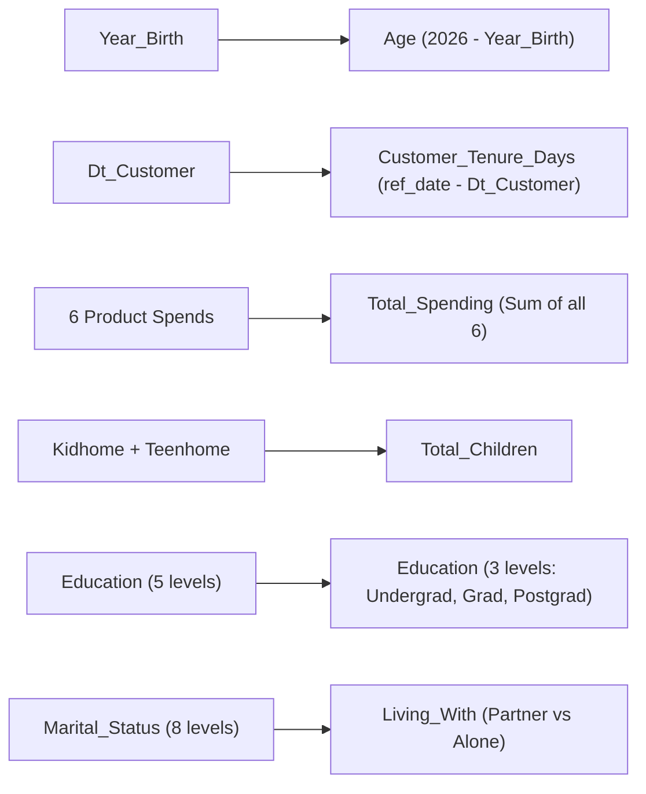

# Submodule 33.03: Feature Engineering (Domain-Specific Transformations) (Hinglish)

## Topic Overview & Motivation
Unsupervised learning mein feature engineering sabse important step hota hai. Clustering algorithms raw numbers ke beech distance calculate karte hain, unhe business domain ka latent context samajh nahi aata jab tak hum use explicitly engineer na karein.

Is module mein raw features ko high-signal commercial features mein convert kiya gaya hai.



---

## 1. Feature Engineering Derivations

### A. Age Feature
Raw birth year (jaise 1965, 1982) feed karne se distance metric confuse hota hai. Age customer profile ko directly interpret karne mein madad karta hai:
$$
\text{Age} = 2026 - \text{Year\_Birth}
$$

### B. Customer Tenure (`Customer_Tenure_Days`)
Clustering algorithms string dates (jaise `04-09-2012`) ko read nahi kar sakte. 
- **Reproducibility Rule**: Ma'am ne `datetime.now()` use karne ki jagah dataset ki maximum joining date ko reference date banaya:
$$
\text{Reference Date} = \max(\text{Dt\_Customer})
$$
$$
\text{Customer\_Tenure\_Days} = (\text{Reference Date} - \text{Dt\_Customer})
$$
Agar hum `datetime.now()` use karte, toh har mahine run karne par customer tenure badal jata aur clusters unstable ho jate. Max date lene se pipeline 100% reproducible rehti hai.

### C. Total Spending (`Total_Spending`)
Hamara primary focus **Customer Segmentation** hai, na ki individual product segmentation. Isliye 6 alag-alag product expenditures ko sum karke total expenditure banaya:
$$
\text{Total\_Spending} = \text{MntWines} + \text{MntFruits} + \text{MntMeatProducts} + \text{MntFishProducts} + \text{MntSweetProducts} + \text{MntGoldProds}
$$

### D. Total Children (`Total_Children`)
Ghar mein kitne chote bacche aur teenagers hain unka total count:
$$
\text{Total\_Children} = \text{Kidhome} + \text{Teenhome}
$$

### E. Education Simplification
5 fragmented categories ko 3 meaningful tiers mein map kiya:
- `Basic`, `2n Cycle` $\to$ `Undergraduate`
- `Graduation` $\to$ `Graduate`
- `Master`, `PhD` $\to$ `Postgraduate`

### F. Marital Status $\to$ `Living_With`
Marital status mein unnecessary values thi (`Absurd`, `YOLO`). E-commerce point of view se yeh matter karta hai ki customer akela rehta hai ya partner ke sath:
- `Married`, `Together` $\to$ `Partner`
- `Single`, `Divorced`, `Widow`, `Alone`, `Absurd`, `YOLO` $\to$ `Alone`

---

## 2. Python Code Implementation
Reference: [smartcart.ipynb](file:///c:/Users/Shivam%20Keshari/OneDrive/Desktop/AI-ML/lecture_33/SmartCart_Project/smartcart.ipynb) (Cells 09 - 15).

```python
# 1. Age
df["Age"] = 2026 - df["Year_Birth"]

# 2. Customer Joining Date & Tenure Days
df["Dt_Customer"] = pd.to_datetime(df["Dt_Customer"], dayfirst=True)
reference_date = df["Dt_Customer"].max()
df["Customer_Tenure_Days"] = (reference_date - df["Dt_Customer"]).dt.days

# 3. Total Spending calculation
df["Total_Spending"] = (
    df["MntWines"] + df["MntFruits"] + df["MntMeatProducts"] + 
    df["MntFishProducts"] + df["MntSweetProducts"] + df["MntGoldProds"]
)

# 4. Total Children
df["Total_Children"] = df["Kidhome"] + df["Teenhome"]

# 5. Education Mapping
df["Education"] = df["Education"].replace({
    "Basic": "Undergraduate", "2n Cycle": "Undergraduate",
    "Graduation": "Graduate",
    "Master": "Postgraduate", "PhD": "Postgraduate"
})

# 6. Marital Status Mapping -> Living_With
df["Living_With"] = df["Marital_Status"].replace({
    "Married": "Partner", "Together": "Partner",
    "Single": "Alone", "Divorced": "Alone",
    "Widow": "Alone", "Absurd": "Alone", "YOLO": "Alone"
})
```
