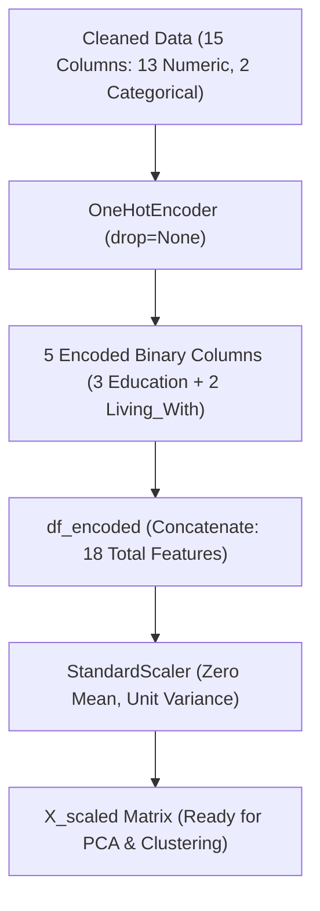

# Submodule 33.07: Categorical Feature Encoding & Feature Scaling

## Topic Overview & Unsupervised Encoding Principles
Distance-based clustering algorithms operate strictly on real-valued Cartesian coordinates. Categorical variables must therefore be mathematically encoded into orthogonal coordinate axes.



---

## 1. Why NOT Drop First in Clustering?
In supervised linear regression, practitioners routinely set `drop='first'` or `drop_first=True` to eliminate the reference dummy variable and avoid the dummy variable trap (perfect multicollinearity):
$$
\sum_{j=1}^{C} D_{ij} = 1 \implies D_{iC} = 1 - \sum_{j=1}^{C-1} D_{ij}
$$

**Critical Distinction in Clustering**:
- Clustering algorithms do not invert matrices $(X^T X)^{-1}$; they calculate geometric Euclidean distances between points:
$$
d(u, v) = \sqrt{\sum_{j=1}^{p} (u_j - v_j)^2}
$$
- If the first category is dropped, customers belonging to the reference category are assigned an all-zero vector $(0, 0, \dots, 0)$, asymmetrically collapsing their geometric distance relative to other categories.
- Retaining all categories preserves symmetric, equidistant representation across all categorical levels in geometric vector space.

---

## 2. Feature Scaling: Z-Score Standardization
Our 18 features span vastly disparate units:
- `Income`: Ranges from \$1,730 to \$162,397 (magnitude: $10^5$).
- `Total_Spending`: Ranges from \$5 to \$2,525 (magnitude: $10^3$).
- `Total_Children`: Discrete counts from 0 to 3.
- `Education_*`, `Living_With_*`: Binary indicators $\in \{0, 1\}$.

Without scaling, distance metrics would be completely dominated by `Income`, rendering customer behavior and categorical status irrelevant. We apply **Z-Score Standardization**:
$$
z = \frac{x - \mu}{\sigma}
$$
ensuring every feature has $\mu = 0$ and $\sigma = 1$.

---

## 3. Python Implementation
Reference: [smartcart.ipynb](file:///c:/Users/Shivam%20Keshari/OneDrive/Desktop/AI-ML/lecture_33/SmartCart_Project/smartcart.ipynb) (Cells 29 - 39).

```python
from sklearn.preprocessing import OneHotEncoder, StandardScaler
import pandas as pd

# 1. One-Hot Encoding on Categorical Columns
ohe = OneHotEncoder()
cat_cols = ["Education", "Living_With"]
enc_cols = ohe.fit_transform(df_cleaned[cat_cols])

# Convert to DataFrame preserving index
enc_df = pd.DataFrame(
    enc_cols.toarray(), 
    columns=ohe.get_feature_names_out(cat_cols), 
    index=df_cleaned.index
)

# Concatenate numeric features with encoded features
df_encoded = pd.concat([df_cleaned.drop(columns=cat_cols), enc_df], axis=1)
print("Encoded Shape:", df_encoded.shape) # Output: (2236, 18)

# 2. Feature Scaling
X = df_encoded
scaler = StandardScaler()
X_scaled = scaler.fit_transform(X)
print("Scaled Matrix Shape:", X_scaled.shape) # Output: (2236, 18)
```

---

## 4. Encoded Features Architecture (18 Columns)
The resulting matrix `X` contains 18 standardized features:
- **13 Numeric Features**: `Income`, `Recency`, `NumDealsPurchases`, `NumWebPurchases`, `NumCatalogPurchases`, `NumStorePurchases`, `NumWebVisitsMonth`, `Complain`, `Response`, `Age`, `Customer_Tenure_Days`, `Total_Spending`, `Total_Children`.
- **5 Encoded Dummies**: `Education_Graduate`, `Education_Postgraduate`, `Education_Undergraduate`, `Living_With_Alone`, `Living_With_Partner`.
