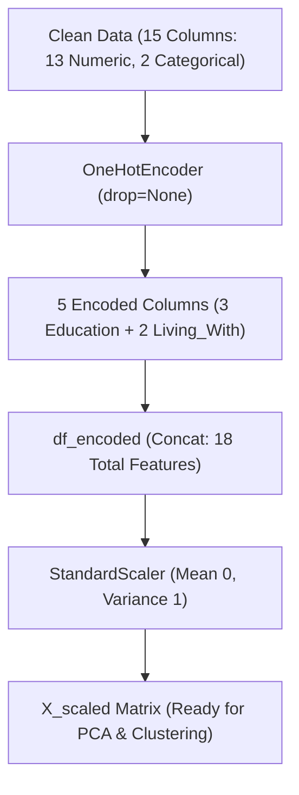

# Submodule 33.07: Categorical Feature Encoding & Feature Scaling (Hinglish)

## Topic Overview & Unsupervised Encoding Principles
Clustering algorithms sirf real numbers aur geometric distances samajhte hain. Isliye categorical features (`Education`, `Living_With`) ko orthogonal coordinate axes mein convert karna padta hai.



---

## 1. Clustering mein `drop='first'` Kyun Nahi Karte?
Supervised learning (jaise Linear ya Logistic Regression) mein multicollinearity aur dummy variable trap se bachne ke liye hum `drop='first'` use karte the:
$$
\sum_{j=1}^{C} D_{ij} = 1 \implies D_{iC} = 1 - \sum_{j=1}^{C-1} D_{ij}
$$

**Clustering ka Golden Concept**:
- Clustering algorithms matrix inversion nahi karte; woh geometric distance measure karte hain:
$$
d(u, v) = \sqrt{\sum_{j=1}^{p} (u_j - v_j)^2}
$$
- Agar hum pehla column drop kar denge, toh reference category ke data points ko $(0, 0, \dots, 0)$ assign ho jayega, jisse unki geometric distance baki categories ke mukable artificially distort ho jayegi.
- Isliye unsupervised clustering mein hum saari categories retain karte hain taaki vector space mein har level equidistant rahe.

---

## 2. Feature Scaling: StandardScaler (Z-Score)
Hamare 18 features ke units aur scales bilkul alag hain:
- `Income`: \$1,730 se \$162,397 ($10^5$ magnitude).
- `Total_Spending`: \$5 se \$2,525 ($10^3$ magnitude).
- `Total_Children`: 0 se 3.
- `Education_*`: 0 ya 1.

Agar hum bina scale kiye clustering karenge, toh Euclidean distance sirf `Income` se dominate ho jayegi aur baki sabhi 17 features ka effect zero ho jayega. Isliye **Z-Score Standardization** apply kiya jata hai:
$$
z = \frac{x - \mu}{\sigma}
$$
jisse har feature ka mean $\mu = 0$ aur standard deviation $\sigma = 1$ ho jaye.

---

## 3. Python Code Implementation
Reference: [smartcart.ipynb](file:///c:/Users/Shivam%20Keshari/OneDrive/Desktop/AI-ML/lecture_33/SmartCart_Project/smartcart.ipynb) (Cells 29 - 39).

```python
from sklearn.preprocessing import OneHotEncoder, StandardScaler
import pandas as pd

# 1. OneHotEncoder fit aur transform karna
ohe = OneHotEncoder()
cat_cols = ["Education", "Living_With"]
enc_cols = ohe.fit_transform(df_cleaned[cat_cols])

# Encoded columns ko DataFrame banana
enc_df = pd.DataFrame(
    enc_cols.toarray(), 
    columns=ohe.get_feature_names_out(cat_cols), 
    index=df_cleaned.index
)

# Numeric aur encoded features ko concatenate karna
df_encoded = pd.concat([df_cleaned.drop(columns=cat_cols), enc_df], axis=1)
print("Encoded Shape:", df_encoded.shape) # Output: (2236, 18)

# 2. Scaling apply karna
X = df_encoded
scaler = StandardScaler()
X_scaled = scaler.fit_transform(X)
print("Scaled Matrix Shape:", X_scaled.shape) # Output: (2236, 18)
```

---

## 4. Final 18 Features
Final standardized matrix mein 18 features hain:
- 13 Numeric: `Income`, `Recency`, `NumDealsPurchases`, `NumWebPurchases`, `NumCatalogPurchases`, `NumStorePurchases`, `NumWebVisitsMonth`, `Complain`, `Response`, `Age`, `Customer_Tenure_Days`, `Total_Spending`, `Total_Children`.
- 5 Encoded Dummies: `Education_Graduate`, `Education_Postgraduate`, `Education_Undergraduate`, `Living_With_Alone`, `Living_With_Partner`.
