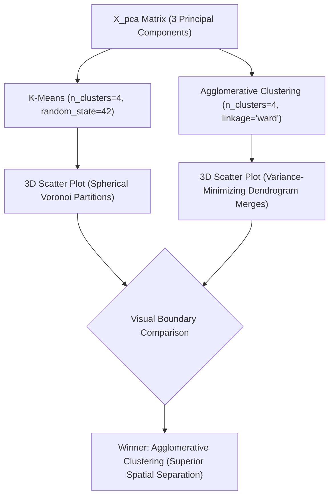

# Submodule 33.10: Clustering Execution: K-Means vs Agglomerative Hierarchical Clustering

## Topic Overview & Algorithmic Comparison
With optimal cluster count established at $K = 4$, we execute and compare the two leading unsupervised clustering paradigms:
1. **Partitioning Algorithm**: **K-Means** (Iterative centroid repositioning minimizing WCSS).
2. **Hierarchical Merging Algorithm**: **Agglomerative Clustering** with **Ward's Linkage**.



---

## 1. Mathematical Mechanics: Ward's Minimum Variance Linkage
While K-Means assumes spherical clusters and isotropic variance around centroids, Agglomerative Clustering builds a hierarchical tree from the bottom up. 

In each iteration, **Ward's Linkage** merges the pair of clusters $A$ and $B$ that minimizes the increase in total Error Sum of Squares ($\Delta \text{ESS}$):

$$
\Delta \text{ESS}_{A,B} = \frac{n_A n_B}{n_A + n_B} \| \mu_A - \mu_B \|^2
$$

where:
- $n_A, n_B$: Number of data points in clusters $A$ and $B$.
- $\mu_A, \mu_B$: Centroids of clusters $A$ and $B$.

Ward's criterion creates compact, balanced clusters while preventing the chaining effect seen in single linkage.

---

## 2. Python Implementation & Visual Comparison
Reference: [smartcart.ipynb](file:///c:/Users/Shivam%20Keshari/OneDrive/Desktop/AI-ML/lecture_33/SmartCart_Project/smartcart.ipynb) (Cells 54 - 59).

```python
from sklearn.cluster import KMeans, AgglomerativeClustering
import matplotlib.pyplot as plt

# 1. K-Means Execution
kmeans = KMeans(n_clusters=4, random_state=42)
labels_kmeans = kmeans.fit_predict(X_pca)

# 2. Agglomerative Hierarchical Clustering Execution
agg_clf = AgglomerativeClustering(n_clusters=4, linkage="ward")
labels_agg = agg_clf.fit_predict(X_pca)

# 3. 3D Plot for Agglomerative Clusters
fig = plt.figure(figsize=(8, 6))
ax = fig.add_subplot(111, projection="3d")
scatter = ax.scatter(X_pca[:, 0], X_pca[:, 1], X_pca[:, 2], c=labels_agg, cmap="Set1", s=20)
ax.set_xlabel("PCA 1")
ax.set_ylabel("PCA 2")
ax.set_zlabel("PCA 3")
ax.set_title("Agglomerative Clustering (K=4, Ward Linkage)")
plt.show()
```

---

## 3. Comparative Evaluation & Production Selection
1. **K-Means Spatial Spread**: In 3D PCA space, K-Means generated boundaries where certain clusters showed color overlap across regions.
2. **Agglomerative Spatial Separation**: Agglomerative Clustering with Ward's linkage produced tight, geometrically coherent, well-delineated segments with minimal boundary ambiguity.
3. **DBSCAN Retrospective**: As verified experimentally by Ma'am, DBSCAN produced over 30 micro-clusters on this continuous manifold, which is useless for commercial persona segmentation.
4. **Final Decision**: **Agglomerative Clustering ($K=4$, `linkage="ward"`)** is selected as our final production segmentation engine.
