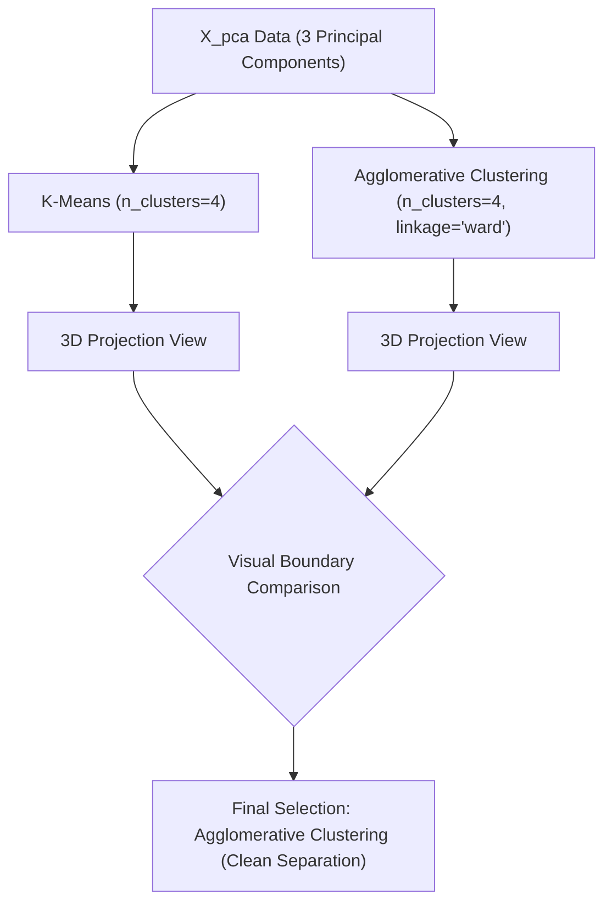

# Submodule 33.10: Clustering Execution: K-Means vs Agglomerative Hierarchical Clustering (Hinglish)

## Topic Overview & Algorithmic Comparison
Optimal $K = 4$ decide hone ke baad Ma'am ne do algorithms ko evaluate kiya:
1. **K-Means Clustering**: Centroid-based iterative partitioning algorithm.
2. **Agglomerative Hierarchical Clustering**: Bottom-up merging algorithm with **Ward's Linkage**.



---

## 1. Ward's Linkage ka Mathematical Logic
Agglomerative clustering mein hum har point ko pehle individual cluster maante hain, aur phir step-by-step unhe merge karte hain.

**Ward's Linkage** do clusters $A$ aur $B$ ko merge karte samay total within-cluster variance increase ($\Delta \text{ESS}$) ko minimize karta hai:

$$
\Delta \text{ESS}_{A,B} = \frac{n_A n_B}{n_A + n_B} \| \mu_A - \mu_B \|^2
$$

Iska fayda yeh hota hai ki clusters balanced aur geometrically compact bante hain.

---

## 2. Python Code Implementation
Reference: [smartcart.ipynb](file:///c:/Users/Shivam%20Keshari/OneDrive/Desktop/AI-ML/lecture_33/SmartCart_Project/smartcart.ipynb) (Cells 54 - 59).

```python
from sklearn.cluster import KMeans, AgglomerativeClustering
import matplotlib.pyplot as plt

# 1. K-Means
kmeans = KMeans(n_clusters=4, random_state=42)
labels_kmeans = kmeans.fit_predict(X_pca)

# 2. Agglomerative Clustering (Ward's Linkage)
agg_clf = AgglomerativeClustering(n_clusters=4, linkage="ward")
labels_agg = agg_clf.fit_predict(X_pca)

# 3. Agglomerative 3D Scatter Plot
fig = plt.figure(figsize=(8, 6))
ax = fig.add_subplot(111, projection="3d")
ax.scatter(X_pca[:, 0], X_pca[:, 1], X_pca[:, 2], c=labels_agg, cmap="Set1", s=20)
ax.set_xlabel("PCA 1")
ax.set_ylabel("PCA 2")
ax.set_zlabel("PCA 3")
ax.set_title("Agglomerative Clustering (K=4)")
plt.show()
```

---

## 3. Comparison aur Decision
1. **K-Means vs Agglomerative**: 3D PCA plot mein Agglomerative clustering ke clusters K-Means ke mukable visually zyada compact aur distinctly separated dikh rahe the.
2. **DBSCAN Kyun Fail Hua?**: DBSCAN ne is dataset par 30+ tiny clusters generate kar diye the jo marketing ke liye unusable hain.
3. **Final Choice**: Ma'am ne **Agglomerative Clustering ($K=4$, `linkage="ward"`)** ko production clustering ke liye select kiya.
