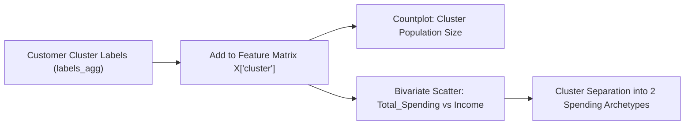

# Submodule 33.11: Cluster Characterization (Income vs Spending Behavioral Patterns)

## Topic Overview & Grounding Labels in Business Realities
Having assigned cluster labels via Agglomerative Clustering ($K=4$), we merge the predicted cluster labels back into the interpretable feature space to examine the physical properties of each customer cluster.



> [!NOTE]
> During video lecture recording, an audio dropout occurred between timestamps `[01:40] - [02:30]`. The explanation resumes seamlessly at `[02:30]`. All notebook code and mathematical explanations are fully intact.

---

## 1. Cluster Size Distribution
We attach cluster labels to the feature dataframe and count customers in each group:

Reference: [smartcart.ipynb](file:///c:/Users/Shivam%20Keshari/OneDrive/Desktop/AI-ML/lecture_33/SmartCart_Project/smartcart.ipynb) (Cells 61 - 63).

```python
import seaborn as sns
import matplotlib.pyplot as plt

# Attach labels to feature matrix
X["cluster"] = labels_agg

# Visual Palette matching lecture
pal = ["red", "blue", "yellow", "green"]

# Population countplot
plt.figure(figsize=(6, 4))
sns.countplot(x=X["cluster"], palette=pal, hue=X["cluster"])
plt.title("Customer Distribution per Cluster")
plt.xlabel("Cluster Label")
plt.ylabel("Customer Count")
plt.show()

print(X["cluster"].value_counts().sort_index())
```

### Exact Cluster Populations ($N = 2,236$):
- **Cluster 0 (Red)**: **905 customers** (40.47% - Largest customer base)
- **Cluster 1 (Blue)**: **534 customers** (23.88%)
- **Cluster 2 (Yellow)**: **444 customers** (19.86%)
- **Cluster 3 (Green)**: **353 customers** (15.79%)

---

## 2. Bivariate Economic Analysis: `Total_Spending` vs `Income`
As identified in our heatmap (Submodule 33.06), `Income` and `Total_Spending` are the primary economic drivers ($r = +0.79$).

Reference: [smartcart.ipynb](file:///c:/Users/Shivam%20Keshari/OneDrive/Desktop/AI-ML/lecture_33/SmartCart_Project/smartcart.ipynb) (Cell 64).

```python
plt.figure(figsize=(8, 6))
sns.scatterplot(
    x=X["Total_Spending"], 
    y=X["Income"], 
    hue=X["cluster"], 
    palette=pal,
    alpha=0.8
)
plt.title("Income vs Total Spending by Cluster")
plt.xlabel("Total Spending ($)")
plt.ylabel("Household Income ($)")
plt.show()
```

---

## 3. High-Level Behavioral Dichotomy

| Cluster Group | Color | Income Bracket | Spending Bracket | Economic Archetype |
| :--- | :--- | :--- | :--- | :--- |
| **Cluster 1** | Blue | High (~$72.8k) | High (~$1,237) | **High-Value Spenders** |
| **Cluster 3** | Green | High (~$70.7k) | High (~$1,190) | **High-Value Spenders** |
| **Cluster 0** | Red | Moderate/Low (~$39.7k) | Moderate/Low (~$222) | **Budget / Value Seekers** |
| **Cluster 2** | Yellow | Lowest (~$37.0k) | Lowest (~$166) | **Budget / Value Seekers** |

### Key Discovery:
The customer base divides into **two pairs**:
1. Why are Cluster 1 and Cluster 3 separated despite having similar high incomes and high spending?
2. Why are Cluster 0 and Cluster 2 separated despite having similar budget incomes and low spending?

The answer lies in the non-financial demographic features: **household structure, living arrangements, and family dependency**, detailed in Submodule 33.12!
