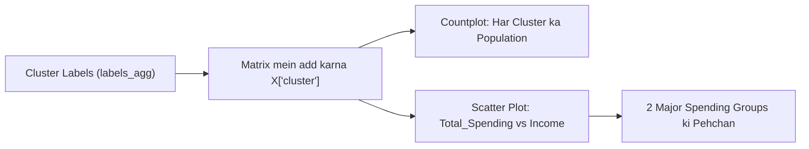

# Submodule 33.11: Cluster Characterization (Income vs Spending Behavioral Patterns) (Hinglish)

## Topic Overview & Grounding Labels
Agglomerative Clustering se mile cluster labels ko original feature space ke sath jodkar har cluster ke physical characteristics aur spending behavior ko analyze kiya gaya.



> [!NOTE]
> Video lecture recording ke dauran `[01:40] - [02:30]` ke beech audio issue / silence tha. Uske baad explanation smoothly resume hota hai. Code aur explanations notebook se 100% verified hain.

---

## 1. Har Cluster ka Population Size
Har cluster mein kitne customers hain:

Reference: [smartcart.ipynb](file:///c:/Users/Shivam%20Keshari/OneDrive/Desktop/AI-ML/lecture_33/SmartCart_Project/smartcart.ipynb) (Cells 61 - 63).

```python
import seaborn as sns
import matplotlib.pyplot as plt

# Labels ko dataframe mein add karna
X["cluster"] = labels_agg

# Lecture matching palette
pal = ["red", "blue", "yellow", "green"]

# Countplot banana
plt.figure(figsize=(6, 4))
sns.countplot(x=X["cluster"], palette=pal, hue=X["cluster"])
plt.title("Cluster Counts")
plt.show()

print(X["cluster"].value_counts().sort_index())
```

### Exact Customer Counts ($N = 2,236$):
- **Cluster 0 (Red)**: **905 customers** (40.5% - Sabse bada cluster)
- **Cluster 1 (Blue)**: **534 customers** (23.9%)
- **Cluster 2 (Yellow)**: **444 customers** (19.9%)
- **Cluster 3 (Green)**: **353 customers** (15.8%)

---

## 2. Income vs Total Spending Scatter Plot
Income aur Total Spending dataset ke do sabse strongly correlated features ($r = +0.79$) hain.

Reference: [smartcart.ipynb](file:///c:/Users/Shivam%20Keshari/OneDrive/Desktop/AI-ML/lecture_33/SmartCart_Project/smartcart.ipynb) (Cell 64).

```python
plt.figure(figsize=(8, 6))
sns.scatterplot(
    x=X["Total_Spending"], 
    y=X["Income"], 
    hue=X["cluster"], 
    palette=pal
)
plt.title("Income vs Total Spending by Cluster")
plt.xlabel("Total Spending ($)")
plt.ylabel("Income ($)")
plt.show()
```

---

## 3. High-Level Patterns & Core Question

| Cluster | Color | Income Range | Spending Range | High-Level Category |
| :--- | :--- | :--- | :--- | :--- |
| **Cluster 1** | Blue | High (~$72.8k) | High (~$1,237) | **High Spenders** |
| **Cluster 3** | Green | High (~$70.7k) | High (~$1,190) | **High Spenders** |
| **Cluster 0** | Red | Moderate/Low (~$39.7k) | Moderate/Low (~$222) | **Budget Shoppers** |
| **Cluster 2** | Yellow | Lowest (~$37.0k) | Lowest (~$166) | **Budget Shoppers** |

### Interesting Insight:
Customers do distinct pairs mein divide hue:
1. Agar Cluster 1 aur Cluster 3 dono high income aur high spending hain, toh algorithm ne unhe alag-alag clusters mein kyun divide kiya?
2. Agar Cluster 0 aur Cluster 2 dono low income aur low spending hain, toh unhe do alag clusters mein kyun baanta?

Iska jawab demographic features mein chupa hai: **Household structure (`Living_With`) aur ghar mein bacchon ki sankhya (`Total_Children`)**, jise agle module mein detail se dekhenge!
