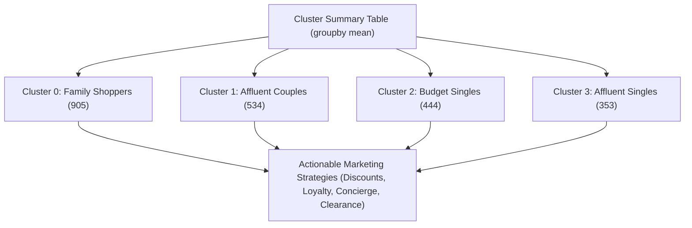

# Submodule 33.12: Cluster Summary & Customer Persona Profiling (Actionable Marketing Strategy)

## Topic Overview & Business Translation
The ultimate milestone of unsupervised learning is translating mathematical cluster coordinates into commercial customer personas and targeted business strategies. 

By grouping data by cluster labels and calculating feature means, we generate the comprehensive **Cluster Summary Matrix**.



---

## 1. The Full Cluster Summary Matrix
Reference: [smartcart.ipynb](file:///c:/Users/Shivam%20Keshari/OneDrive/Desktop/AI-ML/lecture_33/SmartCart_Project/smartcart.ipynb) (Cell 65).

```python
# Calculate comprehensive cluster summary means
cluster_summary = X.groupby("cluster").mean()
print(cluster_summary)
```

### Complete Numerical Feature Profiles:

| Feature | Cluster 0 (Red) | Cluster 1 (Blue) | Cluster 2 (Yellow) | Cluster 3 (Green) |
| :--- | :---: | :---: | :---: | :---: |
| **Customer Population** | **905** | **534** | **444** | **353** |
| **Income ($)** | \$39,681 | \$72,808 | \$36,960 | \$70,723 |
| **Total Spending ($)** | \$222 | \$1,237 | \$166 | \$1,190 |
| **Total Children** | **1.24** | **0.51** | **1.27** | **0.46** |
| **Living_With_Partner** | **1.00 (100%)** | **1.00 (100%)** | 0.007 (0.7%) | **0.00 (0%)** |
| **Living_With_Alone** | **0.00 (0%)** | **0.00 (0%)** | **0.993 (99.3%)** | **1.00 (100%)** |
| **Customer Age (Years)** | 55.7 | 59.5 | 55.7 | 58.9 |
| **Tenure (Days)** | 342.9 | 369.7 | 338.8 | 376.3 |
| **Recency (Days)** | 48.9 | 49.2 | 48.3 | 50.5 |
| **NumDealsPurchases** | **2.59** | 1.96 | **2.59** | 1.86 |
| **NumWebPurchases** | 3.15 | 5.69 | 2.71 | 5.79 |
| **NumCatalogPurchases** | 0.97 | **5.50** | 0.84 | **5.01** |
| **NumStorePurchases** | 4.14 | **8.66** | 3.62 | **8.43** |
| **NumWebVisitsMonth** | **6.31** | 3.58 | **6.66** | 3.73 |
| **Campaign Response Rate** | 7.6% | 16.7% | 14.2% | **32.0%** |
| **Complain Rate** | 1.1% | 0.6% | 1.1% | 0.6% |

---

## 2. In-Depth Persona Profiling & Business Strategies

### Persona 0: "Family Shoppers / Thrifty Couples" (Cluster 0)
- **Profile**: 905 customers (40.5%). Moderate/low income (\$39.7k), modest spending (\$222). 100% live with a partner and have multiple children (avg 1.24). High website visits (6.31/month) and high deal purchases (2.59). Very low response to standard campaigns (7.6%).
- **Business Rationale**: Higher household responsibilities leave minimal disposable income. They actively seek discounts to stretch household budgets.
- **Targeted Marketing Strategy**:
  1. Family-pack discount bundles and multi-buy grocery deals ("Buy 2, Get 1 Free").
  2. Targeted coupons sent prior to high-traffic weekend shopping days.
  3. School supplies and children's essentials promotional campaigns.

---

### Persona 1: "Affluent Couples / Established Spenders" (Cluster 1)
- **Profile**: 534 customers (23.9%). Highest household income (\$72.8k) and highest total spending (\$1,237). 100% live with a partner and have few children (avg 0.51). Dominant omnichannel spenders across physical stores (8.66) and catalogs (5.50). Low deal reliance (1.96).
- **Business Rationale**: Dual-income households with mature financial stability and high purchasing power.
- **Targeted Marketing Strategy**:
  1. Exclusive VIP Tiered Loyalty Program with anniversary and milestone rewards.
  2. Early access to premium product collections (fine wines, organic meat).
  3. Omnichannel store-pickup perks and luxury catalog mailers.

---

### Persona 2: "Budget Singles / Window Shoppers" (Cluster 2)
- **Profile**: 444 customers (19.9%). Lowest income (\$37.0k) and lowest spending (\$166). Nearly 100% live alone (single, divorced, or widowed) with children (avg 1.27 - single parents). Highest monthly web visits (6.66), yet lowest conversion across all channels.
- **Business Rationale**: Single parents under strict budgetary constraints browsing products without sufficient purchasing power.
- **Targeted Marketing Strategy**:
  1. Clearance flash sales and deep discount clearance events.
  2. Low-cost entry-level essentials and zero-interest installment payment options (BNPL).
  3. Free shipping thresholds and abandoned-cart incentive vouchers.

---

### Persona 3: "Affluent Singles / Golden Cluster" (Cluster 3)
- **Profile**: 353 customers (15.8%). High income (\$70.7k) and high expenditure (\$1,190). 100% live alone with low dependents (avg 0.46). **Staggering 32.0% Campaign Response Rate** (nearly double all other clusters!). High catalog (5.01) and web purchases (5.79).
- **Business Rationale**: Single professionals with substantial disposable income, high discretionary spending, and exceptional brand affinity.
- **Targeted Marketing Strategy**:
  1. 1-on-1 personalized product recommendations and concierge customer service.
  2. Luxury impulse drops and personalized email campaigns (highest ROI per marketing dollar).
  3. Subscription services for premium lifestyle and gourmet goods.

---

## 3. End-to-End Project Summary
In this project, we executed the full lifecycle of an enterprise unsupervised learning pipeline:
1. Handled missing data via median imputation.
2. Synthesized domain features (`Age`, `Customer_Tenure_Days`, `Total_Spending`, `Total_Children`, `Living_With`).
3. Managed dimensionality and pruned redundant features down to 15 clean columns.
4. Filtered demographic and financial outliers.
5. Standardized 18 encoded coordinates using `StandardScaler`.
6. Projected the space into 3D using PCA (~45% variance captured).
7. Validated $K=4$ using KneeLocator (Elbow Method) and Silhouette scoring.
8. Deployed Agglomerative Hierarchical Clustering with Ward linkage.
9. Built 4 actionable customer personas with data-backed commercial marketing playbooks.
