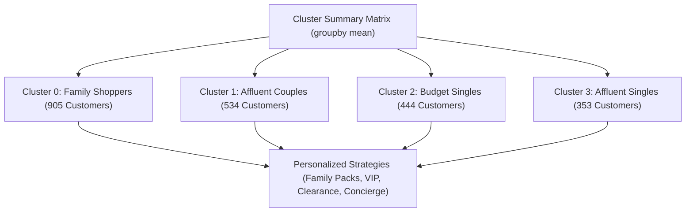

# Submodule 33.12: Cluster Summary & Customer Persona Profiling (Actionable Marketing Strategy) (Hinglish)

## Topic Overview & Business Translation
Unsupervised machine learning ka final goal sirf mathematical numbers nikalna nahi, balki un clusters ko real-world **Customer Personas** aur commercial business strategy mein translate karna hota hai.

Feature matrix ko cluster label se `groupby` karke mean calculate karne par **Cluster Summary Table** generate hota hai.



---

## 1. Complete Cluster Summary Table
Reference: [smartcart.ipynb](file:///c:/Users/Shivam%20Keshari/OneDrive/Desktop/AI-ML/lecture_33/SmartCart_Project/smartcart.ipynb) (Cell 65).

```python
# Cluster summary means display karna
cluster_summary = X.groupby("cluster").mean()
print(cluster_summary)
```

### Exact Feature Means Har Cluster ke liye:

| Feature | Cluster 0 (Red) | Cluster 1 (Blue) | Cluster 2 (Yellow) | Cluster 3 (Green) |
| :--- | :---: | :---: | :---: | :---: |
| **Customer Count** | **905** | **534** | **444** | **353** |
| **Income ($)** | \$39,681 | \$72,808 | \$36,960 | \$70,723 |
| **Total Spending ($)** | \$222 | \$1,237 | \$166 | \$1,190 |
| **Total Children** | **1.24** | **0.51** | **1.27** | **0.46** |
| **Living_With_Partner** | **1.00 (100%)** | **1.00 (100%)** | 0.007 (~0%) | **0.00 (0%)** |
| **Living_With_Alone** | **0.00 (0%)** | **0.00 (0%)** | **0.993 (~100%)** | **1.00 (100%)** |
| **Customer Age** | 55.7 | 59.5 | 55.7 | 58.9 |
| **Customer Tenure (Days)** | 342.9 | 369.7 | 338.8 | 376.3 |
| **Recency (Days)** | 48.9 | 49.2 | 48.3 | 50.5 |
| **NumDealsPurchases** | **2.59** | 1.96 | **2.59** | 1.86 |
| **NumWebPurchases** | 3.15 | 5.69 | 2.71 | 5.79 |
| **NumCatalogPurchases** | 0.97 | **5.50** | 0.84 | **5.01** |
| **NumStorePurchases** | 4.14 | **8.66** | 3.62 | **8.43** |
| **NumWebVisitsMonth** | **6.31** | 3.58 | **6.66** | 3.73 |
| **Campaign Response Rate** | 7.6% | 16.7% | 14.2% | **32.0%** |
| **Complain Rate** | 1.1% | 0.6% | 1.1% | 0.6% |

---

## 2. Four Customer Personas & Business Playbooks

### Persona 0: "Family Shoppers / Thrifty Couples" (Cluster 0)
- **Profile**: 905 customers (40.5%). Moderate/low income (\$39.7k), moderate spending (\$222). 100% partner ke sath rehte hain aur ghar mein bacche hain (avg 1.24). Monthly web visits high hain (6.31) aur deals purchases bhi high hain (2.59).
- **Behavior**: Family responsibilities zyada hain isliye disposable income kam hai. Budget stretch karne ke liye discounts dhundhte hain.
- **Marketing Strategy**:
  1. Family bundle discounts aur value packs ("Buy 1 Get 1 Free").
  2. Grocery aur household essentials par seasonal coupon codes.

---

### Persona 1: "Affluent Couples / Established Spenders" (Cluster 1)
- **Profile**: 534 customers (23.9%). Highest income (\$72.8k) aur highest spending (\$1,237). 100% partner ke sath rehte hain, bacche kam hain (avg 0.51). Physical stores (8.66) aur premium catalogs (5.50) se shopping karte hain.
- **Behavior**: Financial stability aur luxury lifestyle. Discounts par depend nahi karte.
- **Marketing Strategy**:
  1. Exclusive VIP Tiered Loyalty Program.
  2. Premium product categories (imported wines, gourmet food) ke personalized catalogs.

---

### Persona 2: "Budget Singles / Window Shoppers" (Cluster 2)
- **Profile**: 444 customers (19.9%). Sabse kam income (\$37.0k) aur sabse kam spending (\$166). Almost 100% akele rehte hain (single parents with avg 1.27 kids). Sabse zyada website visits (6.66/month) lekin actual purchases sabse kam.
- **Behavior**: Window shoppers jo site par aate hain par budget constraints ki wajah se buy nahi kar pate.
- **Marketing Strategy**:
  1. Clearance flash sales aur budget essentials.
  2. Buy Now Pay Later (BNPL) aur zero-interest installment options.
  3. Cart abandonment discount vouchers.

---

### Persona 3: "Affluent Singles / Golden Cluster" (Cluster 3)
- **Profile**: 353 customers (15.8%). High income (\$70.7k), high spending (\$1,190). 100% living alone, minimal kids (0.46). **Highest Campaign Response Rate (32.0%)** jo baki sabhi clusters se double hai!
- **Behavior**: Single high-earning individuals with massive disposable income. Brand ke marketing campaigns ko sabse actively respond karte hain. **Best ROI Cluster**!
- **Marketing Strategy**:
  1. 1-on-1 personalized recommendations aur VIP Concierge service.
  2. High-margin luxury impulse drops aur targeted app notifications.

---

## 3. Project Summary
Is minor project mein humne end-to-end complete ML system design kiya:
1. Missing income median imputation se handle ki.
2. Domain features (`Age`, `Tenure`, `Total_Spending`, `Total_Children`, `Living_With`) engineer kiye.
3. Redundant columns drop kiye aur 4 outliers filter kiye.
4. OneHotEncoder (bina drop first ke) aur StandardScaler apply kiya.
5. 3D PCA se variance visual analysis kiya.
6. KneeLocator aur Silhouette score se $K=4$ prove kiya.
7. Agglomerative Hierarchical Clustering deploy ki.
8. 4 distinct commercial personas build karke targeted marketing playbooks design kiye.
