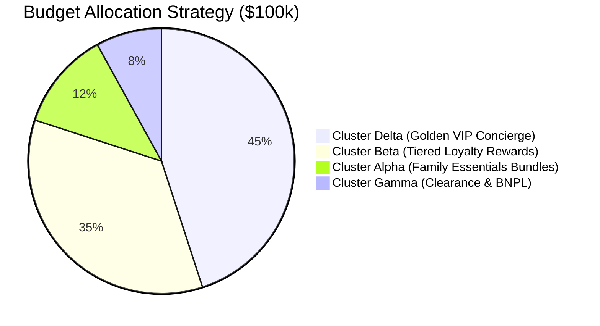

# Solutions: Day 33 Practice Problems Suite

## Solution to Case Study 1: Feature Transformation & RFM Pipeline Design

### 1. Mathematical Flaw of Raw Timestamps & Birth Years
In Euclidean distance spaces:
$$
d(u, v) = \sqrt{\sum_{i=1}^{p} (u_i - v_i)^2}
$$
1. **Raw Birth Year Scale Distortion**: Birth years (e.g., 1960 vs 1990) have squared differences $(1990 - 1960)^2 = 900$. However, birth year is an arbitrary origin-based interval metric. Translating it to `Age` ($2026 - \text{Year\_Birth}$) grounds the feature in direct life-cycle relevance.
2. **Raw Date String Incomputability**: Date strings (`"2021-08-14"`) cannot be parsed by inner products. If parsed as raw POSIX timestamps ($1.62 \times 10^9$ seconds), the enormous numerical magnitude completely dominates all other normalized features. Transforming dates into `Customer_Tenure_Days` yields an interpretable measure of loyalty duration.

### 2. Reproducibility Anchor Date
- **Pitfall**: Using dynamic current system time `datetime.now()` causes the tenure of every customer to increase dynamically every time the pipeline executes.
- **Solution**: Anchor the reference date strictly to the dataset maximum:
$$
\text{Reference Date} = \max(\text{Dt\_Customer})
$$
$$
\text{Customer\_Tenure\_Days}_i = (\text{Reference Date} - \text{Dt\_Customer}_i)
$$
This guarantees that running the pipeline on future compute clusters yields identical vector coordinates and identical cluster centroids.

### 3. The `drop_first=True` Fallacy in Clustering
- In OLS regression, the parameter vector is solved via normal equations:
$$
\hat{\beta} = (X^T X)^{-1} X^T y
$$
If all dummy columns are retained, $\sum_{j=1}^C D_j = \mathbf{1}$, causing $X^T X$ to be singular (non-invertible). Dropping the first dummy avoids this singularity.
- In unsupervised clustering, no matrix inversion occurs. Clustering measures the geometric distance between points:
$$
d(D_A, D_B) = \sqrt{(1 - 0)^2 + (0 - 1)^2} = \sqrt{2}
$$
If category 1 is dropped, points in category 1 become $(0, 0, \dots, 0)$, while categories 2 and 3 remain unit vectors. Consequently, the distance between category 1 and category 2 is:
$$
d(D_1, D_2) = \sqrt{(0 - 1)^2 + 0} = 1 \neq \sqrt{2}
$$
Dropping the first column destroys geometric symmetry. Therefore, in clustering, **all categorical levels must be retained** (`drop=None`).

---

## Solution to Case Study 2: Quantitative Hyperparameter Tuning

### 1. WCSS Formulation & Monotonicity
Within-Cluster Sum of Squares (Inertia) is defined as:
$$
\text{WCSS}(K) = \sum_{k=1}^{K} \sum_{x_i \in C_k} \| x_i - \mu_k \|^2
$$
- When $K=1$, all data points are measured against the global centroid $\mu$.
- When $K$ increases to $K+1$, splitting any cluster into two sub-centroids $\mu_{k1}, \mu_{k2}$ cannot increase variance because:
$$
\min_{\mu_1, \mu_2} \left( \sum_{x \in C_{k1}} \|x - \mu_1\|^2 + \sum_{x \in C_{k2}} \|x - \mu_2\|^2 \right) \le \sum_{x \in C_k} \|x - \mu_k\|^2
$$
- In the extreme limit where $K = N$, every data point becomes its own centroid ($x_i = \mu_i$), resulting in $\text{WCSS} = 0$. Hence, WCSS decreases monotonically with $K$.

### 2. `KneeLocator` Mathematical Formulation
The `KneeLocator` algorithm normalizes both $K$ and $\text{WCSS}$ onto the unit interval $[0, 1]$:
$$
x_{\text{norm}}(k) = \frac{k - k_{\min}}{k_{\max} - k_{\min}}, \quad y_{\text{norm}}(k) = \frac{\text{WCSS}(k) - \text{WCSS}_{\min}}{\text{WCSS}_{\max} - \text{WCSS}_{\min}}
$$
It constructs a diagonal reference chord between the first point $(0, 1)$ and last point $(1, 0)$:
$$
\text{Chord}(k) = 1 - x_{\text{norm}}(k)
$$
The knee is the index $k^*$ that maximizes the orthogonal perpendicular distance from the curve to the chord:
$$
k^* = \arg\max_k \left( \text{Chord}(k) - y_{\text{norm}}(k) \right)
$$

### 3. Metric Evaluation Table & Optimal Selection

| $K$ | WCSS | $\Delta \text{WCSS} = \text{WCSS}_{K-1} - \text{WCSS}_K$ | Silhouette Score |
| :---: | :---: | :---: | :---: |
| 2 | 24,500 | — | 0.38 |
| 3 | 16,800 | 7,700 | 0.42 |
| **4** | **11,200** | **5,600** | **0.45 (Maximum)** |
| 5 | 9,900 | 1,300 (Sharp deceleration) | 0.41 |
| 6 | 8,900 | 1,000 | 0.39 |
| 7 | 8,100 | 800 | 0.36 |
| 8 | 7,400 | 700 | 0.34 |

- **Marginal Drop Analysis**: Moving from $K=3 \to 4$ reduces WCSS by 5,600 units. Moving from $K=4 \to 5$ reduces WCSS by only 1,300 units (a 76.8% deceleration in variance reduction).
- **Silhouette Confirmation**: The global silhouette score peaks precisely at $K=4$ ($s = 0.45$).
- **Conclusion**: Both the Elbow Method and Silhouette Analysis unambiguously confirm **$K^* = 4$**.

---

## Solution to Case Study 3: Cluster Persona Strategy & Marketing ROI Optimization

### 1. Persona Mapping
1. **Cluster Alpha**: *"Family Shoppers / Thrifty Couples"* — Moderate income (\$38.5k), modest spend (\$210), high dependents (1.35), high browsing (6.8 visits), low responsiveness (6.5%).
2. **Cluster Beta**: *"Affluent Couples / Established Spenders"* — High income (\$74.2k), highest spending (\$1,280), low dependents (0.42), low browsing (3.4 visits), solid responsiveness (17.2%).
3. **Cluster Gamma**: *"Budget Singles / Window Shoppers"* — Lowest income (\$35.8k), lowest spend (\$155), single parents (1.40 kids), highest web visits (7.1), moderate response (13.8%).
4. **Cluster Delta**: *"Affluent Singles / Golden Cluster"* — High income (\$71.9k), high spend (\$1,210), minimal dependents (0.38), extraordinary response rate (**33.5%**).

### 2. Quantitative Justification of Delta as the "Golden Cluster"
Consider expected revenue generated per marketing contact:
- Expected Revenue per Contact:
$$
E[\text{Revenue}] = \text{Response Rate} \times \text{Mean Spend}
$$
- **Cluster Alpha**: $0.065 \times \$210 = \mathbf{\$13.65}$ per customer contacted.
- **Cluster Beta**: $0.172 \times \$1,280 = \mathbf{\$220.16}$ per customer contacted.
- **Cluster Gamma**: $0.138 \times \$155 = \mathbf{\$21.39}$ per customer contacted.
- **Cluster Delta**: $0.335 \times \$1,210 = \mathbf{\$405.35}$ per customer contacted!

**Finding**: Reaching out to a Cluster Delta customer yields **\$405.35 in expected return**, which is **1.84x higher than Beta** and **nearly 30x higher than Alpha**! This exceptional capital efficiency establishes Delta as the undisputed Golden Cluster.

### 3. Marketing Strategy & Budget Allocation (\$100,000 Total Budget)

1. **Cluster Delta (Allocation: \$45,000 / 45%)**:
   - High-touch 1-on-1 concierge marketing, personalized gourmet/luxury recommendations, private preview events.
2. **Cluster Beta (Allocation: \$35,000 / 35%)**:
   - VIP tiered loyalty program with milestone tier gifts and luxury physical catalog mailers.
3. **Cluster Alpha (Allocation: \$12,000 / 12%)**:
   - Automated email coupon campaigns, weekend family discount bundles, back-to-school essentials.
4. **Cluster Gamma (Allocation: \$8,000 / 8%)**:
   - Automated push notifications for clearance flash sales, abandoned cart recovery coupons, and BNPL installment promotions.
