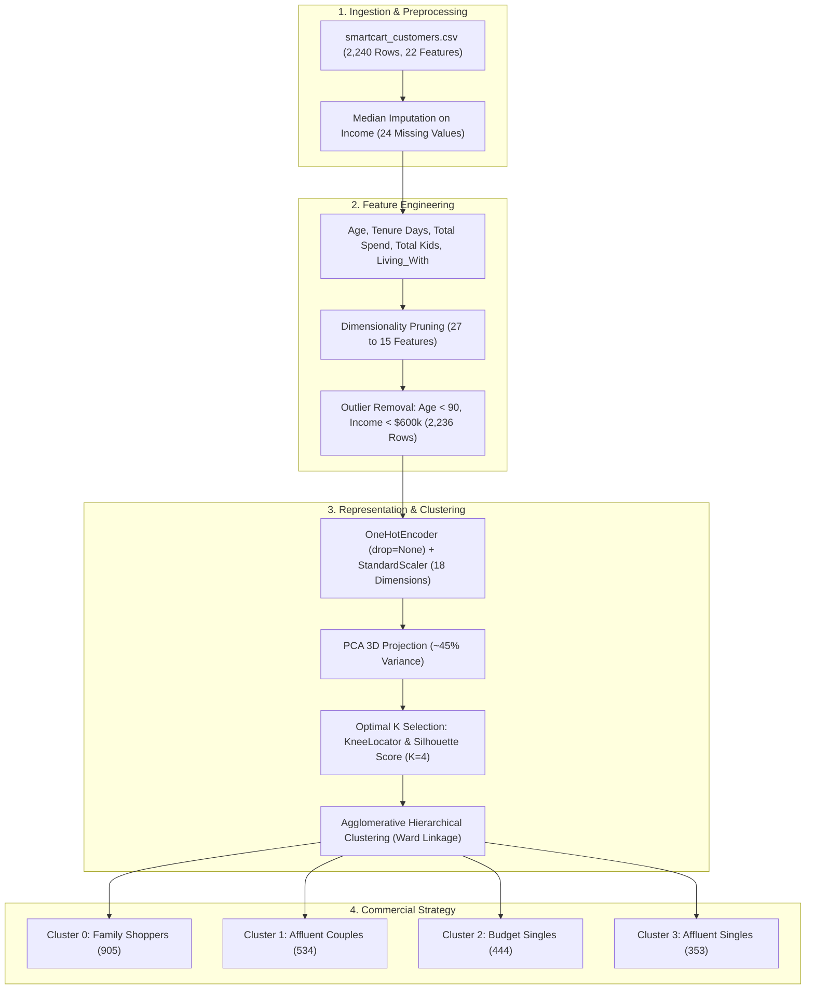

# Lecture 33: SmartCart Clustering System (End-to-End Minor Project)

## Course Module Overview
Welcome to **Lecture 33**, a comprehensive minor project applying **Unsupervised Machine Learning** to enterprise e-commerce customer segmentation. Throughout this project, we transition from raw transaction data to an operational clustering pipeline delivering four data-backed customer personas and targeted commercial marketing playbooks.

---

## Submodule Architecture & Directory Index

| Submodule | Topic & Technical Domain | Official Code & Assets Reference |
| :--- | :--- | :--- |
| **[Notes_33.01](file:///c:/Users/Shivam%20Keshari/OneDrive/Desktop/AI-ML/lecture_33/Notes_33.01/README.md)** | Project Introduction, Business Objectives & Exploratory Audit | Cells 00 - 04 in [`smartcart.ipynb`](file:///c:/Users/Shivam%20Keshari/OneDrive/Desktop/AI-ML/lecture_33/SmartCart_Project/smartcart.ipynb) |
| **[Notes_33.02](file:///c:/Users/Shivam%20Keshari/OneDrive/Desktop/AI-ML/lecture_33/Notes_33.02/README.md)** | Handling Missing Values: Statistical Median Imputation on Income | Cells 05 - 08 in [`smartcart.ipynb`](file:///c:/Users/Shivam%20Keshari/OneDrive/Desktop/AI-ML/lecture_33/SmartCart_Project/smartcart.ipynb) |
| **[Notes_33.03](file:///c:/Users/Shivam%20Keshari/OneDrive/Desktop/AI-ML/lecture_33/Notes_33.03/README.md)** | Feature Engineering: Domain Synthesis of Age, Tenure, Spend & Family | Cells 09 - 15 in [`smartcart.ipynb`](file:///c:/Users/Shivam%20Keshari/OneDrive/Desktop/AI-ML/lecture_33/SmartCart_Project/smartcart.ipynb) |
| **[Notes_33.04](file:///c:/Users/Shivam%20Keshari/OneDrive/Desktop/AI-ML/lecture_33/Notes_33.04/README.md)** | Dropping Redundant Columns & Dimensionality Management | Cells 16 - 20 in [`smartcart.ipynb`](file:///c:/Users/Shivam%20Keshari/OneDrive/Desktop/AI-ML/lecture_33/SmartCart_Project/smartcart.ipynb) |
| **[Notes_33.05](file:///c:/Users/Shivam%20Keshari/OneDrive/Desktop/AI-ML/lecture_33/Notes_33.05/README.md)** | Handling Outliers: Pairplots & Demographic/Financial Bounds | Cells 21 - 23 in [`smartcart.ipynb`](file:///c:/Users/Shivam%20Keshari/OneDrive/Desktop/AI-ML/lecture_33/SmartCart_Project/smartcart.ipynb) |
| **[Notes_33.06](file:///c:/Users/Shivam%20Keshari/OneDrive/Desktop/AI-ML/lecture_33/Notes_33.06/README.md)** | Feature Correlation Matrix & Pearson Heatmap Analysis | Cells 24 - 28 in [`smartcart.ipynb`](file:///c:/Users/Shivam%20Keshari/OneDrive/Desktop/AI-ML/lecture_33/SmartCart_Project/smartcart.ipynb) |
| **[Notes_33.07](file:///c:/Users/Shivam%20Keshari/OneDrive/Desktop/AI-ML/lecture_33/Notes_33.07/README.md)** | Categorical Feature Encoding (OneHotEncoder) & Scaling (StandardScaler) | Cells 29 - 39 in [`smartcart.ipynb`](file:///c:/Users/Shivam%20Keshari/OneDrive/Desktop/AI-ML/lecture_33/SmartCart_Project/smartcart.ipynb) |
| **[Notes_33.08](file:///c:/Users/Shivam%20Keshari/OneDrive/Desktop/AI-ML/lecture_33/Notes_33.08/README.md)** | High-Dimensional Data Visualization: PCA 2D vs 3D Projections | Cells 40 - 45 in [`smartcart.ipynb`](file:///c:/Users/Shivam%20Keshari/OneDrive/Desktop/AI-ML/lecture_33/SmartCart_Project/smartcart.ipynb) |
| **[Notes_33.09](file:///c:/Users/Shivam%20Keshari/OneDrive/Desktop/AI-ML/lecture_33/Notes_33.09/README.md)** | Optimal Cluster Selection: KneeLocator (Elbow Method) & Silhouette Score | Cells 46 - 53 in [`smartcart.ipynb`](file:///c:/Users/Shivam%20Keshari/OneDrive/Desktop/AI-ML/lecture_33/SmartCart_Project/smartcart.ipynb) |
| **[Notes_33.10](file:///c:/Users/Shivam%20Keshari/OneDrive/Desktop/AI-ML/lecture_33/Notes_33.10/README.md)** | Clustering Execution: K-Means vs Agglomerative Hierarchical Clustering | Cells 54 - 59 in [`smartcart.ipynb`](file:///c:/Users/Shivam%20Keshari/OneDrive/Desktop/AI-ML/lecture_33/SmartCart_Project/smartcart.ipynb) |
| **[Notes_33.11](file:///c:/Users/Shivam%20Keshari/OneDrive/Desktop/AI-ML/lecture_33/Notes_33.11/README.md)** | Cluster Characterization: Income vs Spending Behavioral Patterns | Cells 60 - 64 in [`smartcart.ipynb`](file:///c:/Users/Shivam%20Keshari/OneDrive/Desktop/AI-ML/lecture_33/SmartCart_Project/smartcart.ipynb) |
| **[Notes_33.12](file:///c:/Users/Shivam%20Keshari/OneDrive/Desktop/AI-ML/lecture_33/Notes_33.12/README.md)** | Cluster Summary Matrix & Four Customer Persona Profiling Playbooks | Cells 65 - 66 in [`smartcart.ipynb`](file:///c:/Users/Shivam%20Keshari/OneDrive/Desktop/AI-ML/lecture_33/SmartCart_Project/smartcart.ipynb) |
| **[SmartCart_Project](file:///c:/Users/Shivam%20Keshari/OneDrive/Desktop/AI-ML/lecture_33/SmartCart_Project/README.md)** | Complete Project Hub: Jupyter Notebook, Raw Dataset & Assignment Brief | [`smartcart.ipynb`](file:///c:/Users/Shivam%20Keshari/OneDrive/Desktop/AI-ML/lecture_33/SmartCart_Project/smartcart.ipynb), [`smartcart_customers.csv`](file:///c:/Users/Shivam%20Keshari/OneDrive/Desktop/AI-ML/lecture_33/SmartCart_Project/smartcart_customers.csv) |
| **[Practice_Problems](file:///c:/Users/Shivam%20Keshari/OneDrive/Desktop/AI-ML/lecture_33/Practice_Problems/README.md)** | Three Industry Case Studies with Complete Mathematical Solutions | [`Solutions.md`](file:///c:/Users/Shivam%20Keshari/OneDrive/Desktop/AI-ML/lecture_33/Practice_Problems/Solutions.md) |

---

## Production Persona Summary ($N = 2,236$ Customers)
- **Cluster 0 (40.5% - 905 Customers)**: *"Family Shoppers / Thrifty Couples"* — Moderate income (\$39.7k), moderate spend (\$222), multiple children (1.24), discount coupon seekers.
- **Cluster 1 (23.9% - 534 Customers)**: *"Affluent Couples / Established Spenders"* — High income (\$72.8k), high spend (\$1,237), low children (0.51), dominant physical store and catalog buyers.
- **Cluster 2 (19.9% - 444 Customers)**: *"Budget Singles / Window Shoppers"* — Lowest income (\$37.0k), lowest spend (\$166), single parents (1.27 kids), highest web browsing with low conversion.
- **Cluster 3 (15.8% - 353 Customers)**: *"Affluent Singles / Golden Cluster"* — High income (\$70.7k), high spend (\$1,190), living alone, **Highest Campaign Response (32.0%)** delivering maximum marketing ROI.
