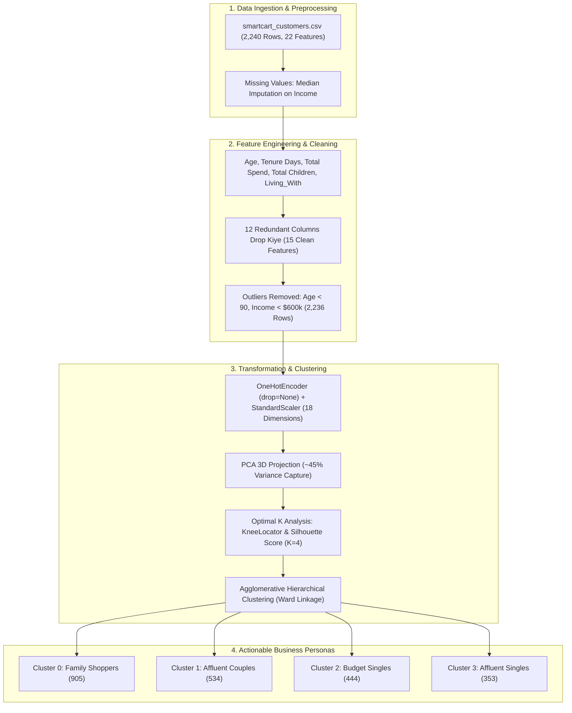

# Lecture 33: SmartCart Clustering System (End-to-End Minor Project) (Hinglish)

## Course Module Overview
**Lecture 33** mein humne **Unsupervised Machine Learning** ka sabse important practical commercial application — **Customer Segmentation System** — end-to-end design aur build kiya hai.

Raw transaction dataset (`smartcart_customers.csv`) se lekar feature engineering, PCA 3D visualization, hyperparameter tuning, Agglomerative Hierarchical Clustering, aur **4 distinct customer personas** ke commercial marketing playbooks tak sabhi steps systematically cover kiye gaye hain.

---

## Submodule Architecture & Index

| Submodule | Topic & Coverage | Notebook Code Reference |
| :--- | :--- | :--- |
| **[Notes_33.01](file:///c:/Users/Shivam%20Keshari/OneDrive/Desktop/AI-ML/lecture_33/Notes_33.01/README_HINGLISH.md)** | Project Intro, Business Problem & Dataset Audit | Cells 00 - 04 in [`smartcart.ipynb`](file:///c:/Users/Shivam%20Keshari/OneDrive/Desktop/AI-ML/lecture_33/SmartCart_Project/smartcart.ipynb) |
| **[Notes_33.02](file:///c:/Users/Shivam%20Keshari/OneDrive/Desktop/AI-ML/lecture_33/Notes_33.02/README_HINGLISH.md)** | Missing Values Handling: Income par Median Imputation | Cells 05 - 08 in [`smartcart.ipynb`](file:///c:/Users/Shivam%20Keshari/OneDrive/Desktop/AI-ML/lecture_33/SmartCart_Project/smartcart.ipynb) |
| **[Notes_33.03](file:///c:/Users/Shivam%20Keshari/OneDrive/Desktop/AI-ML/lecture_33/Notes_33.03/README_HINGLISH.md)** | Feature Engineering: Age, Tenure, Total Spend, Children, Living_With | Cells 09 - 15 in [`smartcart.ipynb`](file:///c:/Users/Shivam%20Keshari/OneDrive/Desktop/AI-ML/lecture_33/SmartCart_Project/smartcart.ipynb) |
| **[Notes_33.04](file:///c:/Users/Shivam%20Keshari/OneDrive/Desktop/AI-ML/lecture_33/Notes_33.04/README_HINGLISH.md)** | Redundant Columns Drop karna & Curse of Dimensionality | Cells 16 - 20 in [`smartcart.ipynb`](file:///c:/Users/Shivam%20Keshari/OneDrive/Desktop/AI-ML/lecture_33/SmartCart_Project/smartcart.ipynb) |
| **[Notes_33.05](file:///c:/Users/Shivam%20Keshari/OneDrive/Desktop/AI-ML/lecture_33/Notes_33.05/README_HINGLISH.md)** | Outlier Detection via Pairplots & Filtering Bounds | Cells 21 - 23 in [`smartcart.ipynb`](file:///c:/Users/Shivam%20Keshari/OneDrive/Desktop/AI-ML/lecture_33/SmartCart_Project/smartcart.ipynb) |
| **[Notes_33.06](file:///c:/Users/Shivam%20Keshari/OneDrive/Desktop/AI-ML/lecture_33/Notes_33.06/README_HINGLISH.md)** | Correlation Heatmap Analysis & Feature Insights | Cells 24 - 28 in [`smartcart.ipynb`](file:///c:/Users/Shivam%20Keshari/OneDrive/Desktop/AI-ML/lecture_33/SmartCart_Project/smartcart.ipynb) |
| **[Notes_33.07](file:///c:/Users/Shivam%20Keshari/OneDrive/Desktop/AI-ML/lecture_33/Notes_33.07/README_HINGLISH.md)** | OneHotEncoder (bina drop first ke) & StandardScaler | Cells 29 - 39 in [`smartcart.ipynb`](file:///c:/Users/Shivam%20Keshari/OneDrive/Desktop/AI-ML/lecture_33/SmartCart_Project/smartcart.ipynb) |
| **[Notes_33.08](file:///c:/Users/Shivam%20Keshari/OneDrive/Desktop/AI-ML/lecture_33/Notes_33.08/README_HINGLISH.md)** | High-Dimensional Data Visualization: PCA 2D vs 3D | Cells 40 - 45 in [`smartcart.ipynb`](file:///c:/Users/Shivam%20Keshari/OneDrive/Desktop/AI-ML/lecture_33/SmartCart_Project/smartcart.ipynb) |
| **[Notes_33.09](file:///c:/Users/Shivam%20Keshari/OneDrive/Desktop/AI-ML/lecture_33/Notes_33.09/README_HINGLISH.md)** | Optimal K Selection: Elbow Method (KneeLocator) & Silhouette Score | Cells 46 - 53 in [`smartcart.ipynb`](file:///c:/Users/Shivam%20Keshari/OneDrive/Desktop/AI-ML/lecture_33/SmartCart_Project/smartcart.ipynb) |
| **[Notes_33.10](file:///c:/Users/Shivam%20Keshari/OneDrive/Desktop/AI-ML/lecture_33/Notes_33.10/README_HINGLISH.md)** | Clustering: K-Means vs Agglomerative Hierarchical Clustering | Cells 54 - 59 in [`smartcart.ipynb`](file:///c:/Users/Shivam%20Keshari/OneDrive/Desktop/AI-ML/lecture_33/SmartCart_Project/smartcart.ipynb) |
| **[Notes_33.11](file:///c:/Users/Shivam%20Keshari/OneDrive/Desktop/AI-ML/lecture_33/Notes_33.11/README_HINGLISH.md)** | Cluster Characterization: Spending vs Income Patterns | Cells 60 - 64 in [`smartcart.ipynb`](file:///c:/Users/Shivam%20Keshari/OneDrive/Desktop/AI-ML/lecture_33/SmartCart_Project/smartcart.ipynb) |
| **[Notes_33.12](file:///c:/Users/Shivam%20Keshari/OneDrive/Desktop/AI-ML/lecture_33/Notes_33.12/README_HINGLISH.md)** | Cluster Summary Table & 4 Customer Persona Playbooks | Cells 65 - 66 in [`smartcart.ipynb`](file:///c:/Users/Shivam%20Keshari/OneDrive/Desktop/AI-ML/lecture_33/SmartCart_Project/smartcart.ipynb) |
| **[SmartCart_Project](file:///c:/Users/Shivam%20Keshari/OneDrive/Desktop/AI-ML/lecture_33/SmartCart_Project/README_HINGLISH.md)** | Dedicated Project Directory: Notebook, Dataset, Assignment PDF | [`smartcart.ipynb`](file:///c:/Users/Shivam%20Keshari/OneDrive/Desktop/AI-ML/lecture_33/SmartCart_Project/smartcart.ipynb), [`smartcart_customers.csv`](file:///c:/Users/Shivam%20Keshari/OneDrive/Desktop/AI-ML/lecture_33/SmartCart_Project/smartcart_customers.csv) |
| **[Practice_Problems](file:///c:/Users/Shivam%20Keshari/OneDrive/Desktop/AI-ML/lecture_33/Practice_Problems/README_HINGLISH.md)** | 3 Industry Case Studies with Detailed Solutions | [`Solutions_HINGLISH.md`](file:///c:/Users/Shivam%20Keshari/OneDrive/Desktop/AI-ML/lecture_33/Practice_Problems/Solutions_HINGLISH.md) |

---

## 4 Customer Personas Summary ($N = 2,236$)
- **Cluster 0 (40.5% - 905)**: *"Family Shoppers / Thrifty Couples"* — Moderate income (\$39.7k), moderate spend (\$222), bacchon ki sankhya (1.24), discount coupons seeker.
- **Cluster 1 (23.9% - 534)**: *"Affluent Couples / Established Spenders"* — High income (\$72.8k), high spend (\$1,237), physical store aur catalog shoppers.
- **Cluster 2 (19.9% - 444)**: *"Budget Singles / Window Shoppers"* — Low income (\$37.0k), low spend (\$166), single parents (1.27 kids), high web visits par low conversion.
- **Cluster 3 (15.8% - 353)**: *"Affluent Singles / Golden Cluster"* — High income (\$70.7k), high spend (\$1,190), living alone, **Highest Campaign Response (32.0%)** with maximum marketing ROI.
