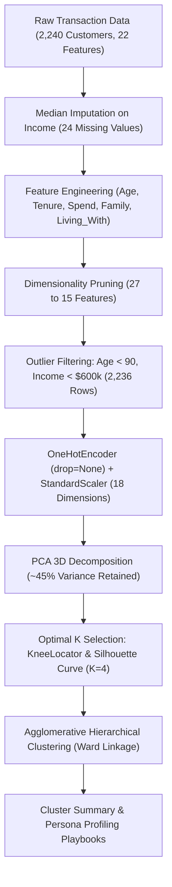

# SmartCart Customer Clustering System (Minor Project)

## Project Overview
The **SmartCart Clustering System** is an enterprise-grade unsupervised machine learning project designed to solve a critical commercial retail challenge: transitioning from indiscriminate mass marketing ("spray-and-pray") to personalized, data-driven customer segmentation. 

By analyzing multi-dimensional customer transaction records, demographic structures, and purchasing channels, this system partitions an e-commerce customer base of 2,240 records into four high-cohesion, actionable behavioral personas.

---

## 1. Project Directory & Assets
- **Jupyter Notebook**: [`smartcart.ipynb`](file:///c:/Users/Shivam%20Keshari/OneDrive/Desktop/AI-ML/lecture_33/SmartCart_Project/smartcart.ipynb) — 67 fully executable notebook cells detailing the complete pipeline.
- **Dataset**: [`smartcart_customers.csv`](file:///c:/Users/Shivam%20Keshari/OneDrive/Desktop/AI-ML/lecture_33/SmartCart_Project/smartcart_customers.csv) — 2,240 raw customer records across 22 attributes.
- **Assignment Brief**: [`SmartCart_Clustering_System.pdf`](file:///c:/Users/Shivam%20Keshari/OneDrive/Desktop/AI-ML/lecture_33/SmartCart_Project/SmartCart_Clustering_System.pdf) — Official minor project specifications and problem statement.

---

## 2. Complete End-to-End Pipeline Architecture

### Phase 1: Exploratory Audit & Missing Data Imputation
- Dataset dimensions: 2,240 rows, 22 columns.
- `Income` missingness: Exactly 24 null values imputed using the distribution median ($M$) to withstand positive skewness and high-earner outliers.

### Phase 2: Feature Engineering & Domain Transformations
1. **`Age`**: Derived as $2026 - \text{Year\_Birth}$.
2. **`Customer_Tenure_Days`**: Anchored against $\max(\text{Dt\_Customer})$ rather than dynamic clock time to ensure pipeline reproducibility across runtime environments.
3. **`Total_Spending`**: Consolidated sum across 6 expenditure categories (`MntWines`, `MntFruits`, `MntMeatProducts`, `MntFishProducts`, `MntSweetProducts`, `MntGoldProds`).
4. **`Total_Children`**: Sum of young children (`Kidhome`) and teenagers (`Teenhome`).
5. **`Education` Mapping**: Simplified into 3 tiers (`Undergraduate`, `Graduate`, `Postgraduate`).
6. **`Living_With` Mapping**: Consolidated into `Partner` vs `Alone`.

### Phase 3: Dimensionality Pruning & Outlier Elimination
- Dropped 12 redundant/replaced columns (`ID`, `Year_Birth`, `Marital_Status`, `Kidhome`, `Teenhome`, `Dt_Customer`, and the 6 individual spending columns), reducing feature count to 15.
- Retained purchasing channels (`NumDealsPurchases`, `NumWebPurchases`, `NumCatalogPurchases`, `NumStorePurchases`).
- Filtered 4 extreme anomalies ($\text{Age} < 90$ and $\text{Income} < \$600,000$), preserving 2,236 clean customer records.

### Phase 4: Encoding & Standardization
- Encoded `Education` and `Living_With` via `OneHotEncoder(drop=None)` to preserve equidistant vector space geometry across categorical levels.
- Applied `StandardScaler` ($z = (x - \mu) / \sigma$) across all 18 feature coordinates.

### Phase 5: PCA & Hyperparameter Tuning
- Conducted 3-component PCA capturing **44.95%** of cumulative variance.
- Identified the convex elbow at $K = 4$ via `KneeLocator` on WCSS (Inertia).
- Corroborated $K = 4$ through silhouette score evaluation.

### Phase 6: Model Selection & Customer Profiling
- Evaluated K-Means vs Agglomerative Hierarchical Clustering.
- Selected **Agglomerative Clustering with Ward's linkage** due to superior geometric separation in 3D PCA projection.

---

## 3. Production Cluster Summary Table ($N = 2,236$)

| Feature | Cluster 0 (Red) | Cluster 1 (Blue) | Cluster 2 (Yellow) | Cluster 3 (Green) |
| :--- | :---: | :---: | :---: | :---: |
| **Customer Population** | **905 (40.5%)** | **534 (23.9%)** | **444 (19.9%)** | **353 (15.8%)** |
| **Household Income ($)** | \$39,681 | \$72,808 | \$36,960 | \$70,723 |
| **Total Spending ($)** | \$222 | \$1,237 | \$166 | \$1,190 |
| **Total Children** | **1.24** | **0.51** | **1.27** | **0.46** |
| **Living With Partner** | **100%** | **100%** | 0.7% | **0.0%** |
| **Living Alone** | **0.0%** | **0.0%** | **99.3%** | **100%** |
| **NumStorePurchases** | 4.14 | **8.66** | 3.62 | **8.43** |
| **NumCatalogPurchases** | 0.97 | **5.50** | 0.84 | **5.01** |
| **NumWebVisitsMonth** | **6.31** | 3.58 | **6.66** | 3.73 |
| **Deals Purchases** | **2.59** | 1.96 | **2.59** | 1.86 |
| **Campaign Response Rate** | 7.6% | 16.7% | 14.2% | **32.0%** |

---

## 4. Actionable Customer Persona Playbooks
1. **Cluster 0 — "Family Shoppers / Thrifty Couples"**: Target with bulk grocery value packs, weekend discount coupons, and family bundle promotions.
2. **Cluster 1 — "Affluent Couples / Established Spenders"**: Target with VIP loyalty programs, premium lifestyle catalogs, and early access to luxury collections.
3. **Cluster 2 — "Budget Singles / Window Shoppers"**: Target with clearance flash sales, cart abandonment vouchers, and zero-interest installment options.
4. **Cluster 3 — "Affluent Singles / Golden Cluster"**: Target with bespoke 1-on-1 concierge recommendations, gourmet subscriptions, and high-margin impulse offers (Highest ROI).
