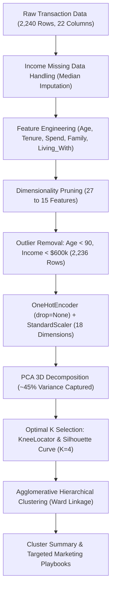

# SmartCart Customer Clustering System (Minor Project) (Hinglish)

## Project Overview
**SmartCart Clustering System** ek comprehensive unsupervised machine learning minor project hai jisme e-commerce retail platform ke generic marketing ("spray-and-pray") problem ko data-driven customer segmentation se solve kiya gaya hai.

Customer demographics, purchasing spend, channels aur engagement ke 22 attributes ko analyze karke 2,240 customer records ko **4 actionable business personas** mein group kiya gaya hai.

---

## 1. Project Files & Directory Structure
- **Jupyter Notebook**: [`smartcart.ipynb`](file:///c:/Users/Shivam%20Keshari/OneDrive/Desktop/AI-ML/lecture_33/SmartCart_Project/smartcart.ipynb) — 67 sequential executable cells jo end-to-end pipeline execute karte hain.
- **Dataset**: [`smartcart_customers.csv`](file:///c:/Users/Shivam%20Keshari/OneDrive/Desktop/AI-ML/lecture_33/SmartCart_Project/smartcart_customers.csv) — 2,240 raw customer transactions.
- **Assignment PDF**: [`SmartCart_Clustering_System.pdf`](file:///c:/Users/Shivam%20Keshari/OneDrive/Desktop/AI-ML/lecture_33/SmartCart_Project/SmartCart_Clustering_System.pdf) — Project assignment specifications.

---

## 2. Complete End-to-End Pipeline Summary

### Phase 1: Exploratory Audit & Missing Imputation
- `Income` column ke 24 missing values ko median se fill kiya gaya taaki outliers mean ko skew na karein.

### Phase 2: Feature Engineering
1. **`Age`**: $2026 - \text{Year\_Birth}$.
2. **`Customer_Tenure_Days`**: Reproducibility ke liye $\max(\text{Dt\_Customer})$ se anchor kiya gaya.
3. **`Total_Spending`**: 6 categories (`MntWines`, `MntFruits`, `MntMeatProducts`, `MntFishProducts`, `MntSweetProducts`, `MntGoldProds`) ka sum.
4. **`Total_Children`**: `Kidhome` + `Teenhome`.
5. **`Education` Mapping**: 3 categories (`Undergraduate`, `Graduate`, `Postgraduate`).
6. **`Living_With` Mapping**: 2 categories (`Partner` vs `Alone`).

### Phase 3: Dimensionality Pruning & Outliers
- 12 redundant columns drop kiye (15 features bache).
- Outliers filter: $\text{Age} < 90$ aur $\text{Income} < 600,000$ (2,236 rows preserve hue).

### Phase 4: Encoding & Scaling
- `OneHotEncoder(drop=None)` use karke 18 dimensions banaye.
- `StandardScaler` apply kiya.

### Phase 5: PCA & Optimal K
- 3D PCA ne **44.95%** variance capture kiya.
- `KneeLocator` ne $K=4$ identify kiya jise Silhouette Score ne corroborate kiya.

### Phase 6: Clustering & Persona Profiling
- Agglomerative Hierarchical Clustering (Ward linkage) ne K-Means se superior separation dikhai.
- 4 actionable personas generate kiye gaye.

---

## 3. Production Cluster Summary Table ($N = 2,236$)

| Feature | Cluster 0 (Red) | Cluster 1 (Blue) | Cluster 2 (Yellow) | Cluster 3 (Green) |
| :--- | :---: | :---: | :---: | :---: |
| **Customer Population** | **905 (40.5%)** | **534 (23.9%)** | **444 (19.9%)** | **353 (15.8%)** |
| **Income ($)** | \$39,681 | \$72,808 | \$36,960 | \$70,723 |
| **Total Spending ($)** | \$222 | \$1,237 | \$166 | \$1,190 |
| **Total Children** | **1.24** | **0.51** | **1.27** | **0.46** |
| **Living With Partner** | **100%** | **100%** | 0.7% | **0.0%** |
| **Living Alone** | **0.0%** | **0.0%** | **99.3%** | **100%** |
| **NumStorePurchases** | 4.14 | **8.66** | 3.62 | **8.43** |
| **NumCatalogPurchases** | 0.97 | **5.50** | 0.84 | **5.01** |
| **NumWebVisitsMonth** | **6.31** | 3.58 | **6.66** | 3.73 |
| **Deals Purchases** | **2.59** | 1.96 | **2.59** | 1.86 |
| **Campaign Response Rate** | 7.6% | 16.7% | 14.2% | **32.0%** |

---

## 4. Four Customer Personas & Marketing Playbooks
1. **Cluster 0 — Family Shoppers**: Family bundle discounts, buy-one-get-one coupons, grocery packs.
2. **Cluster 1 — Affluent Couples**: VIP loyalty rewards, luxury catalog previews, exclusive store privileges.
3. **Cluster 2 — Budget Singles**: Clearance sales, BNPL installments, abandoned cart incentive vouchers.
4. **Cluster 3 — Affluent Singles (Golden Cluster)**: 1-on-1 concierge service, personalized luxury drops (**Highest ROI, 32% Response Rate**).
