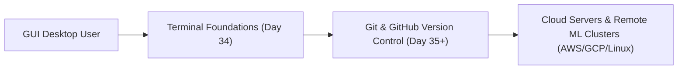

# Submodule 34.01: What Will We Learn? (Terminal Foundations)

## Topic Overview & Developer Context
In modern software engineering, data science, and artificial intelligence, the **Terminal** is an indispensable tool. Before diving into **Git** and **GitHub** for version control and collaborative teamwork, developers must develop a strong, intuitive mastery of the terminal environment. 

Every version control workflow, server configuration, automated deployment pipeline, and machine learning cluster interaction relies fundamentally on text-based command execution.



---

## 1. Why Terminal Mastery Precedes Git & GitHub
- **Underlying Mechanism**: Git is primarily a **Command Line Interface (CLI)** tool. While visual GUI wrappers exist, production workflows, cloud CI/CD pipelines, and server hooks operate strictly through terminal commands.
- **Workflow Speed**: Navigating directories, staging changes, branching, and resolving merge conflicts is drastically faster via the terminal.
- **Universal Standard**: Terminal commands form a universal language understood across macOS, Linux distros (Ubuntu, Debian, CentOS), and Windows developer environments.

---

## 2. Curriculum Roadmap for Day 34
Throughout this module, we systematically master the core terminal operations:
1. **Mental Model & Jargon**: Clarifying the differences between Terminal, Console, Shell (Bash, Zsh), and CLI.
2. **Environment Setup**: Installing and configuring **Git Bash** for Windows users to provide a seamless POSIX/Unix emulation layer.
3. **Inspection Commands**: `pwd` (print working directory), `ls` (list files), and `clear`.
4. **Navigation**: `cd`, relative navigation (`..`), and home directory jumps (`~`).
5. **Path Resolution**: Absolute paths vs. relative paths.
6. **Directory Management**: `mkdir` for single and nested directory trees.
7. **Command Modification via Flags**: Understanding options (`ls -l`, `ls -a`, `ls -la`), and reading manuals (`man`).
8. **File Instantiation**: The `touch` command for creating files and updating access timestamps.
9. **Deletion & Safety Protocols**: `rm`, `rmdir`, recursive deletion (`rm -r`), and force deletion safeguards (`rm -rf`).

---

## 3. Practice Directory Setup
To follow along with the hands-on demonstrations, create a sandbox folder structure on your Desktop:
```bash
# Example demonstration structure
Delta/
├── CSS/
│   ├── chapter0/
│   └── chapter1/
├── JS/
└── README.md
```
You can create arbitrary folder names (`ABC`, `Project`, etc.) and files (`index.html`, `style.css`, `app.js`). The core shell commands operate identically across all folder hierarchies.
