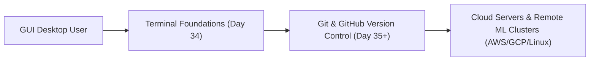

# Submodule 34.01: What Will We Learn? (Terminal Foundations) (Hinglish)

## Topic Overview & Developer Context
Software engineering, data science aur AI/ML ke andar **Terminal** sabse fundamental aur powerful tool hota hai. **Git** aur **GitHub** ko detail mein seekhne se pehle terminal commands ki solid understanding hona mandatory hai.

Git commands, cloud server management, Docker containers aur remote Linux clusters sabhi text-based terminal par hi chalte hain.



---

## 1. Git se Pehle Terminal Kyun Zaroori Hai?
- **Git ka Real Power CLI mein Hai**: Git primarily command line tool hai. Production servers aur CI/CD pipelines par koi Graphical User Interface (GUI) nahi hota, wahan sirf terminal access milti hai.
- **Developer Efficiency**: Folders create karna, files search karna, branches switch karna aur scripts run karna terminal se 10x fast hota hai.
- **Universal Environment**: Chahe aap Mac use kar rahe hon, Linux use kar rahe hon ya Windows, terminal commands ek universal standard set karti hain.

---

## 2. Day 34 Curriculum Roadmap
Is module mein hum step-by-step terminal ke core concepts cover karenge:
1. **Core Jargon**: Terminal, Console, Shell, aur Command Line Interface (CLI) ke exact differences.
2. **Environment Setup**: Windows users ke liye **Git Bash** installation taaki unhe full Unix/POSIX environment mile.
3. **Basic Commands**: `pwd` (print working directory), `ls` (list files), aur `clear`.
4. **Navigation**: `cd` (change directory), `..` (back button), aur `~` (home directory).
5. **Path Resolution**: Absolute Path vs Relative Path ka difference.
6. **Directory Creation**: `mkdir` se naye folders banana.
7. **Command Flags**: Options aur flags (`ls -l`, `ls -a`, `ls -la`), aur `man` command.
8. **File Creation**: `touch` command se nayi empty files banana aur timestamps update karna.
9. **Deletion & Safety**: `rm`, `rmdir`, recursive deletion (`rm -r`), aur force delete (`rm -rf`) ki precautions.

---

## 3. Practice Folder Setup
Lecture ke sath practice karne ke liye aap apne desktop par ek sample folder structure bana sakte hain:
```bash
Delta/
├── CSS/
│   ├── chapter0/
│   └── chapter1/
├── JS/
└── README.md
```
Aap kisi bhi naam ka folder bana sakte hain, command syntax sabhi folders par identically work karta hai.
