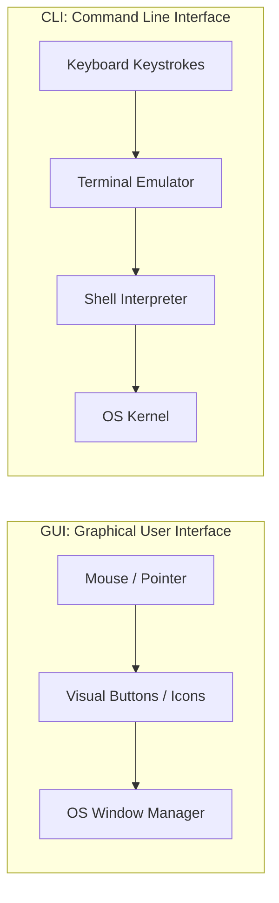

# Submodule 34.02: What is the Terminal? GUI vs CLI, Speed, and System Internals

## Topic Overview & Definition
A **Terminal** is a text-based input and output environment that allows a user to interact directly with the computer's underlying operating system. Instead of interacting with graphical elements (windows, icons, buttons), the user types text commands via a keyboard, and the system executes them, outputting textual responses.

---

## 1. GUI vs CLI: Operational Comparison

| Feature | Graphical User Interface (GUI) | Command Line Interface (CLI / Terminal) |
| :--- | :--- | :--- |
| **Input Mechanism** | Mouse pointer, clicking, dragging, menus. | Pure keyboard text input, commands, and flags. |
| **System Overhead** | High (rendering desktop graphics, window managers). | Extremely low (minimal memory and CPU usage). |
| **Automation** | Difficult to automate; requires repetitive manual clicking. | Trivially automated via Bash/Zsh scripts and cron jobs. |
| **Repetitive Tasks** | Slow (creating 50 folders requires 50 right-clicks). | Instant (`mkdir folder_{1..50}`). |
| **Remote Access** | Requires heavy VNC/RDP network bandwidth. | Instant and lightweight via Secure Shell (`ssh`). |
| **Hidden Features** | Hides system internals, dotfiles, and system configs. | Unlocks full OS control, hidden dotfiles, and permissions. |

---

## 2. Key Advantages of the Terminal for Developers
1. **Unrivaled Speed & Efficiency**:
   - For beginners, clicking a mouse feels natural. However, once terminal commands become muscle memory, file navigation, search, and editing happen in seconds without moving hands away from the keyboard.
2. **Access to System Internals & Hidden Files**:
   - Operating systems hide critical configuration files from casual users (e.g., `.bashrc`, `.zshrc`, `.gitignore`, `.git/`, `.env`). In GUI file managers, these files are invisible. The terminal exposes all files, permissions, and directory structures.
3. **Production Server Readiness**:
   - Enterprise AI models, data pipelines, and web servers are hosted on remote cloud instances (AWS EC2, Google Cloud Engine, Azure VMs). These cloud machines **do not have a monitor or graphical desktop**; they only provide a remote terminal shell. Mastering the terminal is mandatory for cloud computing.
