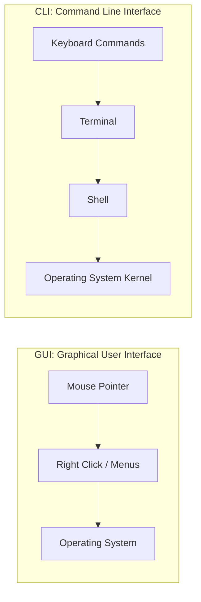

# Submodule 34.02: What is the Terminal? GUI vs CLI, Speed, and System Internals (Hinglish)

## Topic Overview & Definition
**Terminal** ek text-based input aur output environment hota hai jiske through hum directly operating system ke sath communicate karte hain. Buttons, icons aur windows par click karne ki jagah hum keyboard se commands type karte hain aur system unhe instantly execute karke text output return karta hai.

---

## 1. GUI vs CLI: Difference Kya Hai?

| Feature | Graphical User Interface (GUI) | Command Line Interface (CLI / Terminal) |
| :--- | :--- | :--- |
| **Interaction** | Mouse, cursor, right-click, new folder button. | Keyboard text commands aur flags. |
| **Speed** | Initial learning easy, but repetitive tasks mein slow. | Starting mein commands yaad karni padti hain, par baad mein 10x fast. |
| **System Resources** | Heavy graphics rendering, high RAM/CPU usage. | Lightweight, minimal resources consume karta hai. |
| **Automation** | Har step manually click karna padta hai. | Shell script likhkar hazaron tasks automatically execute hote hain. |
| **System Access** | Normal consumer-level files dikhata hai. | System internals aur hidden dotfiles (`.gitignore`, `.bashrc`) expose karta hai. |

---

## 2. Developer ke liye Terminal ke Fayde
1. **Speed aur Productivity**:
   - Shuruat mein lagta hai ki mouse se right click karke folder banana aasan hai, lekin jab 50 folders banane hon ya 100 files delete karni hon, toh terminal ek single command (`mkdir folder_{1..50}`) mein fractional second mein execute kar deta hai.
2. **Hidden Files aur System Internals ki Access**:
   - Normal users ko OS ki configuration files nahi dikhti hain. Developer level configuration files (jaise `.git`, `.gitignore`, `.env`) dot (`.`) se start hoti hain aur hidden hoti hain. Terminal ke through programmer in hidden files ko directly view aur edit kar sakta hai.
3. **Cloud Servers aur Remote Machines**:
   - Real-world AI/ML models AWS ya Google Cloud ke Linux servers par train hote hain. Un servers par koi desktop screen ya mouse nahi hota; unhe operate karne ke liye sirf remote terminal (SSH) milta hai.
