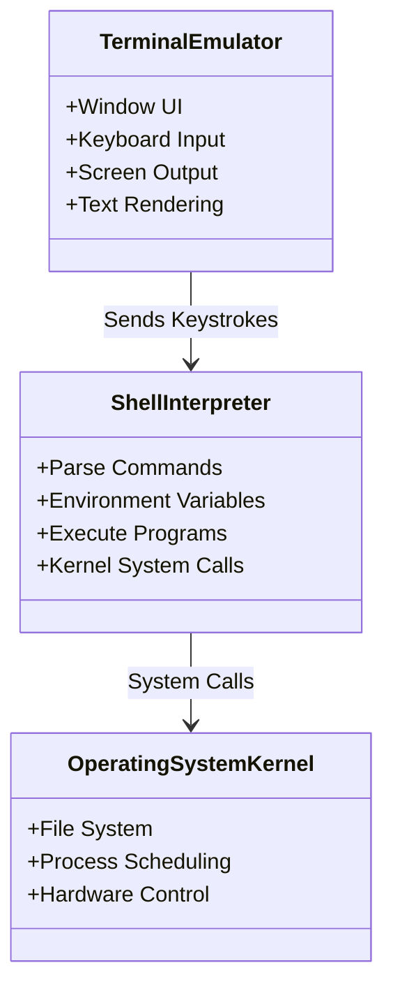

# Submodule 34.03: Clarifying Terminal Jargon: CLI, Terminal, Console, Shell

## Topic Overview & Industry Terminology
In the tech industry, words like **Command Line**, **Terminal**, **Console**, and **Shell** are frequently used interchangeably in informal conversation. While they point toward the same general user experience (a text window where commands are typed), they possess distinct architectural definitions rooted in computer history.

---

## 1. Deconstructing the Terminology

### A. Command Line Interface (CLI)
- **Concept**: A non-graphical user interface paradigm based strictly on lines of text.
- **Context**: Often referred to as "the command line" in Windows systems (`cmd.exe`). It is the general conceptual umbrella opposed to GUI.

### B. Terminal (Terminal Emulator)
- **Concept**: The graphical window/wrapper application that renders the text interface, receives keyboard strokes, and displays text output.
- **Historical Analogy (The ATM Model)**:
  - Think of an **ATM Machine**: The physical metal chassis, screen, and numbered keypad represent the **Terminal**.
  - Modern software terminals (Terminal.app on macOS, Windows Terminal, Git Bash window, iTerm2, Alacritty) are *terminal emulators* simulating historical physical teletype terminals (TTY).

### C. Console
- **Concept**: Historically, a specialized physical terminal permanently attached directly to a mainframe computer cabinet for system administration and diagnostic monitoring.
- **Modern Usage**: Used colloquially to mean the primary terminal screen or debug log console.

### D. Shell
- **Concept**: The actual command interpreter and scripting language program running **inside** the terminal window.
- **Analogy**: If the ATM machine casing is the terminal, the **software running inside the ATM** that processes your bank card and verifies your PIN is the **Shell**!
- The shell reads the user's command string, interprets its syntax, resolves environment variables, invokes system binaries, and passes the output stream back to the terminal.

---

## 2. Common Types of Shells

| Shell Name | Full Name | Primary Platform | Key Characteristics |
| :--- | :--- | :--- | :--- |
| **Bash** | Bourne-Again SHell | Linux, Git Bash (Windows), legacy macOS | The undisputed industry standard for Unix scripting and automation. |
| **Zsh** | Z Shell | Modern macOS (default since Catalina) | Highly extensible, advanced tab completion, supports custom themes (Oh My Zsh). |
| **sh** | Bourne Shell | Unix | Original Unix shell written by Stephen Bourne (1979); minimal and universally compatible. |
| **PowerShell** | Microsoft PowerShell | Windows, cross-platform | Object-oriented shell and scripting language utilizing .NET objects rather than raw text streams. |
| **cmd** | Command Prompt | Windows | Legacy MS-DOS command interpreter. |

---

## 3. Why Windows Users Require Git Bash
- macOS and Linux are Unix-certified/Unix-like operating systems. They share identical POSIX commands (`ls`, `pwd`, `mkdir`, `touch`, `rm`).
- Native Windows Command Prompt (`cmd.exe`) uses completely different DOS syntax (`dir`, `del`, `md`, backslashes `\`).
- **Git Bash** embeds a lightweight **MSYS2** Unix-emulation environment, allowing Windows users to run universal POSIX Bash commands alongside macOS and Linux developers without friction.
