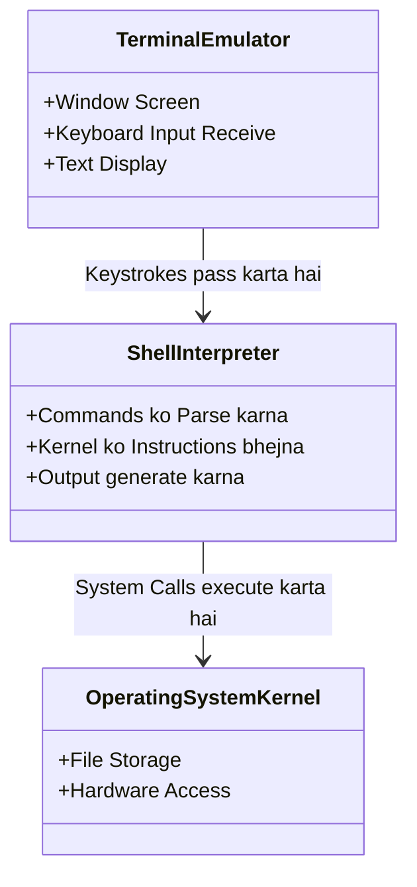

# Submodule 34.03: Clarifying Terminal Jargon: CLI, Terminal, Console, Shell (Hinglish)

## Topic Overview & Industry Terminology
Programming mein log aksar **Terminal**, **Command Line**, **Console**, aur **Shell** ko interchangeably use karte hain. Bolchaal mein inka matlab wahi black window hoti hai jahan commands type ki jaati hain, lekin technically in charo terms ke distinct historical aur architectural meanings hain.

---

## 1. Chaar Terms ka Exact Difference

### A. Command Line Interface (CLI)
- Ek general textual interface jahan hum text commands type karte hain (GUI ke opposite concept).

### B. Terminal (Terminal Emulator)
- Woh window ya application jo screen par open hoti hai aur jisme text render hota hai.
- **ATM Analogy**: Ek ATM machine ka physical hardware (outer body, screen, keyboard) **Terminal** hai.

### C. Console
- Historically, computer ya mainframe se directly juda hua primary hardware monitor/keyboard jahan system administrator login karta tha.

### D. Shell (Sabse Important Software)
- Terminal window ke **andar** jo software program run kar raha hota hai aur commands ko interpret karke execute karta hai, use **Shell** kehte hain.
- **ATM Analogy**: ATM machine ke andar jo software code run kar raha hai jo aapka PIN check karta hai, woh **Shell** hai!

---

## 2. Popular Shells ke Types

| Shell | Full Form | Default OS | Features |
| :--- | :--- | :--- | :--- |
| **Bash** | Bourne-Again SHell | Linux, Git Bash (Windows) | Duniya ka sabse popular aur standard Unix shell. |
| **Zsh** | Z Shell | Modern macOS (default) | Highly customizable, smart autocomplete, themes support karta hai. |
| **sh** | Bourne Shell | Unix | Original 1979 Unix shell. |
| **cmd / PowerShell** | Command Prompt | Windows | Windows ka native shell (object-oriented). |

---

## 3. Windows Users ko Git Bash Kyun Chahiye?
Mac aur Linux dono **Unix-based** systems hain, isliye unke terminal commands (`pwd`, `ls`, `touch`, `rm`) 100% same hote hain. Lekin Windows ka Command Prompt (`cmd.exe`) alag DOS commands (`dir`, `del`, `cls`) use karta hai.

Is inconsistency ko khatam karne ke liye Windows users **Git Bash** install karte hain. Git Bash Windows par ek Unix-like Bash shell provide karta hai jisse Windows user bhi wahi standard Unix commands execute kar sake jo Mac aur Linux users karte hain.
