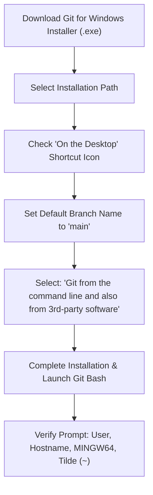

# Submodule 34.04: Windows Setup: Installing & Configuring Git Bash

## Topic Overview & Architectural Purpose
For Windows developers, executing standard POSIX Unix commands requires a Bash emulation layer. **Git for Windows** includes **Git Bash**, an application that packages the **Bash** shell, core Unix utilities (such as `ls`, `grep`, `touch`, `rm`, `cat`), and the **Git** version control system into an integrated MSYS2 environment.



---

## 1. Step-by-Step Installation Walkthrough
1. **Download Installer**: Navigate to the official Git website (`https://git-scm.com/download/win`) and download the 64-bit Windows setup executable.
2. **Desktop Shortcut Option**: During component selection, tick the box for **"On the Desktop"** to place a direct launch shortcut on your desktop.
3. **Default Branch Configuration**: When prompted for initial branch name in new repositories, select **"Override the default branch name for new repositories"** and set it to **`main`** (matching modern industry standard on GitHub).
4. **Environment Path Integration**: Choose **"Git from the command line and also from 3rd-party software"** (recommended default) to allow VS Code and external tools to access Git commands.
5. **Default Settings**: Keep all subsequent options (line ending conversion via LF, terminal emulator MinTTY, credential manager) on their recommended defaults and click **Install**.

---

## 2. Anatomy of the Git Bash Prompt
Upon launching Git Bash, the terminal prompt displays:
```bash
username@HOSTNAME MINGW64 ~
$ 
```

- **`username`**: The current Windows user profile account name.
- **`HOSTNAME`**: The network computer name of your Windows machine.
- **`MINGW64`**: Minimalist GNU for Windows 64-bit runtime environment.
- **`~` (Tilde)**: Indicates the shell is currently positioned in the user's **Home Directory** (`C:\Users\username`).
- **`$`**: Standard unprivileged shell prompt indicator awaiting user input.

---

## 3. Verification Commands
Verify the environment is functioning properly by executing:
```bash
# Verify Git version
git --version

# Verify current working directory
pwd

# List files in home directory
ls

# Clear the screen
clear
```
