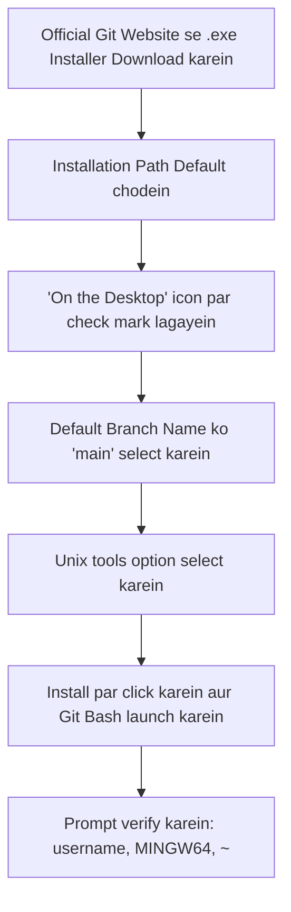

# Submodule 34.04: Windows Setup: Installing & Configuring Git Bash (Hinglish)

## Topic Overview & Purpose
Windows operating system par standard Unix/Linux commands (`ls`, `pwd`, `touch`, `rm`) run karne ke liye hume **Git Bash** install karna hota hai. Git Bash Windows par Bash shell aur Unix utilities ka complete emulation setup karta hai.



---

## 1. Step-by-Step Installation Process
1. **Download**: Official website (`git-scm.com/download/win`) par jakar 64-bit Windows installer download karein.
2. **Desktop Icon**: Components select karte waqt **"On the Desktop"** par tick karein taaki desktop par shortcut icon aa jaye.
3. **Default Branch**: Branch configuration mein default branch ko **`main`** select karein (GitHub standard).
4. **Unix Tools Option**: PATH configuration mein **"Git from the command line and also from 3rd-party software"** select karein.
5. **Finish**: Baki sabhi options ko default chhodte hue **Next $\to$ Install $\to$ Finish** karein.

---

## 2. Git Bash Prompt ka Structure
Jab aap Git Bash open karenge, toh screen par aisi prompt dikhegi:
```bash
username@HOSTNAME MINGW64 ~
$ 
```

- **`username`**: Aapke Windows user profile ka naam (jaise `Shivam`).
- **`HOSTNAME`**: Aapke laptop/computer ka system name.
- **`MINGW64`**: Windows 64-bit Unix-emulation environment.
- **`~` (Tilde)**: Yeh batata hai ki abhi aap apni **Home Directory** (`C:\Users\username`) ke andar khade hain.
- **`$`**: Command line ready hai, aap yahan command type kar sakte hain.

---

## 3. Installation Verification Commands
Git Bash open karke yeh 4 commands run karke test karein:
```bash
# 1. Git version check karna
git --version

# 2. Current working directory check karna
pwd

# 3. Files list karna
ls

# 4. Screen clear karna
clear
```
