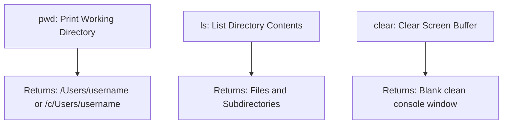

# Submodule 34.05: Fundamental Inspection Commands: `ls`, `pwd`, `clear`, and History

## Topic Overview & Inspection Mechanics
Before navigating or modifying file structures, developers must inspect their current operational environment. Three fundamental commands provide this spatial awareness:
1. **`pwd`**: Where am I? (Print Working Directory)
2. **`ls`**: What is here? (List Files and Folders)
3. **`clear`**: Reset terminal visual screen buffer.



---

## 1. Detailed Command Syntax & Behavior

### A. `pwd` (Print Working Directory)
Outputs the absolute path of the directory in which the shell session is currently operating.
```bash
pwd
# Output on macOS:   /Users/Shraddha
# Output in Git Bash: /c/Users/Shivam
```
*Significance*: In CLI, there are no visual breadcrumb bars like in File Explorer. `pwd` gives you your exact absolute address in the file hierarchy.

### B. `ls` (List)
Lists all visible files, documents, and subdirectories contained inside the current working directory.
```bash
ls
# Output:
# Desktop  Documents  Downloads  Music  Pictures  Videos  Delta
```
- By default, `ls` displays only visible files. Hidden configuration files (starting with `.`) are omitted.
- Directory and folder names are conventionally used interchangeably in terminal discussions.

### C. `clear` (Clear Terminal Screen)
Clears all previous commands and terminal text output, repositioning the prompt at the top-left corner of the window.
```bash
clear
```
*Keyboard Shortcut*: Alternatively, pressing `Ctrl + L` on Windows/Linux or `Cmd + K` on macOS accomplishes the same visual reset without clearing history.

---

## 2. Command History Navigation via Arrow Keys
Terminal emulators maintain an internal buffer of executed commands:
- **Up Arrow ($\uparrow$)**: Recalls previously executed commands in reverse chronological order (older commands).
- **Down Arrow ($\downarrow$)**: Moves forward toward the most recently typed commands.
- *Developer Efficiency*: Never retype long, complex command paths. Tap the Up Arrow to retrieve and re-execute prior instructions.
