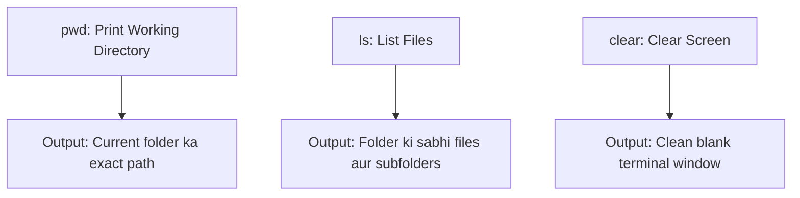

# Submodule 34.05: Fundamental Inspection Commands: `ls`, `pwd`, `clear`, and History (Hinglish)

## Topic Overview & Inspection Mechanics
Terminal mein kisi bhi folder mein jaane ya file banane se pehle yeh jaanna zaroori hota hai ki hum abhi kahan khade hain aur yahan kaun si files hain. Iske liye 3 sabse basic commands use hoti hain:
1. **`pwd`**: Hum abhi kis folder mein hain?
2. **`ls`**: Is folder ke andar kaun-kaun se files aur folders hain?
3. **`clear`**: Terminal screen ko saaf karna.



---

## 1. Commands ka Detail aur Syntax

### A. `pwd` (Print Working Directory)
Yeh command current active directory ka absolute path print karti hai:
```bash
pwd
# Output: /Users/Shraddha (Mac) ya /c/Users/Shivam (Git Bash)
```
Terminal mein koi visual folder bar nahi hota, isliye `pwd` se confirm hota hai ki hum exactly kis directory mein khade hain.

### B. `ls` (List Files)
Current directory ke andar jitne bhi visible folders aur files hain, unki list print karta hai:
```bash
ls
# Output: Desktop  Documents  Downloads  Delta  Music
```
*Note*: Terminal discussion mein **directory** aur **folder** ka ek hi matlab hota hai.

### C. `clear` (Screen Clear karna)
Jab terminal par bohot saara text bhar jata hai, toh `clear` command screen ko reset karke cursor ko top-left par le aati hai:
```bash
clear
```
*Shortcut*: Keyboard par `Ctrl + L` press karne se bhi screen instantly clear ho jati hai.

---

## 2. Arrow Keys se Command History Access karna
Terminal aapki run ki hui saari commands ki history save rakhta hai:
- **Up Arrow ($\uparrow$)**: Pichli (purani) run ki gayi commands screen par le aata hai.
- **Down Arrow ($\downarrow$)**: Wapas nayi commands ki taraf le jata hai.
- Agar aapko koi command dobara chalani hai, toh use dobara type karne ki jagah Up Arrow dabayein aur Enter press karein.
