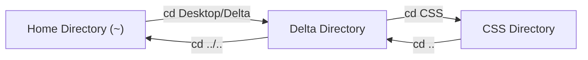

# Submodule 34.06: Directory Navigation: `cd`, `..`, Chaining Paths, and Autocomplete

## Topic Overview & Directory Traversal
In a graphical interface, navigating into a folder requires double-clicking its icon, while navigating backward requires clicking the "Back" arrow. In the terminal, traversal is executed using the **`cd` (Change Directory)** command.



---

## 1. Core Navigation Commands & Syntax

### A. Stepping Inward: `cd <directory_name>`
To navigate into a child directory located within your current working directory:
```bash
# Move into Desktop
cd Desktop

# Move into Delta folder
cd Delta
```

### B. Stepping Backward: `cd ..`
The double dot **`..`** represents the **parent directory** (one level up in the file hierarchy).
```bash
# Go back one level up (equivalent to GUI back button)
cd ..
```

### C. Deep Traversal (Path Chaining)
Instead of executing sequential single-level `cd` commands, paths can be chained using forward slashes (`/`):
```bash
# Move forward multiple levels in a single command
cd Desktop/Delta/CSS

# Move backward multiple levels in a single command
cd ../..
```

---

## 2. The Tab Autocomplete Feature
Developers rarely type out entire directory names. 
- Type the first 2–3 characters of a folder name and press the **Tab** key.
- The shell automatically completes the full directory or file name.
- If multiple candidates exist, tapping Tab twice displays all matching options.
- *Best Practice*: Always use Tab autocomplete to prevent typographical errors.

---

## 3. Error Handling: Non-Existent Directories
If you attempt to navigate into a folder that does not exist or mistype its name:
```bash
cd NonExistentFolder
# bash: cd: NonExistentFolder: No such file or directory
```
*Resolution*: Run `ls` to verify the exact case-sensitive spelling of target directories before executing `cd`.
