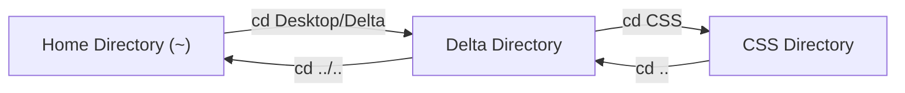

# Submodule 34.06: Directory Navigation: `cd`, `..`, Chaining Paths, and Autocomplete (Hinglish)

## Topic Overview & Navigation
GUI mein kisi folder ke andar jaane ke liye hum double-click karte hain aur bahar aane ke liye "Back" button dabate hain. Terminal ke andar yahi kaam **`cd` (Change Directory)** command se kiya jata hai.



---

## 1. Core Navigation Commands

### A. Folder ke Andar Jana: `cd <folder_name>`
Current folder ke andar kisi subfolder mein jaane ke liye:
```bash
# Desktop folder ke andar jana
cd Desktop

# Delta folder ke andar jana
cd Delta
```

### B. Ek Step Bahar Aana (Back Button): `cd ..`
Terminal mein double dot **`..`** ka matlab hota hai **parent directory** (ek step piche):
```bash
# Ek folder piche aana
cd ..
```

### C. Ek Sath Multiple Levels Navigate Karna (Chaining)
Aap slash (`/`) use karke ek hi command mein multiple levels andar ya bahar ja sakte hain:
```bash
# Ek sath do levels andar jana
cd Desktop/Delta/CSS

# Ek sath do levels bahar aana
cd ../..
```

---

## 2. Tab Autocomplete Feature (Developer Superpower)
Developers kabhi pura folder name type nahi karte:
- Folder ke pehle 2–3 letters type karein aur **Tab** key dabayein.
- Terminal automatically pura naam complete kar dega.
- Agar same letter se do folders start ho rahe hain, toh do baar Tab dabane se saare options screen par dikh jayenge.

---

## 3. Error: `No such file or directory`
Agar aap kisi aise folder ka naam likhenge jo wahan exist nahi karta:
```bash
cd random_folder
# bash: cd: random_folder: No such file or directory
```
Pehle `ls` run karke exact spelling check karein, phir `cd` karein.
