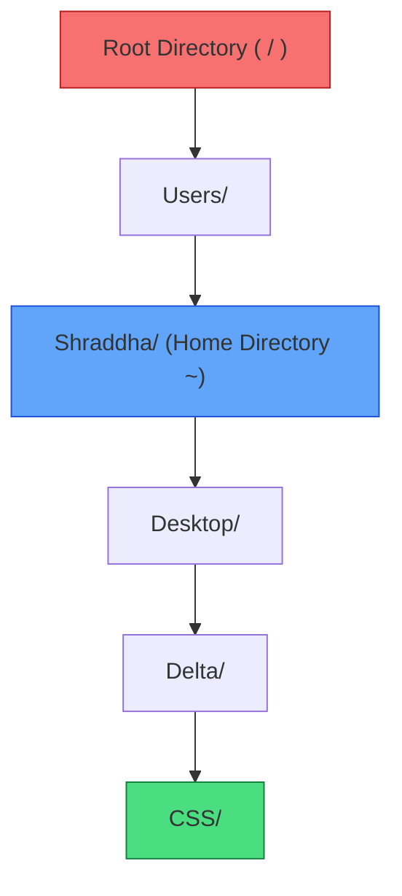

# Submodule 34.07: Path Resolution: Absolute Paths vs Relative Paths

## Topic Overview & Filesystem Hierarchy
When issuing commands to navigate (`cd`), inspect (`ls`), or create files (`mkdir`, `touch`), the terminal must resolve the path to the target resource. In all modern operating systems, paths belong to two fundamental categories:
1. **Absolute Paths**: The full, unambiguous address starting from the filesystem root.
2. **Relative Paths**: A contextual address determined relative to the current working directory (`pwd`).



---

## 1. Comparing Absolute and Relative Paths

| Dimension | Absolute Path | Relative Path |
| :--- | :--- | :--- |
| **Starting Anchor** | Always begins at the root (`/`) or drive letter. | Begins from the current working directory (`pwd`). |
| **Leading Character** | Always begins with a forward slash **`/`**. | Begins with a folder name, single dot (`.`), or double dot (`..`). |
| **Context Dependency** | **Context-independent**: Works identically from anywhere. | **Context-dependent**: Only works if relative position matches. |
| **Example (macOS)** | `/Users/Shraddha/Desktop/Delta` | `Desktop/Delta` (if currently in `/Users/Shraddha`) |
| **Example (Git Bash)** | `/c/Users/Shivam/Desktop/Delta` | `../Delta` (if currently in sibling directory) |

---

## 2. Special Filesystem Anchors & Symbols

### A. The Root Directory (`/`)
The absolute apex of the operating system hierarchy. Every user profile, installed application, system binary, and external drive lives beneath root:
```bash
# Navigate to filesystem root
cd /

# Inspect top-level system directories
pwd # Output: /
ls  # Output: bin, dev, etc, home, opt, usr, var, Users (macOS), c (Git Bash)
```

### B. The Home Directory (`~`)
The dedicated user profile environment where personal projects, downloads, and desktop folders reside:
```bash
# Jump directly to home directory from anywhere
cd ~

# Verify path
pwd # Output: /Users/Shraddha or /c/Users/Shivam
```

### C. Single Dot (`.`) and Double Dot (`..`)
- **`.` (Current Directory)**: Represents the directory you are currently standing in. Used frequently when running local scripts (`./script.sh`).
- **`..` (Parent Directory)**: Represents the immediate enclosing parent folder one level up.

---

## 3. Practical Navigation Demonstration
Suppose your terminal is currently positioned deep inside `/Users/Shraddha/Desktop/Delta/CSS`:
```bash
# Method 1: Navigate to Delta using a Relative Path (step back one level)
cd ..

# Method 2: Navigate to Delta using an Absolute Path (independent of current location)
cd /Users/Shraddha/Desktop/Delta
```
Both reach the exact same target directory, but the absolute path succeeds regardless of where your shell was initially positioned.
