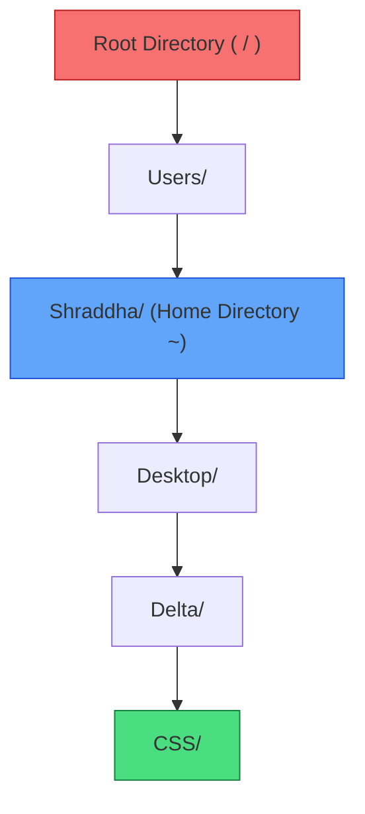

# Submodule 34.07: Path Resolution: Absolute Paths vs Relative Paths (Hinglish)

## Topic Overview & Filesystem Tree
Terminal mein navigation (`cd`) ya file operations karte waqt system ko path specify karna hota hai. Filesystem ke andar do tarike ke paths hote hain:
1. **Absolute Path**: Root se start hone wala pura complete address.
2. **Relative Path**: Aap abhi jis folder mein khade hain (`pwd`), wahan se target tak ka rasta.



---

## 1. Absolute Path vs Relative Path ka Comparison

| Feature | Absolute Path | Relative Path |
| :--- | :--- | :--- |
| **Starting Point** | System ke sabse top **Root (`/`)** se start hota hai. | Current folder (`pwd`) se start hota hai. |
| **Pehla Character** | Hamesha slash **`/`** se shuru hota hai. | Folder ke naam, `.` ya `..` se shuru hota hai (no leading slash). |
| **Location Dependency** | Aap computer ke kisi bhi folder mein khade hon, yeh hamesha kaam karega. | Yeh tabhi kaam karega jab aap sahi parent folder mein hon. |
| **Example** | `/Users/Shraddha/Desktop/Delta` | `Desktop/Delta` (agar abhi aap `~` mein hain) |

---

## 2. Special Symbols jo Yaad Rakhne Hain

### A. Root Directory (`/`)
Computer ka sabse main pehla folder jiske andar baki saare users, applications aur files hoti hain:
```bash
# Root directory mein jana
cd /
pwd # Output: /
```

### B. Home Directory (`~` Tilde)
Aapka personal user profile folder jahan Desktop, Downloads aur Documents hote hain:
```bash
# Kahin se bhi direct home folder mein jump karna
cd ~
pwd # Output: /Users/Shraddha (Mac) ya /c/Users/Shivam (Git Bash)
```

### C. Single Dot (`.`) aur Double Dot (`..`)
- **`.`**: Current folder (jisme abhi aap khade hain).
- **`..`**: Parent folder (ek step upar ka folder).

---

## 3. Practical Example
Maan lijiye aap abhi `CSS` folder ke andar khade hain aur aapko `Delta` mein jana hai:
- **Relative Path**: `cd ..` (sirf ek step piche).
- **Absolute Path**: `cd /Users/Shraddha/Desktop/Delta` (pura root se address).
Dono commands same jagah pahunchayengi, lekin absolute path aap kisi bhi folder se chalayein, hamesha kaam karega!
