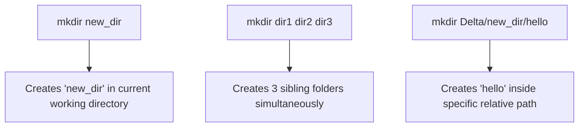

# Submodule 34.08: Directory Creation: `mkdir`, Nested Trees, and Path Arguments

## Topic Overview & Syntax
The **`mkdir` (Make Directory)** command is the universal shell utility for creating new folders. Instead of right-clicking and navigating GUI dialogs, `mkdir` instantiates single directories, multiple sibling directories, or nested folder paths in a single command.



---

## 1. Core `mkdir` Operations

### A. Creating a Single Directory
To create a new directory inside your current working directory:
```bash
mkdir new_directory
```
Verify creation using `ls` to observe `new_directory` in the output listing.

### B. Creating Multiple Directories Simultaneously
Pass space-separated directory names to create multiple directories in a single command:
```bash
mkdir frontend backend database
```
This instantly generates all three directories.

### C. Creating Directories via Relative and Absolute Paths
You do not need to `cd` into a directory to create a subfolder inside it. Supply the relative or absolute path as the argument:
```bash
# Using a relative path
mkdir Delta/new_dir/hello

# Using an absolute path
mkdir /Users/Shraddha/Desktop/Delta/new_dir2/hello2
```

---

## 2. Shell Rules & Error Behaviors

### A. Collision Error (Directory Already Exists)
If a directory with the specified name already exists in that location, the shell refuses to overwrite it:
```bash
mkdir hello
# mkdir: hello: File exists
```
*Takeaway*: The terminal ensures that creating a directory never inadvertently destroys or overwrites an existing folder.

### B. Missing Intermediate Directories
If intermediate parent directories do not yet exist, `mkdir` throws an error:
```bash
mkdir parent/child/grandchild
# mkdir: parent/child: No such file or directory
```
*Pro Tip (Flag `-p`)*: Using the parent flag `mkdir -p parent/child/grandchild` automatically generates all missing intermediate parent directories along the path.

### C. Handling Folder Names with Spaces
If a directory name contains whitespace, the shell treats each word as a separate folder:
- `mkdir my new folder` $\to$ Creates 3 distinct folders: `my`, `new`, and `folder`!
- **Solution (Quotes or Escape Character)**:
  ```bash
  mkdir "my new folder"     # Enclosed in quotes
  mkdir my\ new\ folder     # Backslash space escaping
  ```
