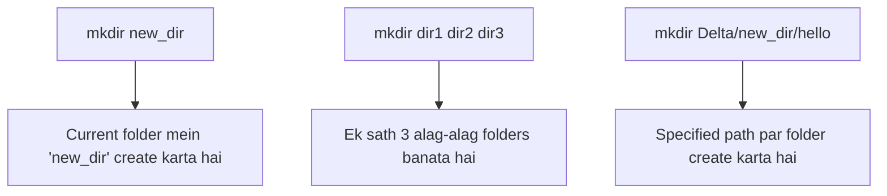

# Submodule 34.08: Directory Creation: `mkdir`, Nested Trees, and Path Arguments (Hinglish)

## Topic Overview & Syntax
Terminal se naye folders banane ke liye **`mkdir` (Make Directory)** command use ki jaati hai. Mouse se right-click karke "New Folder" banane ki jagah `mkdir` command se hum instant single ya multiple folders create kar sakte hain.



---

## 1. `mkdir` Command ke Use Cases

### A. Single Folder Banana
Current working directory mein ek naya folder banane ke liye:
```bash
mkdir new_directory
```
`ls` run karke verify karein, `new_directory` list mein display ho jayegi.

### B. Ek Sath Multiple Folders Banana
Agar aapko ek se zyada folders banane hain, toh space dekar unke naam likhein:
```bash
mkdir frontend backend database
```
Yeh ek hi second mein teeno folders create kar dega.

### C. Path ke Through Folder Banana
Zaroori nahi hai ki aap pehle us folder mein `cd` karke jayein. Aap direct path dekar bhi folder create kar sakte hain:
```bash
# Relative path se
mkdir Delta/new_dir/hello

# Absolute path se
mkdir /Users/Shraddha/Desktop/Delta/new_dir2/hello2
```

---

## 2. Common Errors aur Best Practices

### A. `File exists` Error
Agar usi naam ka folder pehle se wahan bana hua hai:
```bash
mkdir hello
# mkdir: hello: File exists
```
Terminal existing folder ko overwrite nahi karta, taaki purana data safe rahe.

### B. Spaces wale Folder Names
Agar aapne likha `mkdir my project folder`, toh terminal 3 alag-alag folders bana dega: `my`, `project`, aur `folder`.
- **Solution**: Folder ke naam ko double quotes (`" "`) mein likhein ya backslash lagayein:
  ```bash
  mkdir "my project folder"
  mkdir my\ project\ folder
  ```

### C. Intermediate Parent Folders Banana (`-p` Flag)
Agar parent folder exist nahi karta, toh error aati hai. Pure folder tree ko ek baar mein banane ke liye `-p` flag lagate hain:
```bash
mkdir -p project/src/components
```
