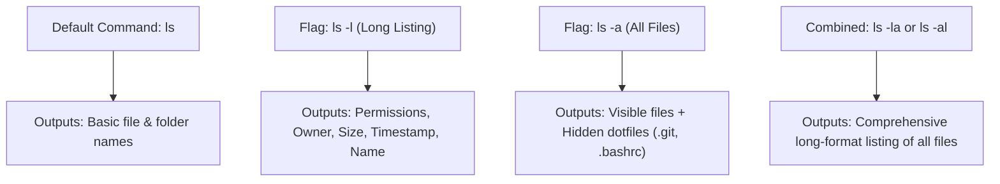

# Submodule 34.09: Mastering Command Flags: Manual Pages (`man`), `ls -l`, and `ls -a`

## Topic Overview & The Concept of Flags
In Unix-like shells, **Flags** (also termed **options** or **switches**) are special tokens passed after a command name to alter its default behavior or request additional metadata. Flags typically begin with a single hyphen (`-`) for single-character options or double hyphens (`--`) for verbose word options.



---

## 1. System Documentation via `man` (Manual Pages)
Every standard Unix command possesses a built-in instruction manual embedded in the operating system:
```bash
# Read the official manual page for ls
man ls
```

### Navigating the `man` Viewer:
- Use the **Up/Down Arrow keys** or **Spacebar** to scroll through documentation.
- **Search**: Type `/keyword` and press Enter.
- **Quit / Exit**: Press the **`q`** key on your keyboard to instantly return to the command prompt.

---

## 2. Essential Flags for the `ls` Command

### A. Long Listing Format (`ls -l`)
By default, `ls` outputs only names. Adding `-l` prints detailed metadata in tabular format:
```bash
ls -l
# Output example:
# drwxr-xr-x  4 Shraddha  staff   128 Aug 31 14:20 Delta
# -rw-r--r--  1 Shraddha  staff  2048 Aug 31 15:10 README.md
```

#### Anatomy of a Long Listing Entry:
$$\begin{array}{|c|c|c|c|c|c|c|}
\hline
\textbf{File Permissions} & \textbf{Links} & \textbf{Owner} & \textbf{Group} & \textbf{Size (Bytes)} & \textbf{Date / Time} & \textbf{Name} \\
\hline
\text{-rw-r--r--} & 1 & \text{Shraddha} & \text{staff} & 2048 & \text{Aug 31 15:10} & \text{README.md} \\
\hline
\end{array}$$

- First character: `d` indicates a directory; `-` indicates a regular file.
- `rwxr-xr-x`: Read (`r`), write (`w`), execute (`x`) permissions for user, group, and others.
- File size is displayed in raw bytes.

### B. All Files Including Hidden Dotfiles (`ls -a`)
In Unix systems, any file whose name begins with a period (`.`) is considered a **hidden file** (e.g., `.bashrc`, `.zshrc`, `.git`, `.gitignore`, `.env`). These are excluded from default `ls` output.
```bash
ls -a
# Output:
# .  ..  .bash_profile  .git  .gitignore  Desktop  Documents
```
- **`.`**: Represents the current directory itself.
- **`..`**: Represents the parent directory.

### C. Combining Flags (`ls -la` or `ls -al`)
Flags can be chained together in any order under a single hyphen:
```bash
ls -la
# Displays full metadata for all files, including hidden dotfiles
```
