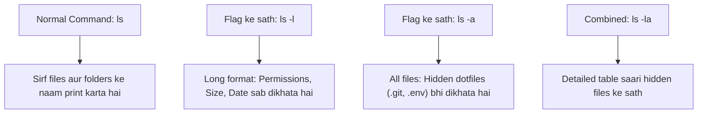

# Submodule 34.09: Mastering Command Flags: Manual Pages (`man`), `ls -l`, and `ls -a` (Hinglish)

## Topic Overview & What are Flags?
Terminal mein **Flags** (ya **options**) woh extra characters hote hain jo hum kisi command ke baad hyphen (`-`) lagakar pass karte hain. Flags kisi bhi command ke default behavior ko modify ya enhance karte hain.



---

## 1. `man` Command (Official System Manual)
Terminal ke andar har command ki complete guide ("janampatri") pre-installed hoti hai jise **`man` (manual)** command se padha ja sakta hai:
```bash
man ls
```
- `man` page open hone par scroll karne ke liye Arrow keys use karein.
- **Manual se Bahar Nikalne ke liye**: Keyboard par **`q`** (quit) press karein. Koi aur key dabane se exit nahi hoga, sirf `q` se exit hoga.

---

## 2. `ls` Command ke Core Flags

### A. Long Listing Format (`ls -l`)
Normal `ls` sirf naam dikhata hai. `ls -l` likhne se har file ki complete details table format mein aati hain:
```bash
ls -l
```

#### Output ka Meaning:
$$\begin{array}{|c|c|c|c|c|c|}
\hline
\textbf{Permissions} & \textbf{Owner} & \textbf{Group} & \textbf{File Size} & \textbf{Timestamp} & \textbf{File Name} \\
\hline
\text{-rw-r--r--} & \text{Shraddha} & \text{staff} & 2048\text{ B} & \text{Aug 31 15:10} & \text{README.md} \\
\hline
\end{array}$$

- Shuru ka pehla letter: `d` ka matlab directory (folder), `-` ka matlab regular file.
- `rwx`: Read, write, execute permissions.
- File ka size bytes mein aur last modified date/time.

### B. Hidden Files Dikhana (`ls -a`)
Unix systems mein jin files ke naam ke aage dot (`.`) laga hota hai, woh hidden hoti hain (jaise `.gitignore`, `.bashrc`, `.env`). Normal `ls` in files ko hide kar deta hai. Saari hidden files dekhne ke liye `-a` (all) flag use karte hain:
```bash
ls -a
```

### C. Flags ko Combine Karna (`ls -la` ya `ls -al`)
Aap do ya teen flags ko ek sath combine karke chala sakte hain:
```bash
ls -la
```
Yeh long-listing format mein saari hidden aur normal files ek sath screen par render karega.
