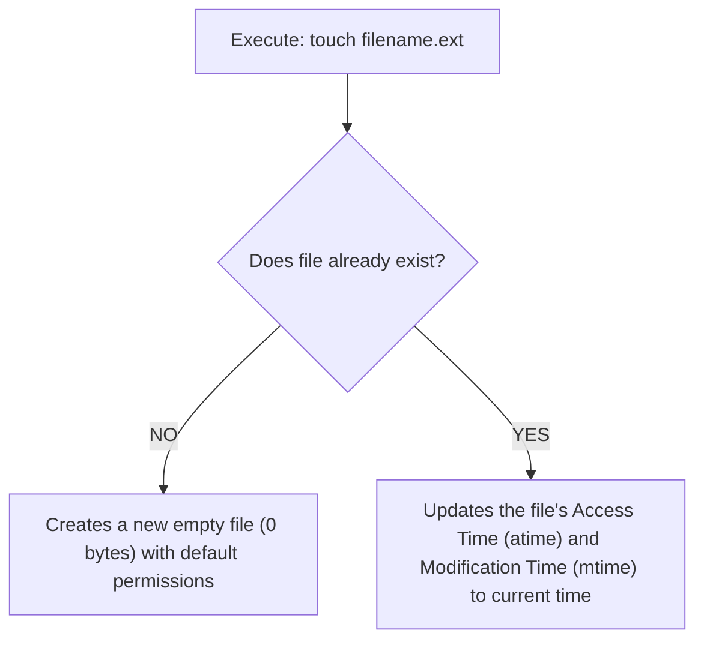

# Submodule 34.10: File Creation & Timestamps: The `touch` Command

## Topic Overview & Operational Dual-Nature
The **`touch`** command is one of the most frequently used utilities in a software engineer's daily workflow. While developers almost universally use `touch` to create new, empty files with specific extensions from the command line, its architectural origin in Unix systems is subtly different.



---

## 1. Creating Files with Extensions
To instantiate a blank file, pass the desired file name along with its file extension:
```bash
# Create an HTML file
touch index.html

# Create a stylesheet
touch style.css

# Create a JavaScript script
touch app.js

# Create a Python script
touch main.py
```
*Best Practice*: Always include the proper file extension (`.html`, `.css`, `.py`, `.json`, `.csv`). Without an extension, the OS creates a generic raw text file without application association.

---

## 2. Creating Multiple Files Simultaneously
Similar to `mkdir`, `touch` accepts multiple space-separated file names:
```bash
touch index.html style.css app.js README.md
```
This instantaneously creates all four files inside the current working directory.

---

## 3. The True Unix Purpose of `touch`: Modifying Timestamps
Checking the manual page via `man touch` reveals the command's primary Unix definition:
> *"The touch utility sets the modification and access times of files."*

Every file maintains two key filesystem timestamps:
1. **Access Time (`atime`)**: When the file was last read.
2. **Modification Time (`mtime`)**: When the file contents were last written.

### Behavioral Mechanic:
- If `target.txt` **already exists**, executing `touch target.txt` does **not** overwrite, erase, or alter the file's contents. Instead, it silently refreshes its `mtime` and `atime` to the current system clock time.
- If `target.txt` **does not exist**, `touch` creates an empty 0-byte file so that an access timestamp can be associated with it.
