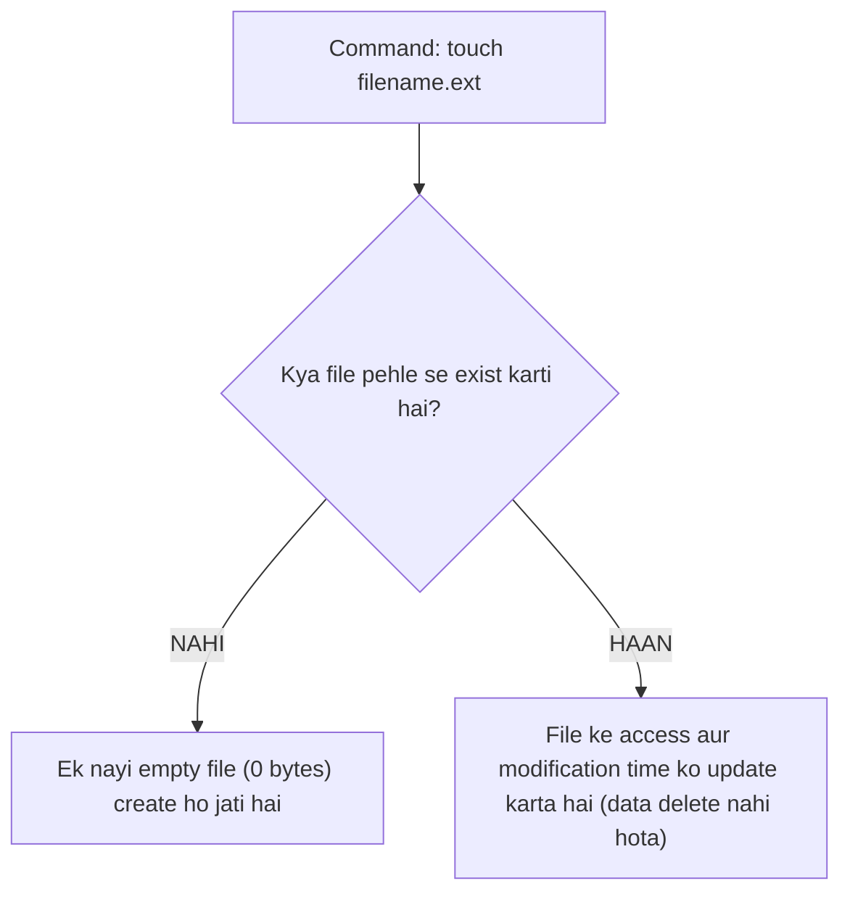

# Submodule 34.10: File Creation & Timestamps: The `touch` Command (Hinglish)

## Topic Overview & The Dual Role of `touch`
Rozmarra ke development workflow mein **`touch`** command ka sabse zyada use hota hai. Developers terminal se nayi empty files (jaise `index.html`, `style.css`, `app.py`) banane ke liye `touch` command use karte hain.



---

## 1. Nayi Files Banana
Kisi bhi directory mein file create karne ke liye `touch` aur extension ke sath file ka naam likhein:
```bash
# HTML file banana
touch index.html

# CSS file banana
touch style.css

# JavaScript file banana
touch app.js

# Python file banana
touch script.py
```
*Important*: Hamesha proper file extension (`.html`, `.css`, `.py`) ke sath file banayein taaki system aur code editor pehchan sakein ki yeh kis type ki file hai.

---

## 2. Ek Sath Multiple Files Create Karna
Space dekar aap ek hi line mein multiple files generate kar sakte hain:
```bash
touch index.html style.css app.js data.csv
```
Yeh command instant charo files create kar degi.

---

## 3. `touch` ka Original Unix Purpose (Timestamps)
Agar aap `man touch` run karke documentation padhenge, toh wahan likha hota hai:
> *"Change file access and modification times."*

Technically, `touch` command files banane ke liye nahi, balki file ke last modified timestamp (`mtime`) ko current system time par update karne ke liye design ki gayi thi:
- Agar file **already exist karti hai**, toh `touch filename` run karne par uska data delete nahi hota, sirf uska modified timestamp aaj ka current time ban jata hai.
- Agar file **exist nahi karti**, toh Unix system ek nayi 0-byte empty file create karke uspe current timestamp laga deta hai!
Isi feature ki wajah se duniya bhar ke developers `touch` ko nayi files create karne ke liye use karte hain.
