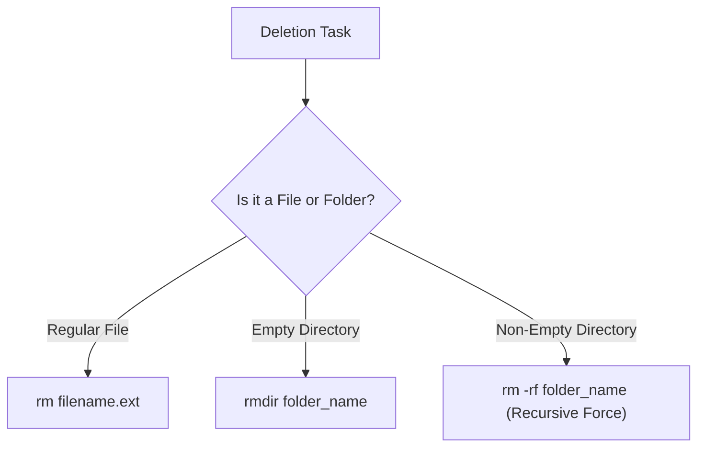

# Submodule 34.11: Safe File & Directory Deletion: `rm`, `rmdir`, and `rm -rf`

## Topic Overview & Critical Safety Disclaimer
Unlike graphical user interfaces (which move deleted items to the Recycle Bin or Trash for easy restoration), **terminal deletion commands permanently un-link data from the filesystem immediately**. 

> [!CAUTION]
> Files and folders deleted via terminal commands do NOT go to the Recycle Bin / Trash. Once deleted via `rm`, data is permanently irrecoverable without low-level forensic disk recovery. Always double-check your current directory (`pwd`) before executing deletion commands.



---

## 1. Deleting Files: The `rm` Command
To delete individual or multiple files, use **`rm` (remove)**:
```bash
# Delete a single file
rm abc.txt

# Delete multiple files simultaneously
rm index.html style.css app.js
```
The files vanish immediately from disk storage.

---

## 2. Deleting Directories: Why `rm` Fails
If you attempt to delete a folder using plain `rm`:
```bash
rm my_folder
# rm: my_folder: is a directory
```
By design, Unix protects developers from accidentally wiping entire folders.

### A. Removing Empty Directories: `rmdir`
The `rmdir` command safely deletes **empty directories**:
```bash
rmdir empty_folder
```
- If the directory contains even a single file or hidden dotfile, `rmdir` strictly aborts:
```bash
rmdir non_empty_folder
# rmdir: non_empty_folder: Directory not empty
```

---

## 3. Recursive & Force Deletion: `rm -r` and `rm -rf`
To delete a directory that contains subfolders and files, you must instruct the shell to traverse down the folder hierarchy recursively:

### A. Recursive Deletion (`rm -r`)
- Flag **`-r`** stands for **recursive**.
- Traverses every nested subfolder, deletes child files, and then removes the parent folder.
```bash
rm -r my_project_folder
```

### B. Recursive Force Deletion (`rm -rf`)
- Flag **`-f`** stands for **force** (suppresses prompts and ignores non-existent files).
- Combining both flags **`-rf`** instructs the terminal: *"Recursively delete everything inside this directory immediately without prompting for confirmation."*
```bash
rm -rf my_project_folder
```

---

## 4. The Golden Rules of CLI Safety
1. **Never run `rm -rf /`**: The root directory `/` represents the entire operating system. Running recursive force delete on root wipes the entire operating system and brick the computer.
2. **Always run `pwd` before `rm -rf`**: Confirm you are in the intended directory before executing force removal.
3. **Beware of Whitespace in Arguments**: Running `rm -rf / path/to/folder` (with an accidental space after `/`) will target the root filesystem!
