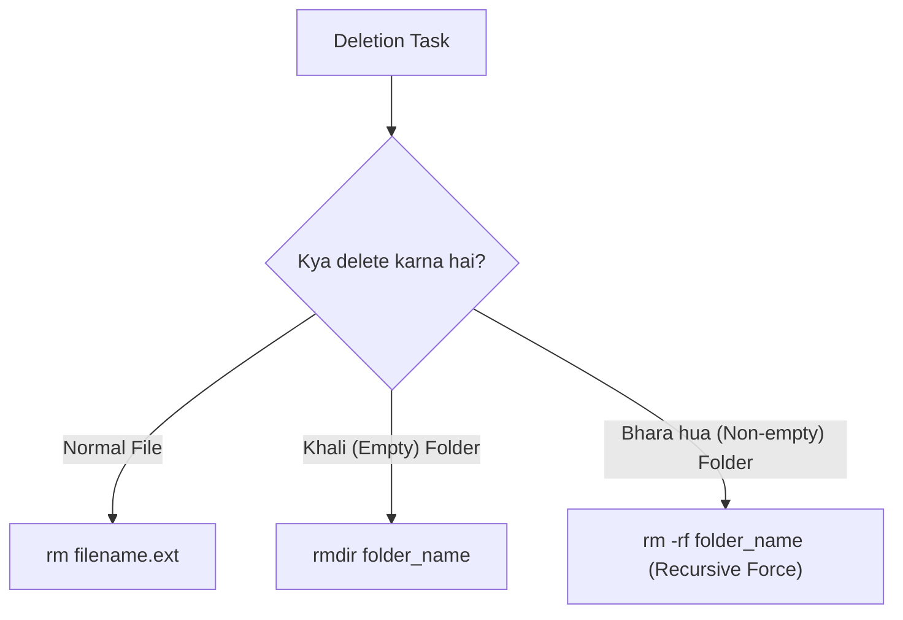

# Submodule 34.11: Safe File & Directory Deletion: `rm`, `rmdir`, and `rm -rf` (Hinglish)

## Topic Overview & Critical Safety Disclaimer
Windows ya Mac ke GUI mein jab hum koi file delete karte hain, toh woh **Recycle Bin** ya **Trash** mein chali jaati hai aur hum use wapas "Restore" kar sakte hain. Lekin terminal ke andar aisi koi safety net nahi hoti.

> [!CAUTION]
> Terminal se delete ki gayi files ya folders Recycle Bin mein NAHI jaate! Terminal commands memory se data ko permanently wipe out kar deti hain. Isliye delete command chalane se pehle hamesha do baar check karein.



---

## 1. Files ko Delete Karna: `rm` Command
Files ko delete karne ke liye **`rm` (remove)** command use hoti hai:
```bash
# Single file delete karna
rm abc.txt

# Ek sath multiple files delete karna
rm index.html style.css app.js
```
Command execute hote hi files permanently delete ho jayengi.

---

## 2. Folders Delete Karna: `rm` Kyun Mana Karta Hai?
Agar aap kisi folder par seedhe `rm` chalayenge:
```bash
rm my_folder
# rm: my_folder: is a directory
```
Terminal aapko protect karne ke liye folder ko delete nahi karta.

### A. Khali Folders ke liye: `rmdir`
Agar folder bilkul empty hai (usme koi file nahi hai), toh use delete karne ke liye **`rmdir` (remove directory)** command use hoti hai:
```bash
rmdir empty_folder
```
Agar folder ke andar ek bhi file ya hidden dotfile hogi, toh terminal error dega:
```bash
rmdir non_empty_folder
# rmdir: non_empty_folder: Directory not empty
```

---

## 3. Bhare hue Folders ko Delete Karna: `rm -r` aur `rm -rf`
Agar kisi folder ke andar files aur subfolders hain, toh hume flags use karne padte hain:

### A. Recursive Deletion (`rm -r`)
- Flag **`-r`** ka matlab hota hai **recursive** (nested tareeqe se andar jakar saari files aur subfolders ko delete karna).
```bash
rm -r project_folder
```

### B. Recursive Force Deletion (`rm -rf`)
- Flag **`-f`** ka matlab hota hai **force** (bina kisi confirmation prompt ke directly delete kar dena).
- Dono flags ko jodkar **`-rf`** banta hai:
```bash
rm -rf project_folder
```
Yeh command folder aur uske andar ke pure material ko permanently erase kar deti hai.

---

## 4. Terminal Safety ke Golden Rules
1. **Kabhi bhi `rm -rf /` mat chalana**: `/` root directory hoti hai. Yeh command pura operating system delete karke computer crash kar degi.
2. **`rm -rf` chalane se pehle `pwd` check karein**: Confirm karein ki aap usi folder mein khade hain jise aap sach mein delete karna chahte hain.
