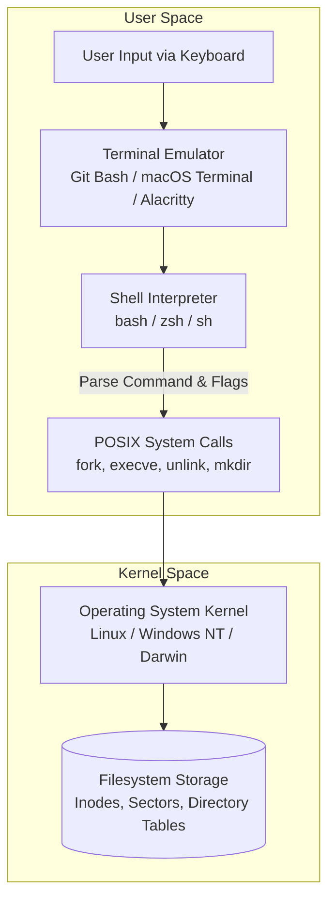

# Lecture 34: Terminal & Command Line Interface Foundations

Welcome to the definitive master curriculum repository for **Lecture 34: Terminal Foundations**. This course bridges the gap between graphical user interface (GUI) interactions and production-grade POSIX Command Line Interface (CLI) engineering.

Every modern Artificial Intelligence and Machine Learning pipeline—from training multi-billion parameter neural networks on remote GPU clusters to orchestrating Kubernetes microservices and CI/CD pipelines—runs through the command line. This module builds unbreakable muscle memory and deep architectural clarity in POSIX navigation, shell interaction, file lifecycle management, and defensive system administration.

---

## Architecture: Terminal vs Shell vs Operating System

Understanding how the command line works requires decoupling the graphical window from the underlying interpreter and kernel:

### The ATM Analogy
- **Terminal**: The physical outer casing, screen, and keypad of the ATM. It is merely the presentation layer that captures keystrokes and renders text characters.
- **Shell**: The internal banking software running inside the ATM that parses your PIN, validates account balances, and executes transactions.
- **Kernel / OS**: The core banking vault and hardware controllers that physically dispense cash.

---

## Comprehensive Submodule Roadmap

This lecture is organized into 11 topic modules, accompanied by an industrial practice suite. Every module contains dual-language documentation (English `README.md` and Hinglish `README_HINGLISH.md`) alongside verified keyframe references and compiled PDFs:

| Submodule | Topic Title | Core Concepts & Commands Covered | Keyframe Reference | Documentation Links |
| :--- | :--- | :--- | :--- | :--- |
| **34.01** | **Curriculum Roadmap** | Terminal vs GUI, ML deployment context, 11-step learning track | `keyframe_01.png` | [English](file:///c:/Users/Shivam%20Keshari/OneDrive/Desktop/AI-ML/lecture_34/Notes_34.01/README.md) \| [Hinglish](file:///c:/Users/Shivam%20Keshari/OneDrive/Desktop/AI-ML/lecture_34/Notes_34.01/README_HINGLISH.md) |
| **34.02** | **What is the Terminal?** | CLI vs GUI latency, server administration, automation workflows | `keyframe_01.png` | [English](file:///c:/Users/Shivam%20Keshari/OneDrive/Desktop/AI-ML/lecture_34/Notes_34.02/README.md) \| [Hinglish](file:///c:/Users/Shivam%20Keshari/OneDrive/Desktop/AI-ML/lecture_34/Notes_34.02/README_HINGLISH.md) |
| **34.03** | **Key Technical Terms** | Terminal vs Shell vs Console vs Command Prompt, POSIX standards | `keyframe_01.png` | [English](file:///c:/Users/Shivam%20Keshari/OneDrive/Desktop/AI-ML/lecture_34/Notes_34.03/README.md) \| [Hinglish](file:///c:/Users/Shivam%20Keshari/OneDrive/Desktop/AI-ML/lecture_34/Notes_34.03/README_HINGLISH.md) |
| **34.04** | **Git Bash Setup** | Windows cmd limitations, MSYS2 emulation, Git Bash installation | `keyframe_01.png` | [English](file:///c:/Users/Shivam%20Keshari/OneDrive/Desktop/AI-ML/lecture_34/Notes_34.04/README.md) \| [Hinglish](file:///c:/Users/Shivam%20Keshari/OneDrive/Desktop/AI-ML/lecture_34/Notes_34.04/README_HINGLISH.md) |
| **34.05** | **Basic Commands** | `ls` (list), `pwd` (print working dir), `clear` (buffer reset) | `keyframe_01.png` | [English](file:///c:/Users/Shivam%20Keshari/OneDrive/Desktop/AI-ML/lecture_34/Notes_34.05/README.md) \| [Hinglish](file:///c:/Users/Shivam%20Keshari/OneDrive/Desktop/AI-ML/lecture_34/Notes_34.05/README_HINGLISH.md) |
| **34.06** | **Navigation Commands** | `cd` (change directory), `cd ..` (parent), `cd ~` (home), path chaining | `keyframe_01.png` | [English](file:///c:/Users/Shivam%20Keshari/OneDrive/Desktop/AI-ML/lecture_34/Notes_34.06/README.md) \| [Hinglish](file:///c:/Users/Shivam%20Keshari/OneDrive/Desktop/AI-ML/lecture_34/Notes_34.06/README_HINGLISH.md) |
| **34.07** | **Paths in Navigation** | Absolute (`/`) vs Relative paths, contextual resolution, safety | `keyframe_01.png` | [English](file:///c:/Users/Shivam%20Keshari/OneDrive/Desktop/AI-ML/lecture_34/Notes_34.07/README.md) \| [Hinglish](file:///c:/Users/Shivam%20Keshari/OneDrive/Desktop/AI-ML/lecture_34/Notes_34.07/README_HINGLISH.md) |
| **34.08** | **Making Directories** | `mkdir`, multi-argument folder creation, handling spaces in names | `keyframe_01.png` | [English](file:///c:/Users/Shivam%20Keshari/OneDrive/Desktop/AI-ML/lecture_34/Notes_34.08/README.md) \| [Hinglish](file:///c:/Users/Shivam%20Keshari/OneDrive/Desktop/AI-ML/lecture_34/Notes_34.08/README_HINGLISH.md) |
| **34.09** | **Flags & Manual Pages** | Command modifiers (`-a`, `-l`, `-la`), POSIX manual pages (`man`) | `keyframe_01.png` | [English](file:///c:/Users/Shivam%20Keshari/OneDrive/Desktop/AI-ML/lecture_34/Notes_34.09/README.md) \| [Hinglish](file:///c:/Users/Shivam%20Keshari/OneDrive/Desktop/AI-ML/lecture_34/Notes_34.09/README_HINGLISH.md) |
| **34.10** | **Touch Command** | File creation, timestamp updating (`atime`/`mtime`), build systems | `keyframe_01.png` | [English](file:///c:/Users/Shivam%20Keshari/OneDrive/Desktop/AI-ML/lecture_34/Notes_34.10/README.md) \| [Hinglish](file:///c:/Users/Shivam%20Keshari/OneDrive/Desktop/AI-ML/lecture_34/Notes_34.10/README_HINGLISH.md) |
| **34.11** | **Deleting Files & Folders** | `rm` (files), `rmdir` (empty dirs), `rm -rf` (recursive), permanent loss | `keyframe_01.png` | [English](file:///c:/Users/Shivam%20Keshari/OneDrive/Desktop/AI-ML/lecture_34/Notes_34.11/README.md) \| [Hinglish](file:///c:/Users/Shivam%20Keshari/OneDrive/Desktop/AI-ML/lecture_34/Notes_34.11/README_HINGLISH.md) |
| **Practice**| **Industrial Scenarios** | Server recovery, MLOps scaffolding, safe deletion governance | Multiple | [English Questions](file:///c:/Users/Shivam%20Keshari/OneDrive/Desktop/AI-ML/lecture_34/Practice_Problems/README.md) \| [Hinglish Questions](file:///c:/Users/Shivam%20Keshari/OneDrive/Desktop/AI-ML/lecture_34/Practice_Problems/README_HINGLISH.md) \| [Solutions](file:///c:/Users/Shivam%20Keshari/OneDrive/Desktop/AI-ML/lecture_34/Practice_Problems/Solutions.md) |

---

## Core Command Quick Reference

| Command | Syntax | Primary Function | Safe Usage Tip |
| :--- | :--- | :--- | :--- |
| **`pwd`** | `pwd` | Prints current working directory absolute path | Always run before issuing destructive commands |
| **`ls`** | `ls [flags] [path]` | Lists files and directories | Use `-la` to inspect hidden dotfiles and permissions |
| **`cd`** | `cd <target_path>` | Changes current working directory | Use `cd ~` or `cd` to quickly jump back to home |
| **`mkdir`** | `mkdir <dir_name>` | Creates new empty directories | Wrap directory names containing spaces in quotes `"..."` |
| **`touch`** | `touch <filename>` | Creates empty 0-byte file or refreshes timestamp | Safe to run on existing files; will never overwrite content |
| **`rm`** | `rm <file>` | Permanently unlinks a file from disk | Bypasses Recycle Bin completely; irreversible |
| **`rmdir`** | `rmdir <dir_name>` | Safely deletes an empty directory | Fails if non-empty; use as primary defensive choice |
| **`rm -rf`** | `rm -rf <path>` | Recursively and forcefully deletes directory trees | Extreme caution: never run with accidental spaces near `/` |
| **`clear`** | `clear` | Clears terminal screen buffer | Can also use keyboard shortcut `Ctrl + L` |
| **`man`** | `man <command>` | Opens POSIX manual reference page | Use arrow keys to scroll, press `q` to quit |

---

## Critical Safety & Production Rules

1. **The Irreversibility of Terminal Deletion**:
   Unlike GUI desktops where deleting a file moves it to a recoverable Recycle Bin or Trash folder, POSIX command-line utilities invoke `unlink()` system calls directly on filesystem inodes. Once executed, the metadata pointers are unlinked and data blocks are reclaimed immediately.
2. **Path Whitespace Escaping**:
   Whitespace is used by shell interpreters as an argument delimiter. If a path contains spaces, you must wrap it in quotes (`cd "Machine Learning"`) or escape each space with a backslash (`cd Machine\ Learning`).
3. **Tab Autocompletion**:
   Never manually type long file or directory names. Press `Tab` once to autocomplete, or twice to display available candidate matches. This eliminates typing errors and confirms file existence.\n