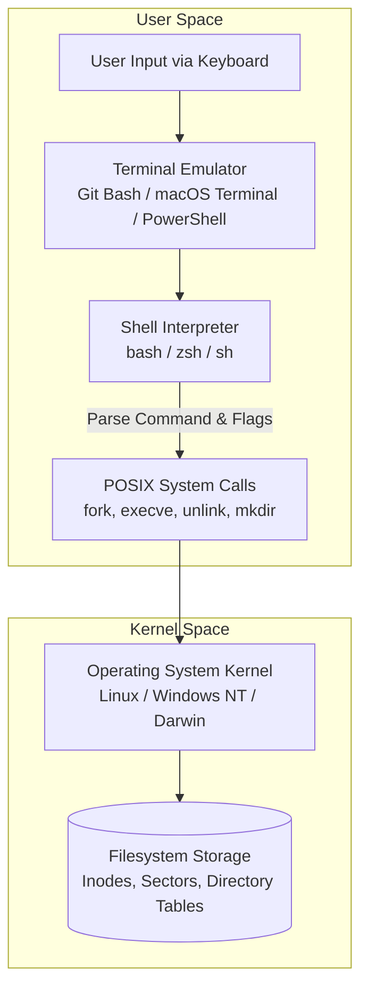

# Lecture 34: Terminal & Command Line Interface Foundations (Hinglish)

Swagat hai **Lecture 34: Terminal Foundations** ke master curriculum repository mein! Yeh module graphical user interface (GUI) se transition karke production-grade POSIX Command Line Interface (CLI) engineering ki solid foundation build karta hai.

Chahe kisi remote high-end cloud GPU cluster par deep learning model train karna ho, Docker containers manage karna ho, ya Git CI/CD pipelines automate karna ho—AI/ML engineering ka har ek core process terminal ke through hi operate hota hai. Is course mein humne terminal navigation, path resolution, file lifecycle, flags, aur defensive system administration ko zero se master kiya hai.

---

## Architecture: Terminal vs Shell vs Operating System

Terminal kaise kaam karta hai, ise samajhne ke liye screen window aur underlying software ka difference clear hona zaroori hai:

### ATM Machine ka Classic Example
- **Terminal**: ATM machine ka physical outer box, display screen, aur keypad hai. Iska kaam sirf aapka input lena aur output screen par render karna hai.
- **Shell**: ATM ke andar chalne wala software program hai jo aapka PIN check karta hai, command process karta hai, aur account verify karta hai.
- **Kernel / OS**: Bank ka main vault aur hardware controllers hain jo physically cash dispense karte hain.

---

## Comprehensive Submodule Roadmap

Is lecture ko 11 dedicated topic modules aur 1 comprehensive industrial practice suite mein divide kiya gaya hai. Har submodule mein complete English aur Hinglish documentation, video keyframe references, aur compiled PDFs shamil hain:

| Submodule | Topic Title | Key Concepts & Commands | Keyframe Reference | Documentation Links |
| :--- | :--- | :--- | :--- | :--- |
| **34.01** | **Curriculum Roadmap** | Terminal vs GUI, ML deployment overview, 11-step syllabus | `keyframe_01.png` | [English](file:///c:/Users/Shivam%20Keshari/OneDrive/Desktop/AI-ML/lecture_34/Notes_34.01/README.md) \| [Hinglish](file:///c:/Users/Shivam%20Keshari/OneDrive/Desktop/AI-ML/lecture_34/Notes_34.01/README_HINGLISH.md) |
| **34.02** | **What is the Terminal?** | CLI vs GUI speed, server management, automated workflows | `keyframe_01.png` | [English](file:///c:/Users/Shivam%20Keshari/OneDrive/Desktop/AI-ML/lecture_34/Notes_34.02/README.md) \| [Hinglish](file:///c:/Users/Shivam%20Keshari/OneDrive/Desktop/AI-ML/lecture_34/Notes_34.02/README_HINGLISH.md) |
| **34.03** | **Key Technical Terms** | Terminal vs Shell vs Console vs Command Prompt, POSIX | `keyframe_01.png` | [English](file:///c:/Users/Shivam%20Keshari/OneDrive/Desktop/AI-ML/lecture_34/Notes_34.03/README.md) \| [Hinglish](file:///c:/Users/Shivam%20Keshari/OneDrive/Desktop/AI-ML/lecture_34/Notes_34.03/README_HINGLISH.md) |
| **34.04** | **Git Bash Setup** | Windows cmd limitations, MSYS2 POSIX emulation layer | `keyframe_01.png` | [English](file:///c:/Users/Shivam%20Keshari/OneDrive/Desktop/AI-ML/lecture_34/Notes_34.04/README.md) \| [Hinglish](file:///c:/Users/Shivam%20Keshari/OneDrive/Desktop/AI-ML/lecture_34/Notes_34.04/README_HINGLISH.md) |
| **34.05** | **Basic Commands** | `ls` (list files), `pwd` (print working dir), `clear` screen | `keyframe_01.png` | [English](file:///c:/Users/Shivam%20Keshari/OneDrive/Desktop/AI-ML/lecture_34/Notes_34.05/README.md) \| [Hinglish](file:///c:/Users/Shivam%20Keshari/OneDrive/Desktop/AI-ML/lecture_34/Notes_34.05/README_HINGLISH.md) |
| **34.06** | **Navigation Commands** | `cd` (change directory), `cd ..` (parent), `cd ~` (home) | `keyframe_01.png` | [English](file:///c:/Users/Shivam%20Keshari/OneDrive/Desktop/AI-ML/lecture_34/Notes_34.06/README.md) \| [Hinglish](file:///c:/Users/Shivam%20Keshari/OneDrive/Desktop/AI-ML/lecture_34/Notes_34.06/README_HINGLISH.md) |
| **34.07** | **Paths in Navigation** | Absolute (`/`) vs Relative paths, contextual movement | `keyframe_01.png` | [English](file:///c:/Users/Shivam%20Keshari/OneDrive/Desktop/AI-ML/lecture_34/Notes_34.07/README.md) \| [Hinglish](file:///c:/Users/Shivam%20Keshari/OneDrive/Desktop/AI-ML/lecture_34/Notes_34.07/README_HINGLISH.md) |
| **34.08** | **Making Directories** | `mkdir`, multiple directories banana, spaces handle karna | `keyframe_01.png` | [English](file:///c:/Users/Shivam%20Keshari/OneDrive/Desktop/AI-ML/lecture_34/Notes_34.08/README.md) \| [Hinglish](file:///c:/Users/Shivam%20Keshari/OneDrive/Desktop/AI-ML/lecture_34/Notes_34.08/README_HINGLISH.md) |
| **34.09** | **Flags & Manual Pages** | Command options (`-a`, `-l`, `-la`), POSIX manual (`man`) | `keyframe_01.png` | [English](file:///c:/Users/Shivam%20Keshari/OneDrive/Desktop/AI-ML/lecture_34/Notes_34.09/README.md) \| [Hinglish](file:///c:/Users/Shivam%20Keshari/OneDrive/Desktop/AI-ML/lecture_34/Notes_34.09/README_HINGLISH.md) |
| **34.10** | **Touch Command** | Empty files create karna, timestamp update karna (`mtime`) | `keyframe_01.png` | [English](file:///c:/Users/Shivam%20Keshari/OneDrive/Desktop/AI-ML/lecture_34/Notes_34.10/README.md) \| [Hinglish](file:///c:/Users/Shivam%20Keshari/OneDrive/Desktop/AI-ML/lecture_34/Notes_34.10/README_HINGLISH.md) |
| **34.11** | **Deleting Files & Folders** | `rm` (files), `rmdir` (empty dirs), `rm -rf` (tree deletion) | `keyframe_01.png` | [English](file:///c:/Users/Shivam%20Keshari/OneDrive/Desktop/AI-ML/lecture_34/Notes_34.11/README.md) \| [Hinglish](file:///c:/Users/Shivam%20Keshari/OneDrive/Desktop/AI-ML/lecture_34/Notes_34.11/README_HINGLISH.md) |
| **Practice**| **Industrial Scenarios** | Server recovery, MLOps scaffolding, safe deletion protocols | Multiple | [English Questions](file:///c:/Users/Shivam%20Keshari/OneDrive/Desktop/AI-ML/lecture_34/Practice_Problems/README.md) \| [Hinglish Questions](file:///c:/Users/Shivam%20Keshari/OneDrive/Desktop/AI-ML/lecture_34/Practice_Problems/README_HINGLISH.md) \| [Solutions](file:///c:/Users/Shivam%20Keshari/OneDrive/Desktop/AI-ML/lecture_34/Practice_Problems/Solutions.md) |

---

## Core Command Quick Reference

| Command | Syntax | Primary Function | Safe Usage Tip |
| :--- | :--- | :--- | :--- |
| **`pwd`** | `pwd` | Current working directory ka absolute path dikhata hai | Destructive command chalane se pehle hamesha `pwd` run karein |
| **`ls`** | `ls [flags] [path]` | Folder ke files aur sub-folders list karta hai | Hidden files dekhne ke liye `-la` flag use karein |
| **`cd`** | `cd <target_path>` | Folder change karta hai | Direct home folder me jane ke liye `cd ~` ya `cd` dabayein |
| **`mkdir`** | `mkdir <dir_name>` | Naya empty folder create karta hai | Agar folder name me space ho toh quotes `"..."` me likhein |
| **`touch`** | `touch <filename>` | Empty 0-byte file banata hai ya timestamp update karta hai | Existing file ka content kabhi delete nahi karta |
| **`rm`** | `rm <file>` | File ko disk se permanently delete karta hai | Recycle Bin me nahi jata; permanent delete hota hai |
| **`rmdir`** | `rmdir <dir_name>` | Sirf empty folder ko safely delete karta hai | Agar folder me file hui toh abort ho jata hai; bahut safe hai |
| **`rm -rf`** | `rm -rf <path>` | Pure folder tree ko bina warning forcefully delete karta hai | Extreme caution: `/` ke aage galti se space kabhi na lagayein |
| **`clear`** | `clear` | Terminal screen buffer ko saaf karta hai | Shortcut: `Ctrl + L` dabayein |
| **`man`** | `man <command>` | Command ka official documentation manual kholta hai | Scroll ke liye Arrow keys, bahar aane ke liye `q` dabayein |

---

## Production Safety Rules

1. **Terminal Deletion Permanent Hoti Hai**:
   Graphical desktop par file delete karne par Recycle Bin me jati hai jaha se Restore ho sakti hai. Terminal par `rm` seedhe OS ka `unlink()` system call chalata hai. File ka disk link break ho jata hai aur Recycle Bin bypass ho jata hai.
2. **Paths me Spaces ka Dhyan**:
   Terminal space ko argument separator manta hai. Agar path me space hai toh hamesha quotes lagayein (`cd "My Documents"`) ya backslash lagayein (`cd My\ Documents`).
3. **Tab Autocomplete ki Aadat Daalein**:
   Files aur folders ke lambe naam manual type mat karein. 1-2 letters likh kar `Tab` key dabayein; terminal automatically naam complete kar dega. Isse typo hone ka zero chance hota hai.\n