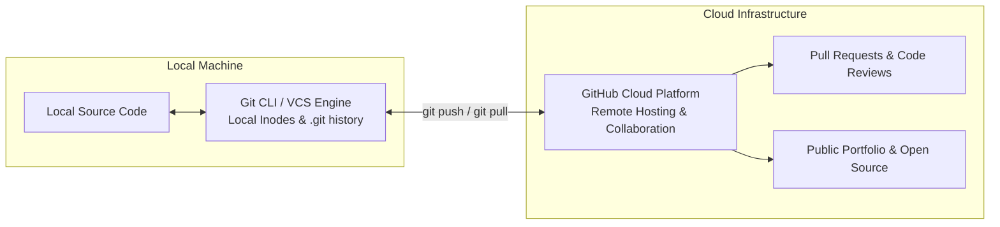

# Submodule 35.01: What is Git & GitHub?

## 1. Introduction to Version Control

In software engineering and data science, projects are rarely built in a single sitting or by a single individual. Real-world machine learning systems, web platforms, and production pipelines evolve continuously across weeks, months, or years.

Before modern version control, developers tracked code versions manually:
```text
my_ml_project_v1.py
my_ml_project_v2_final.py
my_ml_project_v2_final_FINAL.py
my_ml_project_v3_working_dont_touch.py
```
This manual approach leads to catastrophic issues:
- **Zero Visibility**: No record of what changes were made, why they were made, or who made them.
- **Overwritten Work**: Multiple developers editing the same file concurrently overwrite each other's code.
- **No Safe Rollback**: If a newly added feature crashes the production system, restoring previous working state is nearly impossible.

---

## 2. What is Git?

**Git** is an open-source, distributed **Version Control System (VCS)** designed to track changes in source code across time. It was created in 2005 by **Linus Torvalds** (the creator of the Linux operating system kernel).

### Core Capabilities of Git:
1. **Change Tracking**: Every modification to any file in your project is tracked with surgical precision.
2. **Timeline Snapshots (Commits)**: Developers create explicit checkpoints (commits) capturing the exact state of the entire project.
3. **Time Travel & Rollback**: You can inspect or roll back your project to any historical commit at any time.
4. **Branching & Parallel Workflows**: Multiple team members can work on isolated feature branches simultaneously without disrupting the main production code.
5. **Distributed Architecture**: Every developer possesses a complete local copy of the repository and its entire history on their computer, allowing offline work.

---

## 3. What is GitHub?

**GitHub** is a cloud-based hosting platform and service built on top of Git. Owned by Microsoft, GitHub allows developers to store, manage, share, and collaborate on Git repositories over the internet.

### Core Capabilities of GitHub:
1. **Cloud Repository Hosting**: Serves as a centralized remote backup and synchronization hub for local Git repositories.
2. **Collaboration Features**: Facilitates team coordination via **Pull Requests (PRs)**, Code Reviews, Issue Tracking, and Discussions.
3. **Developer Portfolio**: A developer's GitHub profile showcases their public repositories, code contributions, open-source work, and commit activity graph to tech recruiters and engineering managers.
4. **CI/CD & Automation**: Integrated workflows (GitHub Actions) automate testing, building, and deployment of machine learning models and applications.

---

## 4. Key Differences: Git vs GitHub



| Dimension | Git | GitHub |
| :--- | :--- | :--- |
| **Fundamental Nature** | Version Control System software | Cloud hosting platform & web service |
| **Installation** | Installed locally on your computer | Accessed via web browser (`github.com`) |
| **Creator / Owner** | Linus Torvalds (Open Source, 2005) | Microsoft (Acquired in 2018) |
| **Internet Requirement** | Fully functional offline | Requires active internet connection |
| **Interface** | Command Line Interface (CLI) / Shell | Graphical Web Interface & REST API |
| **Primary Responsibility** | Tracking file changes, commits, branches | Remote backup, team collaboration, PR reviews |

---

## 5. Visual Reference


