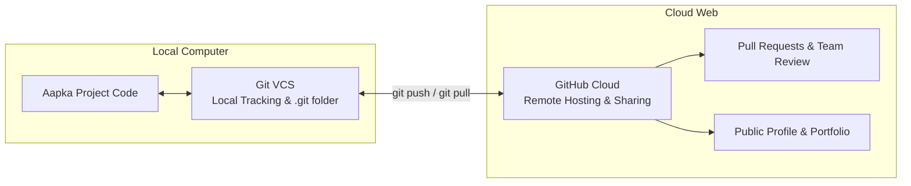
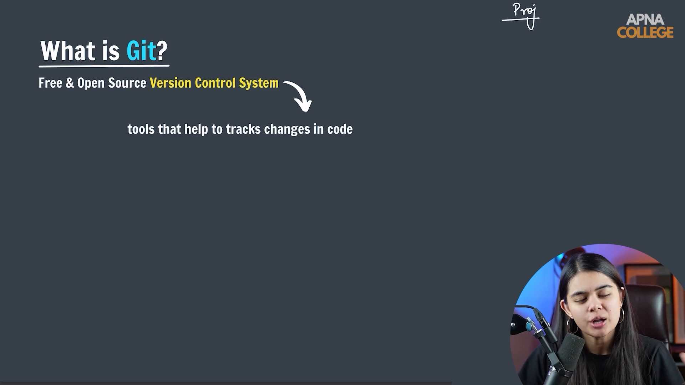

# Submodule 35.01: Git aur GitHub kya hai? (Hinglish)

## 1. Version Control ki Zaroorat

Software engineering aur Artificial Intelligence / Machine Learning mein koi bhi real-world project ek raat mein nahi banta. Projects mahino aur saalon tak develop hote hain, aur aksar multiple developers milkar ek hi codebase par kaam karte hain.

Pehle log versions manually files ka naam badal kar manage karte the:
```text
my_ml_project_v1.py
my_ml_project_v2_final.py
my_ml_project_v2_final_FINAL.py
my_ml_project_v3_working_pakka_final.py
```
Is manual tareeqe mein bhayanak problems aati hain:
- **Koi History Nahi**: Pata nahi chalta kisne kaunsi line kab aur kyun change ki.
- **Code Overwrite**: Agar do log ek sath ek hi file edit kar rahe hain, toh ek ka code doosre se overwrite ho jata hai.
- **Rollback Namumkin**: Agar naye code se pura system crash ho gaya, toh puraana sahi code wapas laana bohot mushkil hota hai.

---

## 2. Git kya hota hai?

**Git** ek open-source, distributed **Version Control System (VCS)** hai. Ise 2005 mein **Linus Torvalds** (Linux kernel ke creator) ne develop kiya tha.

### Git ke Mukhya Kaam:
1. **Code Changes ko Track Karna**: Project ke andar kisi bhi file mein ek single word ya character ka change bhi Git track kar leta hai.
2. **Timeline Snapshots (Commits)**: Project ke har milestone par aap ek snapshot (commit) save kar sakte ho.
3. **Time Travel & Rollback**: Agar aaj ka code kharab ho gaya, toh aap 1 second mein kal ya 1 mahine pehle ke code par wapas ja sakte ho.
4. **Branching**: Team members alag-alag branches par independently naye features develop kar sakte hain bina main code ko kharab kiye.
5. **Offline Capability**: Git aapke local computer par chalta hai, iske liye internet ki zaroorat nahi hoti.

---

## 3. GitHub kya hota hai?

**GitHub** ek cloud-based hosting platform hai jo Git repositories ko internet par host karne ki service deta hai. Ise Microsoft ne acquire kiya tha.

### GitHub ke Mukhya Kaam:
1. **Remote Cloud Storage**: Aapke local computer ke Git code ka cloud backup provide karta hai.
2. **Team Collaboration**: Multiple developers milkar kaam kar sakein iske liye **Pull Requests (PRs)**, Code Reviews, aur Issue Tracking provide karta hai.
3. **Developer Portfolio**: Tech companies aur recruiters aapki GitHub profile dekhkar evaluate karte hain ki aapne kitna code likha hai aur aapke projects kaise hain.
4. **Open Source Ecosystem**: Duniya bhar ke open-source projects (jaise PyTorch, Scikit-learn, TensorFlow) GitHub par publicly available hote hain.

---

## 4. Git vs GitHub: Comparison



| Parameter | Git | GitHub |
| :--- | :--- | :--- |
| **Keval Definition** | Version Control System software | Cloud hosting platform & website |
| **Kahan Chalta Hai** | Aapke local system par install hota hai | Internet browser par (`github.com`) |
| **Creator / Company** | Linus Torvalds (Open Source, 2005) | Microsoft Corporation |
| **Internet Chahiye?** | Bilkul nahi, pura offline chalta hai | Haan, remote sync ke liye internet chahiye |
| **Interface** | Terminal / Bash Commands | Graphical Web Dashboard |
| **Mukhya Upyog** | Changes track karna, branches banana | Remote backup, collaboration, portfolio |

---

## 5. Visual Reference


