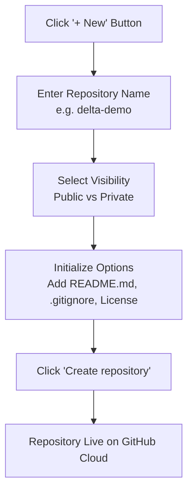

# Submodule 35.03: Using GitHub (Web Interface & Core Anatomy)

## 1. Anatomy of the GitHub Interface

Once logged into GitHub, the web dashboard provides direct access to your profile, activity feed, and repositories.

### Key Sections:
1. **Dashboard Feed**: Displays recent activity from developers and open-source repositories you follow.
2. **Profile Page**:
   - **Avatar & Bio**: Your professional photo, bio, location, and social links.
   - **Contribution Graph / Heatmap**: A green-shaded calendar matrix showing your daily commit frequency over the past year.
   - **Pinned Repositories**: Up to 6 flagship projects highlighted at the top of your profile.
3. **Repositories Tab**: Lists all public and private projects you own or collaborate on.

---

## 2. Creating a New Repository on GitHub

A **Repository** (often abbreviated as **Repo**) is a digital project container holding all your files, datasets, documentation, and the complete commit history.

### Configuration Options:
- **Repository Name**: A unique, descriptive name using lowercase letters and hyphens (e.g., `delta-demo`, `credit-wise-loan-system`).
- **Visibility**:
  - **Public**: Anyone on the internet can see this repository. You choose who can commit changes. Essential for portfolio projects.
  - **Private**: You explicitly control who can view and commit to this repository. Suitable for proprietary or in-progress work.
- **Initialize with README**: Automatically generates a `README.md` markdown file describing the project.
- **Add `.gitignore`**: Pre-configures a list of file extensions that Git should never track (e.g., Python cache `__pycache__`, environment files `.env`).
- **Choose a License**: Specifies how others may legally use, modify, or distribute your code (e.g., MIT License).

---

## 3. Web-Based File Operations & Commits

GitHub provides a complete in-browser editor allowing quick changes:
1. **Viewing Files**: Click any file (e.g., `README.md`) to view formatted markdown or raw source code.
2. **Editing Files**: Click the pencil icon (**Edit this file**) to modify content in the browser editor.
3. **Committing Changes**:
   - A commit is a recorded save-point in your project's history.
   - **Commit Message**: A concise title summarizing the change (e.g., `Update README with installation instructions`).
   - **Extended Description**: Optional multi-line context explaining why the change was made.
   - **Commit Options**: Commit directly to the `main` branch or create a new branch for a pull request.
4. **Inspecting Commit History**:
   - Click the commit counter (e.g., `3 commits`) to view the timeline.
   - Each commit displays its author, timestamp, unique 7-character SHA hash, and diff view (green for added lines, red for deleted lines).

---

## 4. Visual Reference

